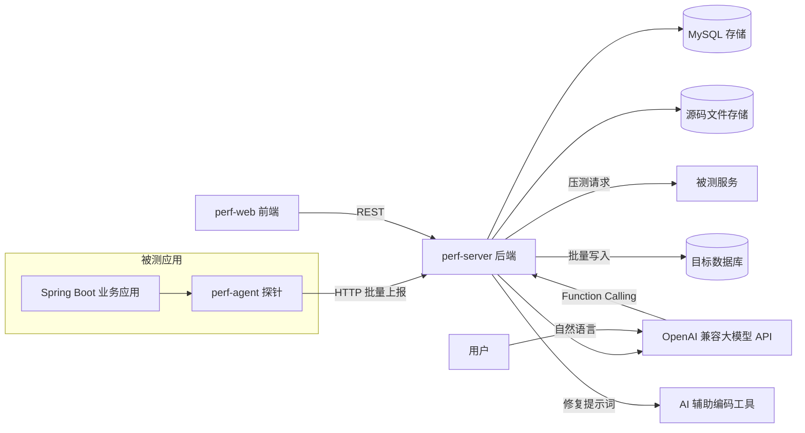

## 产品概述
一个面向 Java 应用的性能检测智能体平台：通过 Java Agent 无侵入接入被测应用，采集 JVM 指标与业务方法调用链耗时；提供自研压测引擎、慢 SQL 采集与自动灌数据能力；支持以 AI 自然语言对话自动执行检测任务；并新增「源码采集与智能优化」能力——采集项目源代码，将性能检测结果关联到具体源码位置，由大模型分析根因并给出多种修改方案，用户选定方案后生成结构化修复提示词，供 AI 辅助编码工具直接修复。

## 核心功能
- **压测**：自研 HTTP 并发压测引擎，支持并发数、持续时长、QPS 配置，实时统计 QPS、RT 分布（P50/P95/P99）、错误率并生成压测报告；预留 JMeter 适配扩展点（SPI）
- **JVM 监控**：通过 JMX 采集堆/非堆内存、GC 次数与耗时、线程数、CPU 占用等指标，Web 端时序图表展示
- **调用链耗时监控**：字节码增强自动埋点 Controller/Service/DAO 等业务方法，生成调用链树，展示每层方法耗时及在父链路中的耗时占比，支持火焰图可视化
- **慢 SQL 采集**：JDBC 语句执行拦截计时（与 ORM 无关，兼容 MyBatis/JPA）+ MySQL 慢查询日志解析，双通道采集并列表展示
- **自动灌数据**：配置目标表结构、字段生成规则与行数，自动批量生成测试数据写入数据库，满足压测前置数据准备场景
- **源码采集**：支持 zip 上传、Git 仓库克隆、本地目录路径三种方式导入被测项目源码，建立文件索引与语言识别，含路径穿越防护与大小上限
- **性能问题分析**：将慢 SQL、热点方法、压测瓶颈等检测结果与相关源码片段关联（慢 SQL 定位 DAO/Mapper，热点方法定位类与方法），调用大模型分析根因（N+1、全表扫描、循环内查询、缺索引、锁竞争等），给出 2-3 种修改方案（含涉及文件、修改点、代码改动要点、预期收益与风险）
- **修复提示词生成**：用户在 Web 或 AI 对话中选定方案后，生成结构化修复提示词（目标文件、问题摘要、检测证据、源码引用、建议修改内容、验证方式），可复制或下载，供 AI 辅助编码工具（CodeBuddy/Copilot 等）直接使用
- **AI 对话**：Function Calling 工具链（执行压测、查询 JVM 指标、分析调用链、获取慢 SQL、灌数据、分析代码问题、生成修复提示词、生成报告）
- **Web 可视化**：总览看板、JVM 图表、调用链树/火焰图、压测实时面板、慢 SQL 列表、数据灌入、源码与优化（仓库管理、问题列表、方案对比、修复提示词）、AI 对话面板

## 边界说明
- 探针通过 `-javaagent` 无侵入接入，不改动被测应用代码；调用链埋点以同步线程场景为主
- 存储优先 MySQL 单库（时序数据分区表，源码文件存本地磁盘），不引入额外中间件；AI 依赖 OpenAI 兼容大模型 API，无 Key 时降级为规则示例模式保证可演示
- 压测/灌数据/源码导入均属高风险操作，前后端均做参数校验与上限保护


## 技术栈
- **监控探针 perf-agent**：Java 17 + ByteBuddy（Advice 内联降低开销）+ JMX（ManagementFactory）+ HTTP 批量上报
- **后端 perf-server**：Spring Boot 3.x + MyBatis + MySQL 8 + Java HttpClient（压测并发）+ OpenAI 兼容 API（Function Calling）
- **前端 perf-web**：Vue3 + TypeScript + Vite + tdesign + ECharts
- **示例应用 perf-demo**：Spring Boot 3.x + MyBatis，含可被分析出性能问题的示例代码（如 N+1 查询）用于端到端验证
- **构建与启动**：Maven 多模块 / npm，提供一键启动脚本与 README

## 实现方案
### 整体架构
监控链路：perf-agent 以 `-javaagent` 方式接入被测应用，ByteBuddy 拦截业务方法与 JDBC 执行，采集调用链树与慢 SQL；JvmCollector 定时轮询 JMX；数据经本地队列异步批量上报 perf-server。perf-server 负责数据入库、压测执行、数据灌入、慢日志解析、源码管理与智能分析，并向 AI 编排层提供工具调用；perf-web 通过 REST API 展示与操作。



### 关键设计决策
- **埋点实现**：ByteBuddy `AgentBuilder` + `Advice` 内联字节码，`ThreadLocal` 维护调用栈构建 `TraceNode` 树，采样率可配置（默认 10%）
- **JDBC 拦截**：拦截 `java.sql.Statement`/`PreparedStatement` 的 execute 系列方法，记录 SQL 与耗时，超过阈值（默认 500ms）标记慢 SQL
- **JVM 采集**：复用 JDK JMX（Memory/Thread/GC/OperatingSystem MXBean），每 5s 轮询
- **压测引擎**：`StressEngine` SPI，默认 `HttpStressEngine`（有界线程池 + 周期采样，累加器 + 桶直方图统计 QPS/RT 分位数/错误率，内存 O(1)），预留 `JMeterStressEngine` 适配器骨架
- **数据灌入**：`DatabaseMetaData` 读取表结构，按类型映射生成随机数据，`rewriteBatchedStatements=true` 批量插入
- **源码管理**：`SourceManager` 支持 zip 解压（防路径穿越：解压路径必须位于目标目录内）、git clone、本地目录导入；单文件 ≤1MB、总量 ≤200MB、文件数 ≤5000；按扩展名识别语言；文件内容存磁盘 + `source_file` 表索引（路径、语言、大小、内容哈希）
- **问题关联**：`IssueAssociator` 三级定位——慢 SQL 通过 SQL 文本模糊匹配 Mapper XML/注解定位 DAO 方法与源码片段；热点方法按类名/方法名精确匹配源码；压测瓶颈按接口 URL 关联 Controller 再沿调用链定位 Service
- **多方案生成**：`PerformanceAnalyzer` 组装上下文（检测证据 + 关联源码片段 + 表结构 + 链路耗时占比）调用大模型，以 JSON Schema 约束输出 2-3 个方案（标题、涉及文件、修改点、代码要点、收益、风险），落库 `performance_issue`/`fix_suggestion`
- **修复提示词生成**：`FixPromptGenerator` 将选定方案结构化组装为 Markdown 提示词（目标文件路径、问题摘要、检测证据、源码引用片段、建议修改内容、验证方式、注意事项），Web 端可复制/下载
- **AI 编排**：工具清单注册 + Function Calling 多轮循环；新增 `analyze_code_issues`、`generate_fix_prompt` 两个工具；无 API Key 时降级为内置规则模板示例模式
- **存储设计**：JVM 指标与压测采样按天分区表；调用链存 JSON 树；新增 `source_repo`、`source_file`、`performance_issue`、`fix_suggestion` 四张表

### 性能与可靠性
- 埋点上报异步批量（环形队列 + 单线程 flush，默认 1s/500 条），失败重试 + 丢弃过期数据，避免拖垮业务应用
- 压测统计采用累加器 + 定时采样与固定桶直方图，避免全量记录
- 大模型分析请求限制并发（信号量），超时与失败可重试；源码读取按需懒加载，避免一次性加载全部文件

## 实现说明
- 所有模块中文注释与文档；Agent 端不引入日志框架以外的第三方依赖
- Agent 配置（上报地址/应用名/采样率/慢 SQL 阈值）通过 `-javaagent:xxx.jar=key=value` 或 `agent.properties` 传入，默认值开箱即用
- 压测/灌数据/源码导入均做参数校验（URL 白名单、行数/并发/文件大小上限）
- 数据库初始化脚本幂等（`CREATE TABLE IF NOT EXISTS`），含演示数据与示例问题记录

## 目录结构
```
/workspace/
├── perf-agent/                         # 监控探针（Java 17 + ByteBuddy）
│   └── src/main/java/com/perfagent/
│       ├── AgentPremain.java           # [NEW] premain 入口，加载配置并注册 AgentBuilder
│       ├── config/AgentConfig.java     # [NEW] 探针配置：应用名/上报地址/采样率/慢SQL阈值
│       ├── instrumentation/
│       │   ├── MethodTimerAdvice.java  # [NEW] 业务方法耗时埋点（Advice 内联）
│       │   ├── JdbcInterceptor.java    # [NEW] JDBC 执行拦截与计时、SQL 提取
│       │   └── TraceEnhancer.java      # [NEW] 定义增强规则（注解/包名匹配）
│       ├── trace/                      # [NEW] TraceContext/TraceNode/TraceSampler
│       ├── jmx/JvmCollector.java       # [NEW] JMX 定时采集 JVM 指标
│       ├── reporter/                   # [NEW] MetricsReporter 批量上报调度 + HttpReporter
│       └── util/JsonUtil.java          # [NEW] 轻量 JSON 序列化
├── perf-server/                        # 后端服务（Spring Boot 3.x + MyBatis）
│   └── src/main/java/com/perfserver/
│       ├── controller/                 # JvmMetric/Trace/SlowSql/Stress/DataGen/Source/Ai Controller
│       ├── collector/AgentReportService.java  # [NEW] 接收探针上报并入库
│       ├── entity/                     # JvmMetric/TraceChain/SlowSql/StressTask/SourceRepo/SourceFile/PerformanceIssue/FixSuggestion
│       ├── mapper/                     # 对应 MyBatis Mapper 接口与 XML
│       ├── stress/                     # [NEW] StressEngine SPI + HttpStressEngine + StressStatistician + JMeter 适配器骨架
│       ├── datagen/DataGenService.java # [NEW] 表结构读取+数据生成+批量插入
│       ├── slowlog/MysqlSlowLogParser.java    # [NEW] MySQL 慢查询日志解析
│       ├── source/
│       │   ├── SourceManager.java      # [NEW] 源码导入（zip/git/本地目录）、安全校验、去重
│       │   ├── SourceFileService.java  # [NEW] 文件索引、语言识别、按需读取
│       │   ├── IssueAssociator.java    # [NEW] 检测结果与源码片段关联定位
│       │   ├── PerformanceAnalyzer.java# [NEW] 大模型根因分析 + 多方案生成（JSON Schema 约束）
│       │   └── FixPromptGenerator.java # [NEW] 选定方案后生成修复提示词
│       └── ai/
│           ├── AiAgentService.java     # [NEW] Function Calling 多轮编排循环
│           ├── tools/                  # [NEW] Stress/JvmMetric/Trace/SlowSql/DataGen/AnalyzeIssue/GenerateFixPrompt/Report 工具
│           └── prompt/PromptBuilder.java      # [NEW] 系统提示词与工具清单构建
├── perf-web/                           # 前端（Vue3 + TS + tdesign + ECharts）
│   └── src/
│       ├── router/index.ts
│       ├── api/                        # jvm/trace/stress/slowSql/dataGen/source/ai
│       ├── layouts/MainLayout.vue      # [NEW] 侧边导航+顶栏布局
│       ├── views/                      # Dashboard/JvmMonitor/TraceAnalyzer/StressCenter/SourceOptimize/AiAssistant
│       └── components/charts/          # [NEW] MetricChart.vue + FlameGraph.vue
├── perf-demo/                          # 示例 Spring Boot 应用（含 N+1 等可分析出问题的示例代码）
├── sql/init.sql                        # [NEW] 全量建表脚本（含分区表 + 源码/问题/方案四张新表）+ 演示数据
├── scripts/                            # build.sh / start-all.sh / start-agent.sh
└── docs/README.md                      # [NEW] 架构说明、部署、使用与 AI 修复闭环演示文档
```

## 关键代码结构
```java
// FixPrompt：修复提示词结构化模型，供 AI 辅助编码工具直接使用
public class FixPrompt {
    private String targetFiles;      // 目标文件路径列表
    private String problemSummary;   // 问题摘要
    private String evidence;         // 性能检测证据（慢SQL/热点方法/耗时占比）
    private String sourceRefs;       // 相关源码片段引用
    private String suggestedChanges; // 建议修改内容与代码要点
    private String validation;       // 修复后验证方式
    private String precautions;      // 注意事项
}
```

```java
// StressEngine：压测引擎 SPI，JMeter 适配器实现同接口即可接入
public interface StressEngine {
    String type();                       // "http" / "jmeter"
    StressTaskResult run(StressTaskRequest request);
}
```

```java
// AiTool：AI 工具统一签名，新增分析/提示词工具按此注册
public interface AiTool {
    String name();                       // 如 analyze_code_issues
    String description();
    String execute(String jsonArgs);     // 执行并返回 JSON 结果
}
```


## 设计风格
深色科技风数据监控后台（Dark Tech Dashboard）：以深蓝黑为底、荧光青绿为强调色，营造专业监控平台的沉浸感与实时数据流动的科技氛围。卡片采用半透明玻璃拟态（低透明度背景 + 细边框 + 柔和阴影），顶部关键指标卡带渐变色与轻微光晕；图表大面积使用 ECharts 面积图/折线图配平滑动画；hover 交互提供卡片抬升、高亮与数值浮层。布局为左侧深色导航栏 + 顶部面包屑/状态栏 + 内容区，桌面端优先，面板宽度自适应。

## 页面规划（6 屏）
为满足单次最多 6 屏限制，将慢 SQL 列表并入「调用链分析」页（二者同为执行链路性能证据），将数据灌入并入「压测中心」页（灌数据是压测前置步骤），新增「源码与优化」独立成页：
1. **总览 Dashboard**：关键指标卡（应用数/最近QPS/慢SQL数/压测任务/待处理问题数）；JVM 总览折线图；最近压测任务；最近慢 SQL；最近性能问题；AI 快捷入口
2. **JVM 监控**：时间范围选择器与指标卡（堆/非堆/GC/线程/CPU）；内存趋势图；GC 次数与耗时图；线程与 CPU 图；应用切换下拉
3. **调用链分析**（含慢 SQL Tab）：查询条件（应用/方法/时间）；调用链列表；调用树嵌套表格（每层耗时与占比）；火焰图组件；占比排行条形图；慢 SQL 列表（来源 JDBC 拦截/日志解析、耗时、SQL 详情）
4. **压测中心**（含数据准备 Tab）：压测配置表单（URL/并发/时长/引擎类型）；实时结果面板（QPS/RT 分位数/错误率滚动图表）；任务列表与历史报告；数据灌入表单（连接/表/行数/字段规则编辑器）与任务进度
5. **源码与优化**：源码仓库管理（zip 上传/Git 地址/本地路径导入、导入进度、文件浏览）；性能问题列表（关联检测证据与源码位置、状态）；问题详情——多方案对比卡片（涉及文件/修改点/收益/风险），选定方案后展示生成的修复提示词（Markdown 渲染、复制/下载按钮）
6. **AI 助手**：对话消息流；工具调用过程卡片（执行压测/查询指标/分析代码问题/生成修复提示词等，展示参数与结果摘要）；快捷指令按钮（"分析最近慢 SQL 根因并给出修复方案"）；报告与提示词 Markdown 渲染

## 交互与响应式
- 实时数据页面（JVM/压测）默认 5s 轮询刷新，支持手动暂停
- 图表 hover 显示数值与时间，火焰图支持缩放与点击下钻
- 源码浏览支持文件树展开与语法高亮；修复提示词一键复制
- 导航、卡片、按钮统一 hover 动效与过渡动画，保持各页面视觉一致

## Agent 扩展
### SubAgent
- **code-explorer**
  - 用途：在 demo-verify 阶段对 perf-demo 及跨模块代码进行多文件探索，快速定位示例代码中可被分析出的性能问题点（N+1 查询等）与联调问题
  - 预期产出：准确的问题源码位置清单与联调故障定位结论，支撑端到端验证与修复闭环演示
### Skill
- **cnb-code-review**
  - 用途：在 demo-verify 阶段对各模块代码执行 PR 级代码评审，检查安全漏洞（源码导入路径穿越、SQL 注入、压测参数校验缺失等）、Bug 与代码质量
  - 预期产出：评审问题清单与修复建议，确保高风险模块（源码导入、压测、灌数据）实现安全可靠
- **cnb-code-commit**
  - 用途：全部模块实现并验证通过后，将项目代码提交并创建 PR，形成可交付的仓库基线
  - 预期产出：完整项目代码入库（PR 创建成功），包含全部模块、脚本与文档
