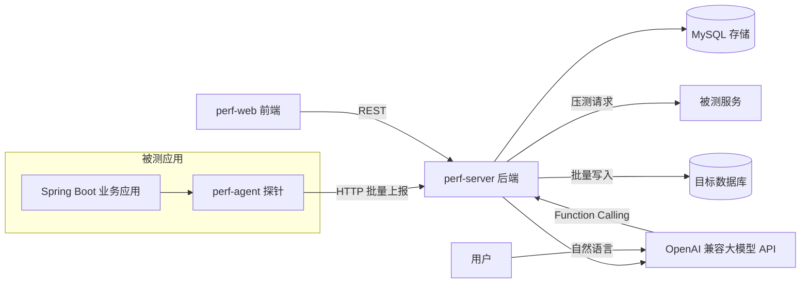

## 产品概述
一个面向 Java 应用的性能检测智能体平台：通过 Java Agent 无侵入接入被测应用，采集 JVM 指标与业务方法调用链耗时，提供自研压测引擎、慢 SQL 采集与自动灌数据能力；支持以 AI 自然语言对话自动执行各项检测任务，并通过 Web 后台可视化展示与生成性能报告。

## 核心功能
- **压测**：自研 HTTP 并发压测引擎，支持并发数、持续时长、QPS 配置，实时统计 QPS、RT 分布（P50/P95/P99）、错误率并生成压测报告；预留 JMeter 适配扩展点（SPI）
- **JVM 监控**：通过 JMX 采集堆/非堆内存、GC 次数与耗时、线程数、CPU 占用等指标，Web 端时序图表展示
- **调用链耗时监控**：字节码增强自动埋点 Controller/Service/DAO 等业务方法，生成调用链树，展示每层方法耗时及在父链路中的耗时占比，支持火焰图可视化
- **慢 SQL 采集**：JDBC 语句执行拦截计时（与 ORM 无关，兼容 MyBatis/JPA）+ MySQL 慢查询日志解析，双通道采集并列表展示
- **自动灌数据**：配置目标表结构、字段生成规则与行数，自动批量生成测试数据写入数据库，满足压测前置数据准备场景
- **AI 对话**：通过 Function Calling 暴露工具（执行压测、查询 JVM 指标、分析调用链、获取慢 SQL、灌数据、生成报告），自然语言指挥自动执行并汇总结论
- **Web 可视化**：总览看板、JVM 指标图表、调用链树/火焰图、压测实时结果与历史报告、慢 SQL 列表、数据灌入配置、AI 对话面板

## 边界说明
- 探针通过 `-javaagent` 无侵入接入，不改动被测应用代码；调用链埋点以同步线程场景为主
- 存储优先 MySQL 单库（时序数据用分区表），不引入额外中间件依赖；AI 依赖 OpenAI 兼容大模型 API


## 技术栈
- **监控探针 perf-agent**：Java 17 + ByteBuddy（字节码增强，Advice 内联降低开销）+ JMX（ManagementFactory 采集）+ HTTP 批量上报
- **后端 perf-server**：Spring Boot 3.x + MyBatis + MySQL 8 + 虚拟线程/线程池（压测并发）+ OpenAI 兼容 API（Function Calling）
- **前端 perf-web**：Vue3 + TypeScript + Vite + tdesign + ECharts
- **示例应用 perf-demo**：Spring Boot 3.x + MyBatis，附带演示库与压测接口，用于端到端验证
- **构建与启动**：Maven 多模块 / npm，提供一键启动脚本与 README

## 实现方案
### 整体架构
监控链路：perf-agent 以 `-javaagent` 方式接入被测应用，ByteBuddy 拦截业务方法（@Controller/@Service/@Repository）与 JDBC 执行，采集调用链树与慢 SQL；JvmCollector 定时轮询 JMX 采集 JVM 指标；数据经本地缓存队列批量异步上报 perf-server。perf-server 负责数据入库、压测执行、数据灌入、慢日志解析，并向 AI 编排层提供工具调用；perf-web 通过 REST API 展示数据与执行任务。



### 关键设计决策
- **埋点实现**：采用 ByteBuddy `AgentBuilder` + `Advice` 内联字节码，避免反射开销；`ThreadLocal` 维护调用栈上下文，方法进入/退出时构建 `TraceNode` 树；采样率可配置（如默认 10%），控制上报量与性能影响
- **JDBC 拦截**：拦截 `java.sql.Statement`/`PreparedStatement` 的 execute/executeQuery/executeUpdate，记录 SQL 文本与耗时，超过阈值（默认 500ms）标记为慢 SQL 上报
- **JVM 采集**：复用 JDK 自带 JMX（MemoryMXBean/ThreadMXBean/GCMXBean/OperatingSystemMXBean），每 5s 轮询一次，避免引入第三方采集器
- **压测引擎**：定义 `StressEngine` SPI，默认 `HttpStressEngine`（Java HttpClient + 有界线程池模拟并发，压测期间周期性采样 QPS/RT 分位数/错误率），预留 `JMeterStressEngine` 适配器骨架
- **数据灌入**：通过 `DatabaseMetaData` 读取目标表结构与字段类型，按类型映射生成随机数据（字符串/时间/数字/枚举规则可配），`rewriteBatchedStatements=true` 批量插入
- **AI 编排**：工具清单注册 + Function Calling 多轮循环；每个工具对应 server 侧 Service 方法；`generate_report` 聚合 JVM/压测/慢 SQL 数据由大模型生成中文性能报告
- **存储设计**：JVM 指标与压测采样为高频写入，采用按天分区表；调用链存 JSON 树便于整树查询；慢 SQL、任务表为普通表

### 性能与可靠性
- 埋点统计与上报采用异步批量（本地环形队列 + 单线程 flush，默认 1s 或 500 条），避免阻塞业务线程
- 压测统计使用累加器 + 定时采样而非全量记录，内存占用 O(1)；RT 分位数采用固定桶直方图近似
- 上报失败自动重试 + 丢弃过期数据，防止探针拖垮业务应用

## 实现说明
- 所有模块中文注释与文档；Agent 端不引入日志框架以外的第三方依赖，减小对目标应用类加载影响
- Agent 上报地址、应用名、采样率、慢 SQL 阈值均通过 `-javaagent:xxx.jar=key=value` 或 `agent.properties` 配置，默认值保证开箱即用
- 压测/灌数据属高风险操作，前后端均做参数校验（URL 白名单校验、行数/并发上限），避免误操作
- 慢日志解析支持 MySQL `long_query_time` 格式与 `mysqldumpslow` 摘要格式，正则提取时间/SQL/耗时
- 数据库初始化脚本幂等（`CREATE TABLE IF NOT EXISTS`），提供演示数据

## 目录结构
```
/workspace/
├── perf-agent/                         # 监控探针（Java 17 + ByteBuddy）
│   ├── pom.xml
│   └── src/main/java/com/perfagent/
│       ├── AgentPremain.java           # [NEW] premain 入口，加载配置并注册 AgentBuilder
│       ├── config/AgentConfig.java     # [NEW] 探针配置：应用名/上报地址/采样率/慢SQL阈值
│       ├── instrumentation/
│       │   ├── MethodTimerAdvice.java  # [NEW] 业务方法耗时埋点（Advice 内联）
│       │   ├── JdbcInterceptor.java    # [NEW] JDBC 执行拦截与计时、SQL 提取
│       │   └── TraceEnhancer.java      # [NEW] 定义增强规则（注解/包名匹配）
│       ├── trace/
│       │   ├── TraceContext.java       # [NEW] ThreadLocal 调用栈上下文
│       │   ├── TraceNode.java          # [NEW] 调用链树节点（含耗时占比计算）
│       │   └── TraceSampler.java       # [NEW] 采样率控制与链路装配
│       ├── jmx/JvmCollector.java       # [NEW] JMX 定时采集 JVM 指标
│       ├── reporter/
│       │   ├── MetricsReporter.java    # [NEW] 批量上报调度（队列+flush）
│       │   └── HttpReporter.java       # [NEW] HTTP JSON 上报实现
│       └── util/JsonUtil.java          # [NEW] 轻量 JSON 序列化
├── perf-server/                        # 后端服务（Spring Boot 3.x + MyBatis）
│   ├── pom.xml
│   ├── src/main/resources/application.yml
│   └── src/main/java/com/perfserver/
│       ├── PerfServerApplication.java
│       ├── config/                     # WebConfig/MyBatisConfig/AiConfig/AsyncConfig
│       ├── controller/                 # JvmMetric/Trace/SlowSql/Stress/DataGen/Ai 六个 Controller
│       ├── collector/AgentReportService.java  # [NEW] 接收探针上报并入库
│       ├── entity/                     # JvmMetric/TraceChain/SlowSql/StressTask/StressSample/DataGenTask
│       ├── mapper/                     # 对应 MyBatis Mapper 接口与 XML
│       ├── stress/
│       │   ├── StressEngine.java       # [NEW] SPI 接口（type/run）
│       │   ├── engine/HttpStressEngine.java    # [NEW] 自研 HTTP 并发压测执行器
│       │   ├── engine/StressStatistician.java  # [NEW] QPS/RT 分位数/错误率统计（桶直方图）
│       │   └── jmeter/JMeterStressEngine.java  # [NEW] JMeter 适配器骨架（预留扩展点）
│       ├── datagen/DataGenService.java # [NEW] 表结构读取+数据生成+批量插入
│       ├── slowlog/MysqlSlowLogParser.java    # [NEW] MySQL 慢查询日志解析器
│       └── ai/
│           ├── AiAgentService.java     # [NEW] Function Calling 多轮编排循环
│           ├── tools/                  # [NEW] Stress/JvmMetric/Trace/SlowSql/DataGen/Report 六个工具
│           └── prompt/PromptBuilder.java      # [NEW] 系统提示词与工具清单构建
├── perf-web/                           # 前端（Vue3 + TS + tdesign + ECharts）
│   ├── package.json / vite.config.ts / tsconfig.json
│   └── src/
│       ├── main.ts / App.vue
│       ├── router/index.ts
│       ├── api/                        # jvm.ts / trace.ts / stress.ts / slowSql.ts / dataGen.ts / ai.ts
│       ├── layouts/MainLayout.vue      # [NEW] 侧边导航+顶栏布局
│       ├── views/                      # Dashboard/JvmMonitor/TraceAnalyzer/StressCenter/DataAndSlowSql/AiAssistant
│       └── components/
│           ├── charts/MetricChart.vue  # [NEW] ECharts 封装（折线/面积图）
│           └── charts/FlameGraph.vue   # [NEW] 调用链火焰图组件
├── perf-demo/                          # 示例 Spring Boot 应用（含演示接口与表）
├── sql/init.sql                        # [NEW] 全量建表脚本（含分区表）+ 演示数据
├── scripts/                            # build.sh / start-all.sh / start-agent.sh
└── docs/README.md                      # [NEW] 架构说明、部署与使用文档
```

## 关键代码结构
```java
// TraceNode：调用链树节点，耗时占比 = duration / parent.duration * 100
public class TraceNode {
    private String className;
    private String methodName;
    private long startNanos;
    private long durationNanos;
    private double costPercent;          // 在父节点中的耗时占比
    private List<TraceNode> children;
    private String sql;                  // JDBC 节点记录 SQL
}
```

```java
// StressEngine：压测引擎 SPI，JMeter 适配器实现同接口即可接入
public interface StressEngine {
    String type();                       // "http" / "jmeter"
    StressTaskResult run(StressTaskRequest request);
}
```

```java
// AI 工具统一签名：注册到 Function Calling 工具清单
public interface AiTool {
    String name();
    String description();
    String execute(String jsonArgs);     // 执行并返回 JSON 结果
}
```


## 设计风格
深色科技风数据监控后台（Dark Tech Dashboard）：以深蓝黑为底、荧光青绿为强调色，营造专业监控平台的沉浸感与实时数据流动的科技氛围。卡片采用半透明玻璃拟态（低透明度背景 + 细边框 + 柔和阴影），顶部关键指标卡带渐变色与轻微光晕；图表区域大面积使用 ECharts 面积图/折线图并配平滑动画；hover 交互提供卡片抬升、高亮与数值浮层。布局为左侧深色导航栏 + 顶部面包屑/状态栏 + 内容区，桌面端优先，面板宽度自适应。

## 页面规划（6 屏）
1. **总览 Dashboard**：顶部关键指标卡（应用数/最近QPS/慢SQL数/压测任务）；JVM 总览折线图；最近压测任务列表；最近慢 SQL 列表；AI 快捷入口
2. **JVM 监控**：时间范围选择器与指标卡（堆/非堆/GC/线程/CPU）；内存趋势图；GC 次数与耗时图；线程与 CPU 图；应用切换下拉
3. **调用链分析**：查询条件（应用/方法/时间）；调用链列表；选中链路后展示调用树（嵌套表格，含每层耗时与占比）；火焰图组件；占比排行条形图
4. **压测中心**：压测配置表单（URL/并发/时长/引擎类型）；实时结果面板（QPS/RT 分位数/错误率滚动图表）；任务列表与历史报告；JMeter 模式切换
5. **数据与慢 SQL**：Tab 页签——慢 SQL 列表（来源/耗时/详情）、数据灌入表单（连接/表/行数/字段规则编辑器）、灌数据任务进度与结果
6. **AI 助手**：对话消息流；工具调用过程卡片（执行压测/查询指标等，展示参数与结果摘要）；快捷指令按钮（"开始一轮压测并出报告"）；报告 Markdown 渲染

## 交互与响应式
- 实时数据页面（JVM/压测）默认 5s 轮询刷新，支持手动暂停
- 图表 hover 显示数值与时间，火焰图支持缩放与点击下钻
- 导航、卡片、按钮统一 hover 动效与过渡动画，保持各页面视觉一致
