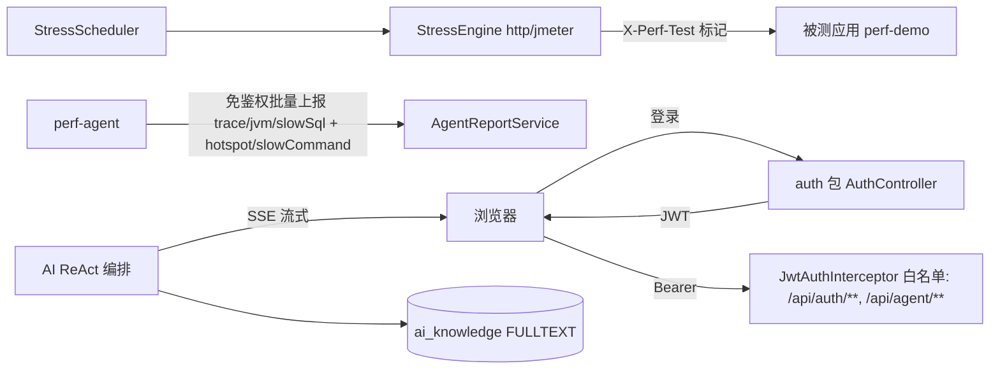

# PerformanceTestor 平台改进计划

> 生成日期：2026-08-30　状态：执行中　来源：全量代码评估结论（docs/plans 之外的评估报告见对话记录）
> 范围决策（用户确认）：全部四阶段功能 + 轻量 JWT 鉴权 + 端到端验证

## 一、背景与目标

基于对四个模块（perf-server 99 文件 / perf-agent 15 文件 / perf-datagen 32 文件 / perf-web 全部视图）的深度代码评估，按六大里程碑逐步修复 P0/P1/P2 三级缺陷、完成 8 项工程快速优化、并落地四阶段新功能，最终通过端到端全链路验证。

## 二、里程碑与任务清单

### M0 — P0 正确性与安全修复

| 任务 | 内容 |
| ---- | ---- |
| 轻量 JWT 鉴权 | 后端新增 `auth/` 包（JwtService HS256 / AuthController `POST /api/auth/login` / JwtAuthInterceptor / WebAuthConfig）；白名单放行 `/api/auth/**` 与 `/api/agent/**`（探针无 JWT 能力必须免鉴权）；账号密码与 jwt-secret 走环境变量占位；前端 stores/auth.ts + LoginView + router.beforeEach 守卫 + http.ts Bearer 注入与 401 统一跳转；scripts 密码参数化 |
| 探针根语义修复 | TraceEnhancer 拦截 `jakarta/javax.servlet.Filter#doFilter` 作为唯一 trace 根；TraceContext 增加 NOT_SAMPLED 状态——根未命中采样时整链短路，消除采样稀释（1-(1-p)^d）与半截链路 |
| 压测引擎加固 | StressStatistician 去 synchronized（LongAdder + 线程分片直方图，30000 桶×1ms 语义不变，对外 API 不变）；warmupSec（默认 10s 不计入正式统计）/ rampUpSec 阶梯升并发 / headers 自定义头；QPS 限流改全局 CAS 令牌桶；主线程忙轮询改精确 deadline 等待；sampler shutdown 补 awaitTermination(2s) |
| agent JVM 修复 | isYoungGc 改精确收集器名称映射表（Copy/PS Scavenge/ParNew/G1 Young→Young；PS MarkSweep/MarkSweepCompact/CMS/G1 Mixed→Old；ZGC/Shenandoah Cycles→Young、Pauses→Old；未知归 Old 并一次性 warn）；collectCpu 缓存强转 OperatingSystemMXBean、getCpuLoad() 替换废弃 API；MetricsReporter#stop 补 final flush（3s 超时兜底）；agentmain AtomicBoolean 幂等 |

### M1 — 灌数引擎修复

- `DefaultDataGenEngine` ormHints 从 volatile 实例字段改 execute() 内局部传递（兑现"引擎无状态"契约，消除并发任务互踩）
- `TopoSorter` 环检测后 DFS 提取真实环路（替代"列出全部未入序表"）
- 补并发隔离与精确环路单测

### M2 — 前端工程优化

- 卸载 tdesign-vue-next / vue-echarts（装而未用），main.ts 移除全量注册
- 建 stores/repoStore.ts / appStore.ts，消除 sourceApi.repos() 等 6 处重复拉取
- StressCenterView（895 行）/ QuickStartView（913 行）抽取 components/stress/StressForm.vue + StressReport.vue
- 补 404 兜底路由、afterEach 同步 document.title
- PerfServerApplication 移除无效 @EnableAsync/@EnableScheduling（M3 恢复后者）

### M3 — 二阶段功能

- **CPU 热点采样**：agent 新增 HotspotSampler（守护线程 10ms 周期采 RUNNABLE 线程栈，ConcurrentHashMap<frame,LongAdder> 聚合、上限 8192 帧，30s 批量上报 topN，hotspotEnabled 默认关）；AgentReportService 扩展 hotspot 类型 + 新表 hotspot_method；前端火焰图 Tab
- **JMeter 真实适配**：JMX 模板生成（ThreadGroup/RampUp/ConstantThroughputTimer）→ ProcessBuilder 调 `jmeter -n -t plan.jmx -l result.jtl` → 解析 JTL CSV 回填分位统计；jmeterHome 可配，未安装降级提示
- **定时压测/基线/告警**：新表 stress_schedule + StressScheduler（@Scheduled 30s 扫描）；同场景按 appVersion 自动 diff QPS/P95/错误率；NotifyService 支持 webhook/钉钉/飞书；压测请求注入 `X-Perf-Test: 1` 标记头，perf-demo 演示 header 检测影子表路由

### M4 — 三阶段功能（已完成 2/3）

- **AI 编排升级** ✅：ReAct 显式循环（Thought/Action/Observation，工具结果截断 2000 字符防上下文膨胀，10 轮上限收尾）；压测执行/根因分析/修复建议三角色路由（角色切换时 system prompt 原地替换保留历史）；`POST /api/ai/chat/stream` SseEmitter 流式（300s，事件 token/thought/tool/observation/done/error，工具轮次间推 thought 心跳防断连）；新表 ai_knowledge（FULLTEXT ngram 中文检索）+ 结论自动入库（正文 ≥40 字）+ search_knowledge 工具；前端 fetch+ReadableStream 逐 token 渲染
- **修复效果自动验证** ✅：问题快照压测场景（`stress_task_id`，支持补绑）；`POST /api/source/issues/{id}/verify` 重放同场景压测 → `BaselineCompareService.diff` 前后指标 diff → P95 降幅 ≥30% 且无回归则自动 `resolved` 并写 `verify_json`（含四行对比明细）；前端"验证修复"按钮 + 前后指标卡 + 基线对比表格 + 无快照补绑入口
- **容量科学化** ⏸️：二项式/指数拟合 + RT-并发二阶导拐点检测 + 分档采样方差置信区间；结果 JSON 增 model/r2/fittedCurve（向后兼容）

### M5 — 四阶段功能

- **PG 方言**：PostgreSQLDialect（information_schema、双引号标识符、CHECK 枚举、SERIAL 识别）+ JpaSourceParser（@Entity/@ManyToOne/@OneToMany）；H2 MODE=PostgreSQL 单测；DataGenService 按 URL 自动路由
- **中间件观测**：TraceEnhancer 沿 JDBC 拦截模式新增 Redis（Lettuce/Jedis）、ES client、RabbitMQ Channel 拦截；超阈值入新表 slow_command；middlewareEnabled 默认关；前端慢命令合并视图
- **报告导出**：ReportPrintView 打印页（print: 变体白底 A4）+ openhtmltopdf PDF（`GET /api/reports/export?stressTaskId=&format=pdf|doc`，Word 用 HTML .doc 零依赖）

### M6 — 端到端验证

- mvn test 全模块（GC 映射/无锁统计/精确环路/无状态引擎补新单测）+ npm run build（vue-tsc）+ scripts/build.sh
- start-all.sh 拉起全链路验证：登录流程（未登录 401→登录→携 token 访问）、agent 免鉴权上报、压测 `GET /api/user/list?limit=200` 20 并发复现基线（QPS≈300/P95≈135ms）且 warmup 生效、CPU 热点/基线 diff/报告导出冒烟（无 jmeter 环境降级跳过）

## 三、技术约束（防回归）

1. `/api/agent/**` 必须保持免鉴权；白名单前缀匹配需单测覆盖
2. agent 热路径零新增锁：NOT_SAMPLED 判断复用现有单 ThreadLocal 读
3. StressStatistician 桶语义与分位口径不变，历史报告对比兼容
4. perf-datagen 公共接口变更需同步 perf-server 宿主层 DataGenService 调用点
5. 新增表必须同步 `sql/init.sql` 与 `sql/init_empty.sql` 两份幂等脚本
6. Mapper XML 禁止 `${}`；新增最小依赖：jjwt 0.12.x、openhtmltopdf 1.0.10（仅 perf-server）
7. JMeter 走 CLI 零 Maven 依赖；知识库用 MySQL FULLTEXT（不引入向量库）
8. H2 单测不依赖外部环境；JMeter/PG 缺环境时降级跳过并留日志

## 四、新增架构



## 五、关键文件变更清单

```
pom.xml                                    # dependencyManagement 增 jjwt/openhtmltopdf
sql/{init.sql,init_empty.sql}              # 新增 hotspot_method/stress_schedule/ai_knowledge/slow_command（双脚本同步）
                                           # performance_issue 补 stress_task_id/verify_json/verify_time（add_column_if_missing 幂等）
perf-server .../auth/                      # [NEW] JwtService/AuthController/JwtAuthInterceptor/WebAuthConfig
perf-server .../stress/                    # StressStatistician 无锁化 / HttpStressEngine 加固 / JmeterStressEngine 实现
perf-server .../stress/StressScheduler.java + BaselineCompareService.java   # [NEW]
perf-server .../notify/NotifyService.java  # [NEW]
perf-server .../collector/AgentReportService.java  # 扩展 hotspot/slowCommand
perf-server .../capacity/CapacityAnalyzer.java     # 拟合+置信区间+拐点
perf-server .../ai/                         # ReAct 循环 / LlmClient stream / SSE 控制器 / SearchKnowledgeTool / AiKnowledgeService
                                            # [NEW] AiRole / ReactPhase / ReactStep / AiStreamEvent(Type) / StreamAccumulator / AiChatStreamController
                                            # [NEW] entity/AiKnowledge + mapper/AiKnowledgeMapper(.xml)
perf-server .../source/SourceIssueService.java     # 场景快照+补绑
perf-server .../service/IssueVerifyService.java    # [NEW] 重放验证闭环（达标自动 resolved）
perf-server .../report/ReportExportService.java    # [NEW] HTML→PDF/.doc
perf-agent .../                             # AgentPremain 幂等 / TraceEnhancer Filter+中间件拦截 / TraceContext NOT_SAMPLED
                                            # JvmCollector GC 映射 / MetricsReporter flush / HotspotSampler [NEW]
perf-datagen .../                           # DefaultDataGenEngine 无状态化 / TopoSorter DFS / PostgreSQLDialect+JpaSourceParser [NEW]
perf-web/src/                               # stores/{auth,repo,app}.ts [NEW] / LoginView+NotFoundView+ReportPrintView [NEW]
                                            # components/stress/{StressForm,StressReport}.vue [NEW] / http.ts+router 改造
scripts/*.sh                                # 密码环境变量化
```
## 六、第二轮改进（Issue #4 建议落地）

> 来源：CNB Issue #4「项目改进方案」NPC 建议 10 条；本轮采纳 8 条，**不采纳第 2 条**（账号体系增强）。

| # | 建议项 | 状态 | 落地要点 |
| - | ------ | ---- | -------- |
| 1 | 敏感凭据加密存储 | ✅ 已完成 | `security/CryptoService`（AES-256-GCM，密钥 `PERF_CRYPTO_SECRET`）；`ENC:` 前缀兼容存量明文、脏数据/密钥轮换降级返回原值；`DbConn`/`DeployConn` 列表经 SQL 计算列只返回 `hasPassword`/`hasCredential`，凭据不出口；`DeployService`/`PerformanceAnalyzer`/`DataGenController` 取用点解密 |
| 2 | 账号体系增强 | ⏭ 本轮不做 | 多用户表 / 改密 / 登录失败限制 / API Key 页面，待后续排期 |
| 3 | 探针上报鉴权 | ✅ 已完成 | `auth/AgentAuthInterceptor` 校验 `X-Perf-Agent-Token`，常量时间比较；令牌为空放行兼容存量 agent；失败计数摘要降噪；agent 侧 `agentToken=<值>` 启动参数透传（`scripts/start-agent.sh` 支持 `AGENT_TOKEN`） |
| 4 | 压测场景编排 | ✅ 已完成 | `StressTaskRequest.scenario` 多步骤 + 权重（`StepSelector` 累积权重二分 O(log n)）+ `ResponseVarExtractor` 点分路径提取与 `{{var}}` 传递；`StressStatistician` 分步骤统计；无 `scenario` 退化单接口；JMeter 多步骤回退 http 引擎 |
| 5 | 持续性能守护门禁 | ✅ 已完成 | `JwtAuthInterceptor` 并行支持静态 API Token（`X-Perf-Api-Token`，`PERF_API_TOKEN`）并标记 CI 调用方；`service/StressGateService` 同步门禁（创建→等待→基线 diff→结论）；`POST /api/stress/gate` + `scripts/perf-gate.sh` 退出码判定 |
| 6 | PG 灌数验收 | ✅ 已完成 | `scripts/verify-datagen-postgres.sh`（对齐 MySQL 版 5 组用例，新增原生枚举写入 / BIGSERIAL 跳过 / 枚举建议值发现）；docs 中 PG 由「预留」改为「可用」 |
| 7 | JVM 阈值告警 | ✅ 已完成 | 新表 `jvm_alert_rule`；`service/JvmAlertService` 60s 扫描 + 冷却期抑制 + 堆使用率/Full GC 增量/线程数三类指标；复用 `NotifyService`；`GET|POST /api/jvm-alert-rules` + 监控页 `components/monitor/JvmAlertRulePanel.vue` 配置面板 |
| 8 | 前端拆分与单测 | ✅ 已完成 | StressCenterView 788→419 行、QuickStartView 883→693 行、OptimizeView 717→620 行；新增 `components/{stress,quickstart,optimize,monitor}` 子组件；引入 vitest + @vue/test-utils，21 个用例覆盖工具函数与任务列表组件 |
| 9 | CI 流水线门禁 | ✅ 已完成 | `.cnb.yml`（原为空文件）补齐为 PR 触发的双 Job：后端 `mvn -B test` 全模块 + 前端 `npm ci && npm run build`（`vue-tsc -b && vite build`） |
| 10 | 报告历史趋势 | ✅ 已完成 | `GET /api/stress/trend`（同应用 + 同 URL 聚合）；`components/stress/StressTrendChart.vue` 多版本折线（QPS / P95 / P99 / 错误率）+ 明细表，接入 `StressReport` |

### 附带修复的既有缺陷

- **报告 PDF 缓存键含秒级时间戳**：报告正文内嵌「生成时间」，跨秒后缓存必然未命中，缓存形同虚设且 `ReportExportServiceTest.pdfReusesCachedBytesForSameContent` 偶发失败。改为摘要前剔除时间戳。
- **前端分档并发从未生效**：前端提交 `stageConcurrencies`，后端 `StressTaskRequest` 只认 `stages`，用户填了分档却静默退化成单档压测、容量曲线无从产生。后端新增 `stageConcurrencies` 字段 + `resolveStages()` 归一化（时长按档数均分），引擎与校验统一走归一化结果。
- **任务列表请求失败未捕获**：`StressTaskList` 轮询失败会产生未处理的 Promise 拒绝。已加就地兜底并保留上次数据。

### 验证结论

- 后端 `mvn -B test` 全模块 **218 个用例全绿**
- 前端 `vue-tsc -b && vite build` 通过，`vitest run` **21 个用例全绿**

## 六、第二轮改进（Issue #4 建议落地）

> 来源：CNB Issue #4「项目改进方案」NPC 建议 10 条；本轮采纳 8 条，**不采纳第 2 条**（账号体系增强）。

| # | 建议项 | 状态 | 落地要点 |
| - | ------ | ---- | -------- |
| 1 | 敏感凭据加密存储 | ✅ 已完成 | 新增 `security/CryptoService`（AES-256-GCM，密钥走 `PERF_CRYPTO_SECRET`）；`ENC:` 前缀兼容存量明文，脏数据/密钥轮换降级返回原值；`DbConn`/`DeployConn` 列表经 SQL 计算列只返回 `hasPassword`/`hasCredential`，凭据不出库；`DeployService`/`PerformanceAnalyzer`/`DataGenController` 取用点解密 |
| 2 | 账号体系增强 | ⏭ 本轮不做 | 多用户表 / 改密 / 登录失败限制 / API Key 页面，待后续排期 |
| 3 | 探针上报鉴权 | ✅ 已完成 | `auth/AgentAuthInterceptor` 校验 `X-Perf-Agent-Token`，常量时间比较；令牌为空即放行以兼容存量 agent；失败计数摘要降噪；agent 侧 `agentToken=<值>` 启动参数透传（`scripts/start-agent.sh` 支持 `AGENT_TOKEN`） |
| 4 | 压测场景编排 | ✅ 已完成 | `StressTaskRequest.scenario` 多步骤 + 权重（`StepSelector` 累积权重二分 O(log n)）+ `ResponseVarExtractor` 点分路径提取与 `{{var}}` 传递；`StressStatistician` 分步骤统计；无 `scenario` 退化单接口；JMeter 多步骤回退 http 引擎 |
| 5 | 持续性能守护门禁 | ✅ 已完成 | `JwtAuthInterceptor` 并行支持静态 API Token（`X-Perf-Api-Token`，`PERF_API_TOKEN`）并标记 CI 调用方；`service/StressGateService` 同步门禁（创建→等待→基线 diff→结论）；`POST /api/stress/gate` + `scripts/perf-gate.sh` 退出码判定 |
| 6 | PG 灌数验收 | ✅ 已完成 | `scripts/verify-datagen-postgres.sh`（对齐 MySQL 版用例，新增原生枚举写入 / BIGSERIAL 跳过 / 枚举建议值发现）；docs 中 PG 由「预留」改为「可用」 |
| 7 | JVM 阈值告警 | ✅ 已完成 | 新表 `jvm_alert_rule`；`service/JvmAlertService` 60s 扫描 + 冷却期抑制 + 堆使用率/Full GC 增量/线程数三类指标；复用 `NotifyService`；`/api/jvm-alert-rules` CRUD + 监控页 `components/monitor/JvmAlertRulePanel.vue` 配置面板 |
| 8 | 前端拆分与单测 | ✅ 已完成 | StressCenterView 788→419 行、QuickStartView 883→654 行、OptimizeView 717→601 行；抽出 `components/stress/{StressTaskList,CapacityAdvicePanel,SchedulePanel}.vue`、`components/quickstart/DeployStepPanel.vue`、`components/optimize/DbConnPanel.vue`；引入 vitest，补 21 个基础用例 |
| 9 | CI 流水线 | ✅ 已完成 | `.cnb.yml` 由空文件补齐为 PR 门禁：后端 `mvn -B test`（全模块）+ 前端 `npm ci && npm run build` 并行双 Job；m2 数据卷缓存依赖 |
| 10 | 报告历史趋势 | ✅ 已完成 | `GET /api/stress/trend`（同应用 + 同 URL 指标序列）；`components/stress/StressTrendChart.vue` 折线图（QPS / P95 / P99 / 错误率）+ 明细表，≥2 次记录才展示曲线 |

### 附带修复（本轮发现并修复的既存缺陷）

- **报告缓存键含秒级时间戳**：`ReportExportService` 缓存键取渲染 HTML 的 SHA-256，而 HTML 内嵌「生成时间」，跨秒必然缓存未命中，缓存形同虚设且导致 `pdfReusesCachedBytesForSameContent` 用例随机失败——改为摘要前剔除该时间戳。
- **分档并发从未生效**：前端提交 `stageConcurrencies`（并发数简写列表），后端 `StressTaskRequest` 只认 `stages`，用户填了分档却静默退化成单档压测，容量曲线无从产生——新增 `resolveStages()` 归一化，引擎与校验统一走该方法。
- **Full GC 增量用 max-min 聚合**：应用重启导致计数器回退时会算出巨大虚增（500→100 得 400）——改为按时间序取「末 − 初」并钳制为 0。
- **任务列表轮询缺错误处理**：`StressTaskList` 加载失败会产生未处理的 Promise 拒绝并中断后续轮询——就地吞掉并保留上次数据。
