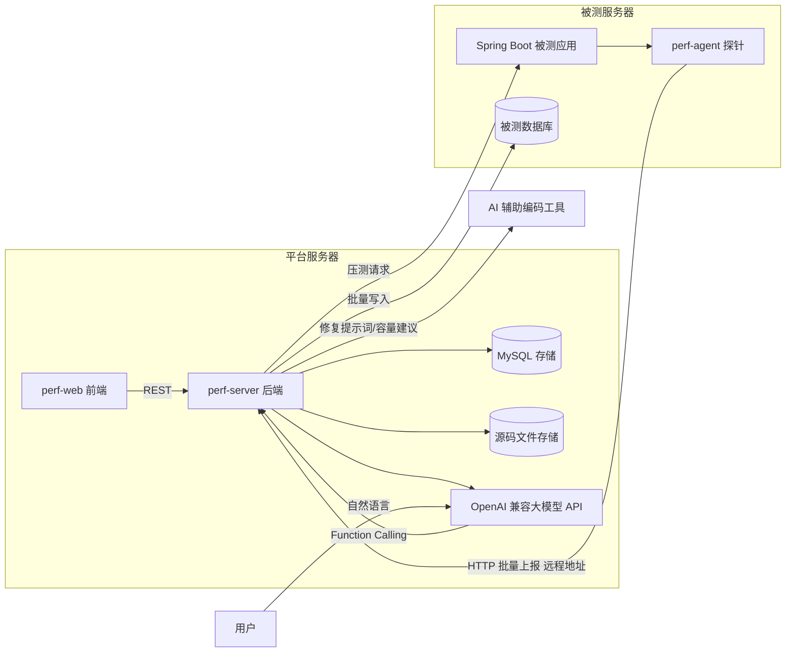

# PerformanceTestor 整体架构设计

> 生成日期：2026-08-27　模块：全局　状态：已定稿

## 1. 设计目标

- 平台与被测应用**分离部署**，避免压测 / 监控对被测应用产生资源干扰；
- Java Agent 无侵入接入，业务线程零阻塞；
- 采集 → 存储 → 分析 → AI 建议 → 修复提示词的完整闭环；
- 降低第三方中间件依赖，单 MySQL 库即可承载。

## 2. 部署拓扑（分离部署）



## 3. 组件职责

| 组件 | 职责 | 部署位置 |
| ---- | ---- | -------- |
| perf-agent | 字节码增强埋点（方法耗时 / JDBC）、JMX 采集、批量上报 | 被测服务器（`-javaagent` 挂载） |
| perf-server | 采集 API、压测引擎、灌数据、慢日志解析、数据库连接管理、源码管理、容量分析、AI 编排 | 平台服务器 |
| perf-web | 七屏可视化（Vue3 + tdesign + ECharts） | 平台服务器 |
| MySQL | 元数据 / 时序指标（分区表）/ 任务与报告 / 源码索引 / 问题与方案 | 平台服务器 |
| 被测应用 | 被检测的 Spring Boot 业务系统 | 被测服务器 |

## 4. 网络拓扑与端口要求

| 方向 | 流量 | 端口 |
| ---- | ---- | ---- |
| 平台 → 被测 | 压测 HTTP 请求 | 被测应用端口（80/8080 等） |
| 平台 → 被测库 | 灌数据批量写入 | MySQL 3306 等 |
| 被测 → 平台 | agent 上报采集数据 | perf-server 上报端口（8080） |
| 用户 → 平台 | Web 访问 | perf-web（5173）/ perf-server（8080） |
| 平台 → LLM | 大模型 API 调用 | 外网（HTTPS 443） |

## 5. 关键设计决策

- **agent 上报可靠性**：本地环形队列 + 单线程 flush（1s/500 条），失败指数退避重试、超时丢弃，网络抖动不影响被测应用；
- **埋点实现**：ByteBuddy AgentBuilder + Advice 内联，ThreadLocal 维护调用栈构建 TraceNode 树，采样率可配（默认 10%）；
- **JDBC 拦截**：拦截 Statement / PreparedStatement execute 系列，SQL 文本与耗时记录，超阈值（默认 500ms）标记慢 SQL；
- **JVM 采集**：JDK JMX（Memory / Thread / GC / OS MXBean），5s 轮询；
- **压测引擎**：StressEngine SPI，默认 HttpStressEngine（有界线程池 + 周期采样，累加器 + 固定桶直方图，内存 O(1)），预留 JMeter 适配器骨架；
- **容量评估**：QPS-RT 曲线分段线性插值，求目标 RT 阈值下最大可承受并发与 QPS，随压测报告 JSON 落库；
- **源码管理**：zip 解压（防路径穿越）、git clone、本地目录导入；单文件 ≤1MB、总量 ≤200MB、文件数 ≤5000；项目删除（`DELETE /api/source/repos/{id}`）需 `repoName` 二次确认 + 无进行中压测，磁盘目录删除做路径穿越防护；
- **压测模板**：常用场景参数沉淀（`stress_template`），`app_name=''` 为通用模板对所有项目可见；模板只存参数快照，发起压测时仍走原有校验；
- **修复闭环**：`apply-fix` 记录修复来源（分支/PR/补丁）并自动触发重放验证，与一键验证/基线对比共用一条判定链路；
- **AI 编排**：OpenAI 兼容 API Function Calling 多轮循环，无 Key 时降级规则模板模式；
- **明暗主题（P3-3）**：颜色全量收敛为 CSS 变量（`:root` 深色 / `[data-theme='light']` 浅色），Tailwind 以 `rgb(var(--x) / <alpha-value>)` 消费并覆盖内置 `white` 为 `--overlay` 语义变量，使既有叠层类零改动双主题可用；三态（dark/light/system）持久化于 `localStorage`，`index.html` 内联脚本首屏无闪；ECharts 颜色运行时读变量，切主题后失效缓存重算；
- **文案国际化（P3-1）**：前端 `vue-i18n`（骨架文案，可切语言并持久化 `<html lang>`），后端 Spring `MessageSource`（`i18n/messages*.properties`，语言取自 `Accept-Language`，缺失 key 回显 key 不抛异常）；中英 key 集合一致性由单测锁死，其余业务文案按需分批迁移；
- **无障碍（P3-2）**：全局 `:focus-visible` 焦点环、skip-link、表格/下拉/图标按钮 `aria-label`、状态徽章 `role=status`、展开控件 `aria-expanded`；未做读屏实测。

## 6. 数据流

```
被测应用 --agent 埋点/JMX--> 采集数据 --> HTTP 批量上报 --> perf-server 入库
平台 --压测请求--> 被测应用 --> 压测采样 --> 容量评估
平台 --灌数据--> 被测数据库
检测结果 + 源码 --> IssueAssociator 定位 --> 大模型分析 --> 多方案 --> 修复提示词
```
