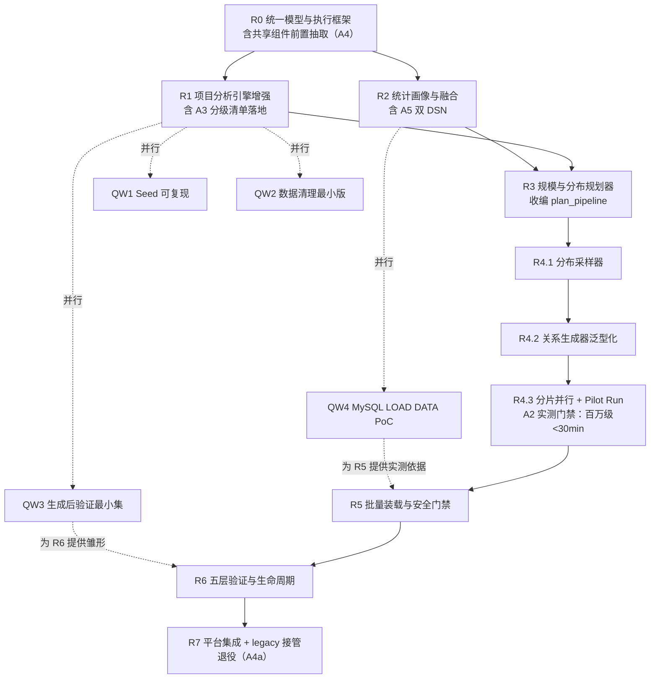

# PTDE 实施方案：R0～R7 分批执行计划

- **文档类型**：实施方案 / 分批执行计划
- **版本**：1.0
- **状态**：待评审（评审通过后按批次动工）
- **日期**：2026-11-17
- **依据文档**：
  - 《性能测试平台-智能测试数据引擎-完整技术方案.md》（总方案 v1.0，下称"总方案"）
  - 《PTDE-落地方案-现状差距分析与改造路线.md》（落地方案 v1.1，已评审确认决策 A1～A6，下称"落地方案"）
- **代码基线**：`perf-py/`（Python 3.12，pydantic 2.x、FastAPI、SQLAlchemy 2.x、tree-sitter-java、pymysql、psycopg2-binary）

---

## 1. 文档定位与依据

本文是落地方案 §6 R0～R7 改造路线的**工程化细化**：把每个阶段的一段式描述拆解为可执行的任务分解、文件级清单、结构级设计草案和可度量的验收门禁。

**本文遵守的硬约束**：

1. **不引入新决策、不改变阶段划分与验收口径**。所有设计遵循落地方案 §7 已确认决策（A1 分轨钳制、A2 Python 多进程 + 语言无关协议、A3 分级显式、A4 共享组件前置抽取、A4a 终态接管退役、A5 双 DSN、A6 pydantic 模型形态）。
2. **契约全程不变**。`/api/datagen` 13 个端点与 `perf datagen run` 的 spec.json 形状为对外承诺（`perf-py/tests/contract/` 为准），每个批次的准入条件是契约测试全绿。
3. **文件级清单落在真实代码上**。本文所有"现状"描述均经代码核对，与落地方案行文的差异已显式标注（见 §2.3 事实勘误）。
4. **生产安全单独成节强调**。双 DSN（A5）、环境门禁、清理所有权（总方案 §13、§12.5）贯穿 R2/R5/R6，并在各阶段验收门禁中体现。

**阅读方式**：§2 给出全局执行视图；§3～§10 按"目标 / 任务分解 / 文件级清单 / 关键设计草案 / 验收门禁 / 回归保障 / 回滚方式"统一模板展开 R0～R7；§11～§15 是横切内容（快赢项、数据库变更、R7 切换手册、风险登记册、追溯矩阵）。

---

## 2. 总体执行视图

### 2.1 批次划分与依赖

每个批次对应一组可独立合入、独立验收的 PR 集合。批次内任务可并行，批次间按依赖顺序推进。



**批次推进原则**（承接落地方案 §6 原则与总方案 §14.2）：

- 第一阶段（R0～R3）不引入分布式设施；生成内核用 Python 多进程 + 分片文件，R4c Pilot Run 实测吞吐不达标再评估 Go/Rust worker（A2）。
- 每阶段独立可验收、可回退；legacy 管线（`perf-py/datagen/`）在 R7 接管切换前全程可用且行为不回归。
- 快赢项（QW1～QW4）不依赖新架构，随 R1/R2 并行交付，提前兑现价值。

### 2.2 里程碑与验收总表

对齐落地方案 §10 与总方案 §17，"关键验收"为可度量口径，详见各阶段验收门禁。

| 批次 | 阶段 | 交付物 | 关键验收（对齐总方案 §17） |
|---|---|---|---|
| B0 | R0 | `ptde/models` + 状态机 + 4 张 ptde 新表 + 共享组件抽取 | 模型有版本与指纹、Schema 化、状态转换程序化；共享抽取后 legacy 行为不回归、契约测试全绿 |
| B1 | R1 | `ptde/analyzer` + 三态证据 + Schema 快照扩展 + `ptde_finding` 表 | 真实项目实体/约束/访问模式有证据；未知项显式标记；A3 分级清单落地 |
| B1 并行 | QW1～QW3 | Seed 注入、按任务清理、最小验证报告 | 现有管线相同输入复现相同数据；可按任务 ID 清理；简化 ValidationReport 落库 |
| B2 | R2 | `ptde/profiler`（采集器 + Merger） | 无明文导出；画像带采集元数据；硬约束不被统计覆盖；A5 双 DSN 生效 |
| B2 并行 | QW4 | MySQL `LOAD DATA LOCAL INFILE` PoC | 单方言实测装载吞吐数据，为 R5 提供依据 |
| B3 | R3 | `ptde/planner`（5 种目标类型） | 每表规模有 `explicit/production/derived/estimated` 来源标注；冲突显式失败；容量估算经试装载校准 |
| B4 | R4 | `ptde/generator` 三层 + Seed + 分片（R4.1→R4.2→R4.3 三步） | 同输入复现同逻辑数据；百万级不全量驻内存；R4c Pilot Run：百万级 < 30 分钟 |
| B5 | R5 | `ptde/adapters`（Capability Probe + MySQL/PG 原生装载 + 检查点恢复 + 安全门禁） | 导入结果可核对；失败可恢复；降级有说明；门禁覆盖总方案 §13.3 检查项 |
| B6 | R6 | `ptde/validator` 五层 + `ptde/lifecycle` | 仅约定验证项全部满足才进 READY；清理只作用于可确认归属的数据；结果可追溯 |
| B7 | R7 | CLI/API + 压测绑定 + 监控 + legacy 接管退役 | 数据集可绑定复用、可反查、可审计；切换后契约与行为不变，legacy 清零（A4a） |

### 2.3 代码事实勘误（相对落地方案行文）

以下差异经代码核对确认，本文按核对后的事实执行，不改变落地方案结论：

| # | 落地方案表述 | 核对后事实 | 对实施的影响 |
|---|---|---|---|
| F1 | 总行数硬钳制 100 万（`default_engine.py` `_validate`） | 钳制为 `1 ≤ total ≤ spec.max_rows`，上限来自 `DataGenSpec.max_rows`，**默认值** 100 万（`default_engine.py` L352-365） | A1 表述修正为"legacy 保留 max_rows 钳制（默认 100 万）"；新管线不设 max_rows，按约束求解显式失败 |
| F2 | 方言 `fetch_metadata` 采集元数据 | 仅采集列/主键/声明外键/行数；**无索引（除主键）、无分区、无触发器、无生成列采集**；PG 自增靠 `COLUMN_DEFAULT nextval` 间接识别 | R1 的 Schema 快照扩展是"新增采集"而非"补全"；工作量按新增接口方法估算 |
| F3 | `plan_pipeline.py` 的 RowCountEstimator / PlanRuleComposer / PlanIntegrityChecker 为组件 | 实际为**模块级函数集合**（按 Java 类分段注释），配 `TableContext/Composed/PlanTable` 等 dataclass | R3 收编时按函数级迁移登记；对外描述统一用"组件" |
| F4 | `datagen/model.py` 需承接统一模型 | 现状全部为标准库 `@dataclass`（非 pydantic），camelCase 序列化靠手写 `to_camel()`；pydantic 2.x 已在依赖中但未用于该包 | A6 落地方式：新模型一律 pydantic v2（version+fingerprint），旧 dataclass 模型不改造，只写旧→新适配函数 |
| F5 | `sql/init.sql` 三张 datagen 表 | `data_gen_task` 的 `total_rows/tables_json/detail_json` 不在 CREATE TABLE 内，由 L247-265 幂等 ALTER 补列；`semantic_hint` 有 `uk_hint` 唯一键 + 先查后插 upsert（`server/datagen_repo.py` L196-226） | ptde 新表 DDL 一次建全；存量迁移脚本须兼容"建表列 + 补丁列"两种形态 |
| F6 | 枚举四级发现 | 带 DB 入口 `discover_with_db` 的 CHECK 约束一级由方言 `get_enum_values` 内部承接（PG）；MySQL 无独立 CHECK 级 | R1 收编时证据来源登记要区分"方言内 CHECK"与"独立解析"两条路径 |
| F7 | `topo_sorter.py` 静默剔边 | 现状为 Kahn + DFS `find_cycle` 定位环成员后**抛 ValueError**；"剔除最低置信度边重试"在 `plan_pipeline.py` 的 `break_weakest_cycle_edge`（方案执行链路），不在 topo_sorter | R4 的 SCC 升级覆盖两处：`topo_sorter.py`（引擎）与 `plan_pipeline.complete_parents/break_weakest_cycle_edge`（方案管线） |
| F8 | `/api/datagen` 契约测试 | 契约测试文件共 3 个 datagen 相关：`test_contract_datagen.py`（读路径）、`test_contract_datagen_write.py`（写路径）、`test_contract_datagen_plans.py`（plans 全链）；golden 快照 `golden/datagen_tasks.json` | R0 起回归门禁以这三个文件 + `test_datagen_cli.py` 为准入基准 |

### 2.4 `datagen/` 收编映射总表

`perf-py/datagen/` 全部 26 个模块（含 `dialects/` 2 个文件）的终态去向。R7 按 A4a 删除整包前，此表是迁移核对清单。

| 现有模块（`perf-py/datagen/`） | 去向 | 阶段 | 演进方式 |
|---|---|---|---|
| `model.py`（17 个 dataclass） | `ptde/models/` + `ptde/models/compat.py` | R0 | 旧模型保留为兼容视图；旧→新适配函数承接字段映射；R7 随包退役 |
| `id_pool.py` | `ptde_common/id_pool.py` → `ptde/generator/keys.py` | R0 抽共享；R4 泛型化 | 先原样共享（legacy 改 import）；R4 去 `MAX_POOL_SIZE=500_000` 上限、支持 bigint/UUID/复合键/预分配区间 |
| `enum_value_discoverer.py` | `ptde_common/enum_value_discoverer.py` → `ptde/analyzer/enum_finder.py` | R0 抽共享；R1 收编 | 共享期行为不变；R1 输出带证据三态 |
| `spi.py`（DatabaseDialect/BatchExecutor） | `ptde/adapters/` 分层基座 | R5 | 拆分为 Metadata/Statistics/BulkLoad/CapabilityProbe 子适配器接口；SPI 注册机制沿用 |
| `dialects/mysql.py` | `ptde/adapters/mysql/` | R1 扩展采集；R5 原生装载 | `fetch_metadata` 扩展索引列序/分区/触发器/生成列；新增 `LOAD DATA LOCAL INFILE` 适配 |
| `dialects/postgres.py` | `ptde/adapters/postgres/` | R1 扩展采集；R5 原生装载 | 新增 `COPY FROM STDIN` 适配；保留 `parse_check_definition` 复用 |
| `executor.py`（DbApiBatchExecutor） | `ptde/adapters/bulkload/fallback.py` | R5 | 降为降级链最后一档；`DEFAULT_BATCH_SIZE=500` 语义保留 |
| `rule_engine.py` | `ptde/generator/primitive.py` | R4 | 收编为基础生成器层；fixed/range/enum+weights/seq/overThreshold 语义逐一保留并加单测对照 |
| `relation_resolver.py`（四级合并） | `ptde/analyzer/relation_resolver.py` | R1 | 输出补 `status/evidence` 三态字段；四级优先级（explicit 40 > db_fk 30 > orm_join 20 > naming 10）保留 |
| `naming_relation_resolver.py` | `ptde/analyzer/naming_resolver.py` | R1 | naming 级一律 INFERRED；抽样验证语义（0.85/0.4/0.3 置信度分级）保留 |
| `mybatis_source_parser.py` / `jpa_source_parser.py` / `orm_source_parser.py` | `ptde/analyzer/lang_java/` | R1 | 作为第一个 Language Adapter 的解析器集合 |
| `java_ast.py` / `java_source_hints.py` / `call_graph_analyzer.py` | `ptde/analyzer/lang_java/` | R1 | AST 与调用链基础设施 |
| `endpoint_index_parser.py` / `endpoint_path.py` | `ptde/analyzer/endpoint_index.py` | R1 | 端点索引，供 R3 工作负载目标使用 |
| `mybatis_sql_resolver.py` | `ptde/analyzer/sql_resolver.py` | R1 | XML SQL → 可执行查询的解析 |
| `sql_table_extractor.py` / `sql_predicate_extractor.py` / `sql_literal_extractor.py` | `ptde/analyzer/access_patterns.py` | R1 | 输出结构化 `AccessPattern` 模型（表/JOIN/WHERE/ORDER BY/选择性线索） |
| `explicit_rule_hints.py` | `ptde/analyzer/rule_extractor.py` | R1 | 业务规则证据提取 |
| `plan_pipeline.py` | `ptde/planner/workload.py` | R3 | 函数级收编：QPS 峰压推导、规则合成、完整性检查、SeqStart/RtBaseline Resolver；LLM 增强保持"建议"定位 |
| `topo_sorter.py` | `ptde/generator/deps.py` | R4 | 升级 Tarjan SCC + 显式安全策略；legacy 版保留不动 |
| `default_engine.py` | legacy 管线，R7 退役 | — | 过渡期保留为对照管线；A1：保留 max_rows 钳制口径 |
| `__init__.py` 及包级导出 | R7 退役 | — | 随整包删除 |

---

## 3. R0：统一模型与执行框架（批次 B0）

### 3.1 目标

落总方案 §5.1 统一数据模型与 §12.2 状态机；完成 A4 共享组件前置抽取；建立 ptde 四张新表（含 A4a 存量迁移映射字段）；旧模型保留兼容视图并补旧→新适配函数。本阶段不改任何运行行为。

### 3.2 任务分解

| ID | 任务 | 前置 | 涉及文件 | 验收 |
|---|---|---|---|---|
| T0.1 | 共享包 `ptde_common/` 建立：迁移 `id_pool.py`、`enum_value_discoverer.py`，新增 `model_base.py`（版本+指纹基座） | — | 新建 `perf-py/ptde_common/`；修改 `perf-py/datagen/id_pool.py`、`enum_value_discoverer.py`（改为 re-export） | legacy 侧全部现有单测（`test_datagen_id_pool.py`、`test_datagen_enum_value_discoverer.py` 等）不改断言、全绿 |
| T0.2 | `ptde/models/` 落 §3.4 模型全集（pydantic v2，每个模型带 `version: str` 与 `fingerprint: str`） | T0.1 | 新建 `perf-py/ptde/models/{base,snapshot,entity,access,profile,spec,dataset}.py` | 模型可 JSON/YAML 双读（A6）；指纹为规范 JSON sha256；不依赖特定数据库/语言 |
| T0.3 | 旧→新模型适配函数 | T0.2 | 新建 `perf-py/ptde/models/compat.py` | `DataGenSpec/TableSpec/FieldRule/RelationHint/SchemaMetadata` → 新模型往返转换字段无丢失（单测覆盖） |
| T0.4 | Dataset 状态机（确定性程序状态机） | T0.2 | 新建 `perf-py/ptde/models/dataset.py`（状态枚举 + 转换表）+ `perf-py/ptde/lifecycle/state_machine.py` | 每次转换记录操作者/时间/原因；非法转换抛异常（单测覆盖 §3.5 全表） |
| T0.5 | 数据库迁移：4 张 ptde 新表 | T0.2 | 修改 `/workspace/sql/init.sql`（追加，幂等 `CREATE TABLE IF NOT EXISTS` 风格） | DDL 与 §12.1 草案一致；重复执行不报错 |
| T0.6 | 配置框架：严格模式开关（A3 预留）+ 双 DSN 占位（A5 预留，R2 生效） | T0.2 | 新建 `perf-py/ptde/config.py` | 配置项有默认值与校验；严格模式默认关闭 |
| T0.7 | 回归安全网补齐：为 legacy 关键行为补契约用例（落地方案 §9 第 4 条） | — | `perf-py/tests/contract/`、`perf-py/tests/test_datagen_*.py` | `pytest tests/contract tests/test_datagen_*` 全绿 |

### 3.3 文件级清单

**新建**：

```text
perf-py/ptde_common/               # A4 共享包（ptde 与 legacy datagen 两边引用）
├── __init__.py
├── id_pool.py                     # 自 datagen/id_pool.py 原样迁入（含 MAX_POOL_SIZE=500_000、RLock）
├── enum_value_discoverer.py       # 自 datagen/enum_value_discoverer.py 原样迁入
└── model_base.py                  # VersionedModel 基座：version/fingerprint、规范 JSON、sha256

perf-py/ptde/
├── __init__.py
├── config.py                      # 严格模式开关、DSN 配置结构（A5 占位）
├── models/
│   ├── __init__.py
│   ├── base.py                    # VersionedModel(pydantic BaseModel)
│   ├── snapshot.py                # ProjectSnapshot / DatabaseSchemaSnapshot
│   ├── entity.py                  # EntityModel / RelationModel / BusinessInvariant
│   ├── access.py                  # AccessPattern
│   ├── profile.py                 # StatisticsProfile / UnifiedDataProfile
│   ├── spec.py                    # DatasetSpec / GenerationPlan / ExecutionManifest
│   ├── dataset.py                 # DatasetDefinition / DatasetInstance / ValidationReport + 状态枚举
│   └── compat.py                  # 旧 dataclass → 新 pydantic 适配函数
└── lifecycle/
    ├── __init__.py
    └── state_machine.py           # 状态转换表 + 转换记录（操作者/时间/原因）
```

**修改**：

| 文件 | 修改内容 | 行为约束 |
|---|---|---|
| `perf-py/datagen/id_pool.py` | 内容替换为 `from ptde_common.id_pool import *`（re-export） | 对外符号不变 |
| `perf-py/datagen/enum_value_discoverer.py` | 同上 | 对外符号不变 |
| `/workspace/sql/init.sql` | 追加 4 张 ptde 表 DDL（§12.1） | 幂等风格；不修改既有表 |

### 3.4 关键设计草案 A：核心模型字段

总方案 §5.1 模型全集逐项落位（pydantic v2；字段为结构级草案，实现时按总方案 §5.2/§5.3 YAML 示例对齐）：

**基座** `VersionedModel`：`version: str`（模型 schema 版本）、`fingerprint: str`（`sha256(canonical_json(self_without_fingerprint))`）、`created_at: datetime`。指纹计算排除 `fingerprint` 字段本身与易变字段（`created_at` 等，用 `exclude_fingerprint` 字段集声明）。

| 模型 | 文件 | 关键字段草案 |
|---|---|---|
| `ProjectSnapshot` | snapshot.py | `source_revision: str`、`tech_stack: dict[str,str]`（声明 vs 运行时证据分离）、`dependencies: list[DependencyRef]`、`schema_fingerprint: str`、`config_fingerprint: str`、`analyzed_at: datetime`、`analyzer_version: str` |
| `DatabaseSchemaSnapshot` | snapshot.py | `database: DbRef`（product/version/compat_mode/engine）、`tables: list[TableSchema]`；`TableSchema` 含 `columns/indexes(含列序)/primary_keys/foreign_keys/unique_constraints/check_constraints/partitions/triggers/generated_columns/sequences/row_estimate`；**R0 先落结构，R1 补采集实现**（现状方言仅采集列/主键/外键/行数，见 F2） |
| `EntityModel` | entity.py | `id/table/fields: list[FieldModel]/relations: list[RelationRef]/evidence: list[Evidence]`；`FieldModel` 含 `name/type/nullable/primary_key/allowed_values/generation_strategy/business_rule_ref`（对齐总方案 §5.2） |
| `RelationModel` | entity.py | `child_table/child_column/parent_table/parent_column/cardinality/relation_kind(db_fk|orm|logical)/status(CONFIRMED|INFERRED|UNKNOWN)/confidence/evidence: list[Evidence]`——承接 `RelationHint` 四元组 + `source/confidence/source_refs` 语义 |
| `BusinessInvariant` | entity.py | `id/description/status/scope(entities)/predicate(结构化：relation_exists 等)/evidence`（对齐总方案 §5.3；不可结构化表达的登记为待人工审核验证器，不自动执行） |
| `AccessPattern` | access.py | `id/sql_kind/tables/joins: list[JoinRef]/filters: list[Predicate]/order_by/group_by/limit_offset/range_fields/time_window/selectivity_hints/source_refs`——承接 `SqlAccess/Predicate/JoinRef` 语义 |
| `StatisticsProfile` | profile.py | `id/source(type/database_type/collected_at/sampling_rate)/tables: list[TableProfile]`；`TableProfile` 含 `approximate_rows/row_count_accuracy/columns: list[ColumnProfile]`；`ColumnProfile` 含 `distinct_count/null_ratio/distribution(Uniform/Normal/LogNormal/Zipf/WeightedCategorical/Temporal/…)/top_k/quantiles/length_stats/fit_quality`（对齐总方案 §4.5 示例结构） |
| `UnifiedDataProfile` | profile.py | `id/sources: list[ProfileSource]/entities: dict[str,EntityProfile]/merge_report: MergeReport`；`MergeReport` 记录 §4.4 优先级逐项裁决与冲突清单 |
| `DatasetSpec` | spec.py | `name/profile_mode(source_only|stats_only|hybrid)/production_profile_id/target_database/targets(RowTarget|ScaleFactorTarget|StorageTarget|WorkloadTarget|AutoTarget，可组合)/time_range/constraints(max_generation_time/max_memory/max_staging_storage/max_database_connections)/reproducibility(seed)/workload(scenarios+weights)`（对齐总方案 §6.2）。**注意：不含 max_rows 字段（A1：新管线无钳制）** |
| `GenerationPlan` | spec.py | `id/dataset_spec_fingerprint/target/entities: dict[str,EntityPlan]/storage(estimated_table/index/total_size/confidence)/distribution_plan/sharding_plan/warnings/conflict_errors`；`EntityPlan` 含 `rows/source(explicit|production|derived|estimated)/derivation(推导说明)/distribution/parent_binding`（对齐总方案 §6.6） |
| `ExecutionManifest` | spec.py | `id/instance_id/seed/generator_version/partition_algorithm_version/model_fingerprints(spec/plan/profile/schema)/adapter_capability_snapshot/adapter_version/time_inputs/actual_id_ranges/shard_summaries/start_end_time`（对齐总方案 §12.4 可复现要素全集） |
| `DatasetDefinition` | dataset.py | `def_key/name/version/spec(DatasetSpec)/spec_fingerprint/created_by`——同一 def_key 多 version |
| `DatasetInstance` | dataset.py | `id/definition_id/definition_version/plan_id/target_environment(DbRef+environment_id)/status(状态机)/actual(actual_rows/total_storage)/validation_summary/owner_token(清理所有权标记)/legacy_refs(§12.1 迁移映射)/error` |
| `ValidationReport` | dataset.py | `instance_id/layers: list[LayerResult]`；`LayerResult` 含 `layer(count|relationship|distribution|business|db_ready)/status(PASS|FAIL|WARN)/metrics/checks: list[CheckResult]/tolerance/evidence` |

### 3.5 关键设计草案 B：Dataset 状态机转换表

状态集：`PLANNED / GENERATING / LOADING / VERIFYING / READY / PARTIAL / FAILED / CLEANING / CLEANED / CANCELLED`（总方案 §12.2）。转换表（✔=允许）：

| From \ To | GENERATING | LOADING | VERIFYING | READY | PARTIAL | FAILED | CLEANING | CLEANED | CANCELLED |
|---|---|---|---|---|---|---|---|---|---|
| PLANNED | ✔ | | | | | | | | ✔ |
| GENERATING | | ✔ | | | ✔ | ✔ | | | ✔ |
| LOADING | | | ✔ | | ✔ | ✔ | | | ✔ |
| VERIFYING | | | | ✔ | | ✔ | | | |
| PARTIAL | ✔ | ✔ | | | | | | | |
| FAILED | | | | | | | ✔ | | |
| READY | | | | | | | ✔ | | |
| CLEANING | | | | | | | | ✔ | |

约束：

1. 转换由 `state_machine.py` 的唯一入口 `transition(instance, to_state, operator, reason)` 执行；非法转换抛 `InvalidStateTransition`。
2. 每次转换写入转换记录（`from/to/operator/reason/occurred_at`），随 Instance 持久化（落 `ptde_dataset_instance.transition_log` JSON 追加，见 §12.1）。
3. `PARTIAL → GENERATING/LOADING` 必须携带恢复上下文（上一次 Manifest ID），恢复流程在 R5 细化。

### 3.6 验收门禁

1. **契约与回归**：`uv run pytest tests/contract tests/test_datagen_*` 全绿（含 `test_contract_datagen.py`、`test_contract_datagen_write.py`、`test_contract_datagen_plans.py` golden 快照不变）。
2. **模型**：全部模型可 JSON/YAML 双读往返；`fingerprint` 对同内容稳定、对任一字段变更敏感（单测覆盖）；不 import 任何方言/数据库驱动模块（以 import 检查测试断言）。
3. **状态机**：§3.5 转换表逐格有测试；非法转换、缺操作者/原因的调用均抛异常。
4. **DDL**：`sql/init.sql` 重复执行两次无错；4 张表存在且字段与 §12.1 一致。
5. **共享抽取（A4）**：`ptde_common` 无对 `datagen` 的反向 import；legacy `datagen/id_pool.py`、`enum_value_discoverer.py` re-export 后符号集合不变（`dir()` 对比测试）。

### 3.7 回归保障与回滚

- **回归保障**：R0 不触碰生成/装载路径；`default_engine.py`、`executor.py`、`rule_engine.py` 零修改。
- **回滚方式**：共享包迁移通过 re-export 过渡，回滚只需还原两个 datagen 模块文件；ptde 新表为纯新增，无需回滚 DDL。

---

## 4. R1：项目分析引擎增强（批次 B1）

### 4.1 目标

建立 `ptde/analyzer/`，收编 `datagen/` 现有 Java 栈解析器为第一个 Language Adapter；发现结果统一 `CONFIRMED/INFERRED/UNKNOWN` 三态；扩展 DatabaseSchemaSnapshot 采集（索引列序/分区/触发器/生成列/Sequence/Identity/Check）；A3 分级显式清单随本阶段落地。

### 4.2 任务分解

| ID | 任务 | 前置 | 涉及文件 | 验收 |
|---|---|---|---|---|
| T1.1 | Language Adapter 接口定义（按多语言预留，本期仅实现 Java） | R0 | 新建 `ptde/analyzer/language_adapter.py` | 接口含 `analyze(paths) -> AnalyzerOutput`；输出为结构化模型而非文本 |
| T1.2 | 收编 Java 解析器至 `ptde/analyzer/lang_java/` | T1.1 | 迁移 `mybatis_source_parser.py`、`jpa_source_parser.py`、`orm_source_parser.py`、`java_ast.py`、`java_source_hints.py`、`call_graph_analyzer.py`、`endpoint_index_parser.py`、`endpoint_path.py`、`mybatis_sql_resolver.py` | legacy `datagen_service` 源码扫描行为不回归（现有相关单测全绿） |
| T1.3 | 关联解析三态化：`RelationModel.status/evidence` 输出 | T1.2 | 新建 `ptde/analyzer/relation_resolver.py`（承接 `relation_resolver.py` 四级合并）、`ptde/analyzer/naming_resolver.py`（承接 `naming_relation_resolver.py`） | naming 级、注解 SQL JOIN 正则结果一律 `INFERRED`；**禁止静默跳过**，全部显式记录进 `ptde_finding` |
| T1.4 | AccessPattern 结构化提取 | T1.2 | 新建 `ptde/analyzer/access_patterns.py`（收编 `sql_table_extractor.py`、`sql_predicate_extractor.py`、`sql_literal_extractor.py`） | 输出 `AccessPattern` 模型；来源 SQL 无法解析时登记 UNKNOWN 而非丢弃 |
| T1.5 | 枚举发现收编 + 证据登记 | T1.2 | 新建 `ptde/analyzer/enum_finder.py`（自 `ptde_common/enum_value_discoverer.py` 包装） | 四级来源（方言 ENUM/内联/CHECK·注释/Java 反查，见 F6）各自登记独立证据条目 |
| T1.6 | DatabaseSchemaSnapshot 扩展采集 | T1.2 | 修改（新适配器内实现，不改 legacy）`ptde/adapters/mysql/metadata.py`、`ptde/adapters/postgres/metadata.py`（R1 先建 metadata 子集） | MySQL：`information_schema.STATISTICS`（含复合索引列序 SEQ_IN_INDEX）、分区（INFORMATION_SCHEMA.PARTITIONS）、触发器、生成列（GENERATION_EXPRESSION）；PG：`pg_indexes`、`pg_partitioned_table`、`pg_trigger`、`information_schema.check_constraints`、Sequence（`pg_sequences`） |
| T1.7 | A3 分级清单落地 | T1.3 | 新建 `ptde/analyzer/finding_policy.py` | 硬约束类（主键/外键/唯一/元数据残缺）缺失 → 显式失败；推断类（naming 关联、注解 SQL、枚举猜测）→ warning + 进采纳流；`strict_mode=True` 时推断类也阻断 |
| T1.8 | `ptde_finding` 表 + 采纳流对接 | T1.7 | 修改 `/workspace/sql/init.sql`；新建 `ptde/analyzer/finding_repo.py` | 复用 `semantic_hint` 的 pending/adopted/dismissed 工作流模式与 `uk_finding` 幂等 upsert（对齐 `datagen_repo.py` 先查后插风格） |
| T1.9 | 迁移文件与测试代码识别（降级为"识别并登记，不解析"） | T1.2 | `ptde/analyzer/lang_java/` 内补充目录识别（Flyway `db/migration`、Liquibase `changelog`） | 发现登记进 ProjectSnapshot.evidence，状态 UNKNOWN |
| T1.10 | `ProjectSnapshot` 产出（源码版本 + 技术栈 + schema 指纹） | T1.2, T1.6 | 新建 `ptde/analyzer/snapshot_builder.py` | 技术栈区分"声明依赖"与"运行时连接"证据；无法确认标 `UNKNOWN`（总方案 §3.2） |

### 4.3 文件级清单

**新建**（均位于 `perf-py/ptde/analyzer/`）：`__init__.py`、`language_adapter.py`、`finding_policy.py`、`finding_repo.py`、`relation_resolver.py`、`naming_resolver.py`、`access_patterns.py`、`enum_finder.py`、`snapshot_builder.py`、`lang_java/`（9 个收编模块）、`adapters/mysql/metadata.py`、`adapters/postgres/metadata.py`。

**修改**：`/workspace/sql/init.sql`（追加 `ptde_finding` 表，§12.2）。

**收编**：`datagen/` 的 `relation_resolver.py`、`naming_relation_resolver.py`、9 个 Java/SQL 解析模块按 §2.4 总表迁入；legacy 侧原模块保留（`datagen_service` 仍在用），R7 统一退役。

### 4.4 关键设计草案

**三态证据模型**（总方案 §3.6）：每条发现（`Finding`）至少含 `id / type / value / source_file | database_object / evidence / confidence / status(CONFIRMED|INFERRED|UNKNOWN) / analyzer_version`。证据为结构化引用（文件路径+行号、SQL 对象名），不接受纯文本断言。

**A3 分级清单（随 T1.7 落地，后续阶段共用）**：

| 类别 | 项 | 缺失/失败时行为 |
|---|---|---|
| 硬约束类 | 主键缺失、声明外键解析失败、唯一约束、方言元数据残缺（fetch_metadata 列不全）、Schema 快照失败 | **显式失败**（严格与非严格模式均阻断），错误带对象名与原因 |
| 推断类 | naming 关联、注解 SQL JOIN 正则结果、列注释枚举猜测、Java 枚举反查、MagicHint | warning + 登记 `ptde_finding`（status=INFERRED, status 流转 pending→adopted/dismissed），不阻断 |
| 可配置 | 以上之外新增项按两类归档 | 严格模式 `ptde.config.strict_mode=true` 时推断类也阻断 |

**Schema 快照扩展对照**（现状 → 目标，F2）：

| 元数据 | 现状（两方言） | R1 目标采集来源（MySQL / PG） |
|---|---|---|
| 复合索引及列序 | 无（仅主键） | `information_schema.STATISTICS`(SEQ_IN_INDEX, NON_UNIQUE) / `pg_indexes`+`pg_index.indkey` |
| 分区 | 无 | `information_schema.PARTITIONS` / `pg_inherits`+`pg_partitioned_table` |
| 触发器 | 无 | `information_schema.TRIGGERS` / `pg_trigger`（排除内部） |
| 生成列 | 无 | `information_schema.COLUMNS.GENERATION_EXPRESSION` / `pg_attribute.attgenerated` |
| Sequence/Identity | PG 仅靠 nextval 默认值间接识别 | MySQL：AUTO_INCREMENT 属性已有，补显式登记 / PG：`pg_sequences` |
| Check 约束 | PG 有（`parse_check_definition`）；MySQL 8 无 | MySQL 8：`information_schema.CHECK_CONSTRAINTS` / PG 保留现有解析 |

### 4.5 验收门禁

1. 用一个真实项目（如 `perf-demo/` Java 项目或团队任选业务项目）跑 `analyzer`：实体、约束、访问模式、证据完整可导出；导出文件中 UNKNOWN/INFERRED 项显式标记、数量可统计。
2. AI/推断结果不伪装为数据库事实：`DatabaseSchemaSnapshot` 中任一字段必须可溯源到方言查询或 DDL；单测以"构造半残缺 schema"验证硬约束显式失败路径。
3. 现有 `datagen_service` 源码扫描不回归：`pytest tests/` 中 source 相关用例全绿。
4. `ptde_finding` 幂等 upsert 生效（同键重复发现不重复插行）；采纳/忽略流转有测试。

### 4.6 回归保障与回滚

- legacy 解析器本体不动，`ptde/analyzer/lang_java/` 为迁入副本；两套并存期间以单测对照保证同输入同输出（抽样用例）。
- 回滚：`ptde/analyzer` 为纯新增包，直接移除即可；无数据回滚需求（`ptde_finding` 为新增表）。

---

## 5. R2：统计画像与融合（批次 B2）

### 5.1 目标

建立 `ptde/profiler/`：只读统计采集器（行数/基数/NULL/Top-K/直方图/分位数/时间分桶/关联基数/热点倾斜）、采集安全机制（A5 双 DSN + 采样/超时/资源限制 + 脱敏）、Profile Merger（按总方案 §4.4 优先级融合，冲突显式报告）。

### 5.2 任务分解

| ID | 任务 | 前置 | 涉及文件 | 验收 |
|---|---|---|---|---|
| T2.1 | A5 双 DSN 配置生效：`profile_dsn`（只读）/`target_dsn`（写），未配置 profile_dsn 时回退同值 + warning 进执行清单 | R0 `config.py` | 修改 `ptde/config.py` | 采集器连接使用 profile_dsn；回退路径产生可断言的告警记录；采集日志记录所用凭据身份（脱敏后） |
| T2.2 | Statistics Collector（只读） | T2.1 | 新建 `ptde/profiler/collector.py` + 方言统计子适配器 `adapters/{mysql,postgres}/statistics.py` | 采集项覆盖 §5.4 表；只执行 SELECT/只读语句（语句白名单校验） |
| T2.3 | 采集安全机制 | T2.2 | `ptde/profiler/collector.py` | 采样率、超时、行数上限、采集窗口可配置；高基数敏感字段分桶/Top-K/哈希类别；小样本类别披露保护；记录采集时间/采样率/精度 |
| T2.4 | 文件来源画像（无生产库访问时的替代来源） | T2.2 | 新建 `ptde/profiler/file_source.py` | 支持 YAML/JSON 统计文件导入（结构同 `StatisticsProfile`）；与库采来源可区分标记 |
| T2.5 | 测试库自画像（验证用） | T2.2 | 复用 T2.2 | 对目标测试库跑完整采集，作为 R2 验收与 R3 校准输入 |
| T2.6 | Profile Merger | T2.2, T2.4 | 新建 `ptde/profiler/merger.py` | 按 §4.4 优先级表逐项融合；冲突生成 `MergeReport`；源码硬约束不被统计覆盖 |
| T2.7 | 明文防护审计测试 | T2.3 | `perf-py/tests/test_ptde_profiler_security.py` | 构造含"姓名/手机号/身份证"形数据的生产模拟库，断言画像输出不含明文值（仅分布参数） |

### 5.3 文件级清单

**新建**：`perf-py/ptde/profiler/{__init__,collector,file_source,merger}.py`、`perf-py/ptde/adapters/mysql/statistics.py`、`perf-py/ptde/adapters/postgres/statistics.py`。

**修改**：`ptde/config.py`（双 DSN 生效）；`/workspace/sql/init.sql`（追加 `ptde_statistics_profile` 表，§12.3，画像落库供复用）。

### 5.4 关键设计草案

**采集项清单**（对齐总方案 §4.2，按适配器能力分级）：

| 采集项 | MySQL 来源 | PG 来源 | 精度标记 |
|---|---|---|---|
| 表行数 | `information_schema.TABLES.TABLE_ROWS`（近似） | `pg_class.reltuples` / 精确 COUNT（可配） | approximate/exact |
| 字段基数 | 采样 `COUNT(DISTINCT)` | `pg_stats.n_distinct` 优先，回退采样 | estimated |
| NULL 比例 | 采样 | `pg_stats.null_frac` | estimated/exact |
| Top-K 频次 | 采样 GROUP BY + LIMIT K | `pg_stats.most_common_vals/freqs` | estimated |
| 数值直方图/分位数 | 采样分桶 | `pg_stats.histogram_bounds` | estimated |
| 时间分桶/跨度 | 采样 GROUP BY 时间窗 | 同左 | estimated |
| 关联基数（父实体子实体数分布） | 采样 GROUP BY 父键 | 同左 | estimated |
| 热点倾斜 | Top-K 占比 + Zipf 拟合（复用 `build_skew_weights` 参数化思路） | 同左 | fitted |

**融合优先级**（总方案 §4.4 原文规则，实现为逐项裁决函数）：

| 信息 | 主要依据 | 冲突处理 |
|---|---|---|
| 字段类型、主键、外键 | Schema 快照 | 以目标 Schema 为准，统计不覆盖 |
| 字段含义 | 源码/人工确认 | AI 推断需带 INFERRED 标记 |
| 业务规则 | 源码、测试断言 | 未确认规则不自动执行 |
| 字段值分布 | 统计画像 | 可被 DatasetSpec 目标覆盖（覆盖时记入 MergeReport） |
| 数据规模 | 用户目标 > 生产基线 > 资源预算 | 冲突返回规划错误（R3 执行） |
| 热点分布 | 统计画像 + 访问模式 | 记录统计新鲜度与置信度 |
| 缺失特征 | 显式配置或规则生成 | 标记 `estimated`，不得伪装为生产统计 |

### 5.5 验收门禁

1. 全流程不导出生产明文业务记录：画像输出仅含分布参数/计数/分桶（T2.7 审计测试通过）。
2. 画像带采集元数据：`collected_at / sampling_rate / accuracy / source_type` 非空且随指纹入库。
3. 源码硬约束不被统计覆盖：构造"Schema 主键 vs 统计冲突"用例，Merger 输出以 Schema 为准并记冲突。
4. A5：仅配置 `target_dsn` 时采集可用但产生 warning 记录；两个 DSN 分别配置时连接身份正确（单测 + 集成手验）。
5. 无生产库时文件来源可用：示例统计文件导入 → `StatisticsProfile` 指纹稳定。

### 5.6 回归保障与回滚

- 纯新增包；唯一共享改动是 `config.py`（R0 已预留结构），不触碰 legacy 路径。
- 回滚：移除 `ptde/profiler` 即可；`profile_dsn` 配置项保留但退化为未使用。

---

## 6. R3：规模与分布规划器（批次 B3）

### 6.1 目标

建立 `ptde/planner/`：DatasetSpec 五种目标类型（可组合）、关系规模推导（离散分布 + 配额修正）、存储估算（Pilot Run 校准 `B_i`）、约束冲突显式失败；收编 `plan_pipeline.py` 为工作负载目标分支。

### 6.2 任务分解

| ID | 任务 | 前置 | 涉及文件 | 验收 |
|---|---|---|---|---|
| T3.1 | 目标类型模型与校验 | R0 models | 新建 `ptde/planner/targets.py` | 5 类目标可组合；互斥/冲突组合在模型层校验 |
| T3.2 | 约束求解与显式失败 | T3.1 | 新建 `ptde/planner/solver.py` | 目标不可满足时抛 `PlanningConflict`（含逐条冲突说明），**禁止静默降低行数或改变分布**（推翻现状 `_shrink_to_limit` 行为——legacy 保留不动，A1 分轨） |
| T3.3 | 关系规模推导 | T3.2 | 新建 `ptde/planner/derivation.py` | 按离散分布采样 + 配额修正（总方案 §6.3：用户订单量分布先于用户数推导，零订单用户/群体比例入模）；每表结果带 `source(explicit|production|derived|estimated)` 与推导说明 |
| T3.4 | 存储估算与 Pilot Run 校准 | T3.2 | 新建 `ptde/planner/storage_estimator.py`、`ptde/planner/pilot_run.py` | `B_i` 由试装载实测校准（禁止字段长度相加）；两轮扩样修正非线性偏差；输出估算值+误差区间 |
| T3.5 | 工作负载目标分支（收编） | T3.2 | 新建 `ptde/planner/workload.py`（收编 `plan_pipeline.py`：`estimate`/`compose`/`complete_parents`/`edge_confidence`/`refresh_seq_starts`/`resolve_rt_baseline`，F3 函数级迁移） | 收编后行为与 legacy 对照一致（同输入同输出的单测对照）；LLM 增强（`llm_enhance`）保持建议定位，不进确定性路径 |
| T3.6 | 分布规划 | T3.3 | 新建 `ptde/planner/distribution_planner.py` | 为每字段产出分布参数计划（类型+参数+来源）；条件分布对（如 status↔paid_at）识别为字段依赖图输入（R4 消费） |
| T3.7 | GenerationPlan 产出与冲突诊断 | T3.4, T3.5, T3.6 | 新建 `ptde/planner/planner.py` | 输出 `GenerationPlan`（含 warnings 与 conflict_errors 分离）；计划可导出 YAML/JSON |

### 6.3 文件级清单

**新建**：`perf-py/ptde/planner/{__init__,targets,solver,derivation,storage_estimator,pilot_run,workload,distribution_planner,planner}.py`。

**收编**：`datagen/plan_pipeline.py` 按函数级迁入 `ptde/planner/workload.py`；`endpoint_index_parser`/`call_graph_analyzer` 产物（R1 已收编）作为访问事实输入。

**修改**：无 legacy 文件修改（`_shrink_to_limit` 等 legacy 行为保持 A1 分轨）。

### 6.4 关键设计草案

**规模推导算法骨架**（确定性，记录算法版本）：

```text
输入：DatasetSpec.targets + UnifiedDataProfile + DatabaseSchemaSnapshot
1. 锚定显式目标表（explicit）
2. 对每条关系边（RelationModel，status=CONFIRMED 优先）：
   子表规模 = Σ 父实体数 × 每父子实体数分布采样期望
   零订单实体占比、群体比例（如 §6.3 用户分群表）入模
3. 配额修正：采样结果与目标行数偏差 > 容差时，按分布保形修正
   （记录修正事件进 derivation 说明）
4. 求解约束：存储 ≤ max_staging_storage & 目标容量、时间 ≤ max_generation_time、
   连接 ≤ max_database_connections；不可满足 → PlanningConflict
5. 输出 EntityPlan（rows/source/derivation）+ storage estimate（confidence）
```

**Pilot Run 校准协议**（总方案 §6.5）：

1. 取核心表代表性样本（默认 1 万行，可配）。
2. 经 R5 装载通道（R3 期间先用 `DbApiBatchExecutor` 降级通道实测，QW4 结果作为原生通道参照）导入并建索引。
3. 采集表大小/索引大小/行数/资源 → 计算 `B_i`（行均存储成本）。
4. 扩样 10× 重测，修正非线性偏差；输出 `StorageEstimate(total, error_band)`。

### 6.5 验收门禁

1. 每张表的规模有 `explicit/production/derived/estimated` 来源标注与推导说明（导出 GenerationPlan 逐表可查）。
2. 冲突显式失败：构造"1 亿订单 vs 200GB 存储"不可满足用例，断言 `PlanningConflict` 且错误信息含逐条冲突。
3. 新管线无 100 万钳制：`DatasetSpec` 设 500 万行时规划成功（A1 分轨，对照 legacy 同输入被钳制）。
4. 关联数量可验证：推导结果在 R4 生成后可复核（数量容差内）。
5. 容量估算经试装载校准：Pilot Run 报告入库，`B_i` 非字段长度相加值。
6. 收编对照：`plan_pipeline` 现有单测（`test_datagen_plan_pipeline.py`）语义迁入 `workload.py` 并全绿。

### 6.6 回归保障与回滚

- `plan_pipeline.py` 本体保留（legacy 管线继续使用），收编为副本迁移；对照测试保证一致。
- 回滚：`ptde/planner` 纯新增，可整体移除；Pilot Run 数据只在 `ptde_*` 新表，无影响。

---

## 7. R4：确定性数据生成内核（批次 B4，改造面最大）

### 7.1 目标

建立 `ptde/generator/` 三层结构（Primitive → Distribution Samplers → Relationship Generators）、条件分布依赖图、确定性 Seed 全链路、文件中转/流式双模式与分片协议、循环依赖 SCC 显式安全策略。按落地方案 §9 风险第 1 条拆为三步独立交付：**R4.1 分布采样器 → R4.2 关系生成器泛型化 → R4.3 分片并行 + Pilot Run**。

### 7.2 任务分解（按三步推进）

**R4.1 分布采样器**：

| ID | 任务 | 前置 | 涉及文件 | 验收 |
|---|---|---|---|---|
| T4.1 | Primitive Generators 收编 | R3 | 新建 `ptde/generator/primitive.py`（收编 `rule_engine.py`：`apply_rule/weighted_index/normalize_scalar/scale_to_column_type/base_type/is_integer_family/seq_value`） | 与 legacy 同输入同输出对照单测；fixed/range(含 overThreshold)/enum+weights/seq 语义逐一保留 |
| T4.2 | 分布采样器层 | T4.1 | 新建 `ptde/generator/samplers/`（uniform/normal/lognormal/zipf/temporal/weighted_categorical/correlated/conditional/null_ratio/length） | 覆盖总方案 §7.1 全部 12 类分布；每类分布有统计特性单测（均值/方差/分位数容差） |
| T4.3 | 条件分布字段依赖图 | T4.2 | 新建 `ptde/generator/field_deps.py` | `P(paid_at | status)` 型依赖：字段生成顺序由依赖图拓扑决定；R3 的条件对识别结果直接消费 |
| T4.4 | Seed 可复现机制 | T4.2 | `ptde/generator/seed.py` | 每字段采样器持有派生自 `root_seed + entity + shard_id + field` 的独立 `random.Random` 实例；同输入复现同逻辑数据（跨进程一致） |

**R4.2 关系生成器泛型化**：

| ID | 任务 | 前置 | 涉及文件 | 验收 |
|---|---|---|---|---|
| T4.5 | IdPool 泛型化 | R4.1 | 新建 `ptde/generator/keys.py`（演进 `ptde_common/id_pool.py`） | 支持 bigint/字符串/UUID/复合键；**去除 `MAX_POOL_SIZE=500_000` 与整数限制**；预分配 ID 区间接口（对齐总方案 §7.6：区间经目标 Schema、既有数据、多 Worker 分片规则检查） |
| T4.6 | 关系生成器（1:1 / 1:N / M:N / 复合键 / 逻辑关联） | T4.5 | 新建 `ptde/generator/relations.py` | 外键关联按分布采样父子绑定；M:N 按规模选型：可计算映射 / 分片映射 / 外部 KV / 关系配额（总方案 §7.7） |
| T4.7 | 循环依赖显式安全策略 | T4.6 | 新建 `ptde/generator/deps.py`（升级 `topo_sorter.py` 思路）+ `ptde/generator/cycle_policy.py` | Tarjan SCC 分析；安全策略逐条判定（可空回填/延迟约束/分阶段装载）；无安全方式 → 阻止执行并输出原因（**废除 `break_weakest_cycle_edge` 静默剔边语义**，legacy 侧保留 A1 分轨）；含自引用处理（`SELF_REF_MAX_DEPTH` 语义继承） |

**R4.3 分片并行 + Pilot Run**：

| ID | 任务 | 前置 | 涉及文件 | 验收 |
|---|---|---|---|---|
| T4.8 | 分片规划器 | T4.7 | 新建 `ptde/generator/partitioner.py` | 按表/ID 范围/分区键/确定性哈希切分；分片大小由导入吞吐/Worker 资源/暂存空间/倾斜度调节（总方案 §8.4） |
| T4.9 | 文件中转模式（staging 分片文件） | T4.8 | 新建 `ptde/generator/staging.py`、`ptde/generator/file_format.py` | 格式要素全集（§7.4）；每分片文件带校验和 |
| T4.10 | 流式直传模式（有界缓冲） | T4.8 | 新建 `ptde/generator/stream.py` | 与文件模式共用分片元数据/格式定义/检查点协议；背压不丢数据 |
| T4.11 | 多进程 Worker（生成端无 DB 连接） | T4.9, T4.10 | 新建 `ptde/generator/worker.py` | Worker 只产数据，不持数据库连接（生成与装载解耦）；分片间无共享可变状态；跨 Worker 复现一致 |
| T4.12 | Pilot Run 与 A2 实测门禁 | T4.11 | `ptde/planner/pilot_run.py` 扩展 | **百万级数据端到端 < 30 分钟**（A2 基准）；不达标 → 触发 A2 决策反转评估（预留编译 worker，协议已语言无关） |

### 7.3 文件级清单

**新建**：`perf-py/ptde/generator/{__init__,primitive,field_deps,seed,keys,relations,deps,cycle_policy,partitioner,staging,file_format,stream,worker}.py` + `ptde/generator/samplers/`（10 个采样器模块）。

**收编**：`rule_engine.py`（T4.1）、`id_pool.py`（T4.5）、`topo_sorter.py` 思路（T4.7）；`executor.py` 在 R5 才移至 Loader 侧，R4 期间 Pilot Run 借用其降级通道。

**修改**：`ptde_common/id_pool.py` 保留不动（legacy 与新 keys.py 并存，R7 统一退役）。

### 7.4 关键设计草案 A：分片文件格式要素（总方案 §8.3 全集）

| 要素 | 约定 |
|---|---|
| 字符集 | 统一 UTF-8；文件头声明 |
| 分隔符 | CSV/TSV 由方言能力决定；字段/行分隔符可配置，默认避开业务值域 |
| NULL 表达 | 显式标记（如 `\N`），与空串区分 |
| 引号与转义 | RFC4180 兼容；方言原生格式按官方规范 |
| 日期时间与时区 | 统一 UTC 存储 + 目标时区转换声明；格式由方言适配器定 |
| Decimal | 字符串化保精度（禁止 float 往返）；目标精度由 ColumnMeta 决定 |
| 二进制/LOB | 十六进制或 Base64（按方言 LOAD 语法能力），文件头声明编码 |
| 特殊字符 | 换行/制表符/引号转义规则显式化 |
| 校验和 | 每分片文件附带 sha256 + 行数 |
| 格式版本 | `format_version` 写入分片元数据（A2 语言无关协议要求） |

### 7.5 关键设计草案 B：语言无关分片协议（A2 预留）

分片任务描述与结果均为版本化 JSON（无 Python 专属假设），未来可替换 Go/Rust worker：

```json
{
  "protocol_version": 1,
  "shard_id": "orders-0007",
  "entity": "orders",
  "id_range": {"start": 7000001, "end": 8000000, "strategy": "planned_range"},
  "plan_fingerprint": "sha256:...",
  "seed_derivation": "sha256(seed|entity|shard_id)",
  "output": {"mode": "file|stream", "format": "csv_v1", "path": "...", "checksum": "sha256:..."},
  "result": {"generated_rows": 0, "duration_ms": 0, "status": "pending"}
}
```

约束：字段名 snake_case、值为 JSON 原生类型、无 Python 对象引用；协议版本变更需 bump `partition_algorithm_version` 并记录进 ExecutionManifest。

### 7.6 验收门禁

1. **可复现**：相同 DatasetSpec + Seed，两次构建的逻辑数据逐行一致（对比哈希；时间字段受固定 time_inputs 约束）。
2. **约束满足**：生成数据通过字段合法性、外键完整性、条件分布一致性抽检（如不存在 `status=PENDING 且 paid_at 非空`）。
3. **内存可控**：百万级生成峰值内存 < `max_memory` 配置（默认 8GB 预算内的分片级控制），不全量常驻。
4. **Pilot Run 基准（A2）**：百万级端到端（生成→staging→降级装载）< 30 分钟；实测报告归档。
5. **循环依赖**：构造自引用与双向外键用例：有安全策略时按策略执行；无安全方式时阻止执行并输出原因（不再静默剔边）。
6. **legacy 对照**：legacy 管线全程可用；R4 起 legacy 与新管线对同一 DatasetSpec 双跑，行数/关联/分布结果对照（落地方案 §8 第 3 条）。

### 7.7 回归保障与回滚

- R4.1/R4.2 不触碰 legacy 生成路径；R4.3 的 Worker/staging 全新代码。
- 双跑对照是每步的准入条件；任一步回滚只影响 `ptde/generator` 内对应模块，legacy 不受影响。

---

## 8. R5：多数据库批量装载（批次 B5）

### 8.1 目标

建立 `ptde/adapters/`：Capability Probe（非硬编码）、MySQL `LOAD DATA LOCAL INFILE` 与 PG `COPY FROM STDIN` 原生装载、降级链、分片检查点与断点恢复、执行前安全门禁（G11 剩余部分，总方案 §13）。

### 8.2 任务分解

| ID | 任务 | 前置 | 涉及文件 | 验收 |
|---|---|---|---|---|
| T5.1 | Adapter 分层接口 | R4.2 | 新建 `ptde/adapters/base.py`（Metadata/Statistics/BulkLoad/CapabilityProbe/Constraint/Transaction/StorageMetrics 子接口，SPI 注册机制沿用） | 接口按总方案 §9.2 分层；`DatabaseDialect` 语义可映射 |
| T5.2 | Capability Probe | T5.1 | 新建 `ptde/adapters/probe.py` | 探测项覆盖总方案 §10.1（产品/版本/兼容模式/批量导入/并行/事务边界/触发器语义/LOB/统计刷新…）；输出 Adapter Capability 快照（探测填充，非复制示例，总方案 §10.2） |
| T5.3 | MySQL Bulk Load Adapter | T5.2, QW4 | 新建 `ptde/adapters/mysql/bulkload.py` | `LOAD DATA LOCAL INFILE`：处理 `secure_file_priv`、LOCAL 权限、错误与警告计数、触发器/分区影响；不静默丢弃错误记录 |
| T5.4 | PG Bulk Load Adapter | T5.2 | 新建 `ptde/adapters/postgres/bulkload.py` | `COPY FROM STDIN` 流式装载；失败后空间清理提示；RLS/约束检查 |
| T5.5 | 降级链 | T5.3, T5.4 | 新建 `ptde/adapters/bulkload/fallback.py`（承接 `executor.py` 为最后档） | 原生 → 官方替代批量接口 → 参数化批量 INSERT（批次/并发降档）→ 降级告警；无法在预算内完成 → 执行前明确失败（总方案 §10.3） |
| T5.6 | 装载前目标表检查 | T5.2 | 新建 `ptde/adapters/precheck.py` | 触发器/生成列/约束/分区/LOB/自增/RLS/复制限制逐项检查（总方案 §9.4）；默认保留全部约束（特殊策略需显式批准+验证） |
| T5.7 | 分片检查点与断点恢复 | T5.5 | 新建 `ptde/loader/checkpoint.py`；DDL 见 §12.4 `ptde_shard_checkpoint` | 每 Shard/Chunk 记录期望行数/实际行数/校验摘要/提交状态；恢复前核对实际提交状态（多子任务文件非全文件原子）；不重复不遗漏 |
| T5.8 | 并发与限流（Pilot Run 校准） | T5.5 | 新建 `ptde/loader/throttle.py` | 并发度/批次经 Pilot Run 校准（无通用固定值）；监控数据库 CPU/IO/日志增长/锁等待，软限流 |
| T5.9 | 执行前安全门禁 | T5.2 | 新建 `ptde/loader/gate.py` | 覆盖总方案 §13.3 检查项（§8.4）；生产库与无法识别环境禁止写入；破坏性操作显式授权+审计 |

### 8.3 文件级清单

**新建**：`perf-py/ptde/adapters/{__init__,base,probe,precheck,bulkload/fallback}.py`、`ptde/adapters/mysql/{__init__,metadata(R1 已建),statistics(R2 已建),bulkload}.py`、`ptde/adapters/postgres/{...同构...}.py`、`perf-py/ptde/loader/{__init__,checkpoint,throttle,gate}.py`。

**收编**：`executor.py` → `adapters/bulkload/fallback.py`（`DEFAULT_BATCH_SIZE=500` 与高倾斜警告语义保留，含 refSkew >50% 热行的 batch 调优建议）；`dialects/*` 的 URL 处理（`enrich_jdbc_url`）迁入各原生适配器。

### 8.4 关键设计草案 A：执行前安全门禁清单（总方案 §13.3）

| 检查项 | 实现 |
|---|---|
| 环境识别 | 连接后查询产品/版本/实例标识/Schema；**不得仅凭连接名、主机名、环境变量名判断**（总方案 §13.1）；无法识别 → 禁止写入 |
| 环境策略 | 独立测试库/Schema：授权后允许；共享库：确认隔离策略；生产库：禁止构建/更新/清理 |
| 授权与写入权限 | 目标凭据具备装载所需最小权限；权限不足显式失败 |
| Schema 隔离 | 确认目标 Schema 独占或有数据隔离策略 |
| 资源预算 | 磁盘空间、事务日志容量、连接数余量预检 |
| 外部副作用 | 触发器外部副作用（消息/邮件/支付）风险检查；默认隔离 |
| 破坏性操作 | DDL/TRUNCATE/DROP/清理须显式授权参数 + 审计记录 |
| 凭据分离 | 统计采集（profile_dsn）与装载（target_dsn）凭据/权限/审计分离（A5 延续） |

### 8.5 关键设计草案 B：装载策略与检查点

**装载策略选择**（总方案 §9.4 → 代码路径）：

```text
precheck 结果
  ├─ 原生通道可用（LOAD DATA / COPY）且权限满足 → BulkLoadAdapter（首选）
  ├─ 原生受限（secure_file_priv/LOCAL 权限/RLS…）→ 官方替代批量接口 → 告警说明
  └─ 均不可用 → DbApiBatchExecutor 降级档（batch 下调）→ 降级告警
约束处理：默认保留全部约束/触发器；关闭类策略需显式批准 + 全量验证（总方案 §19）
```

**检查点协议**（`ptde_shard_checkpoint`，§12.4）：每分片唯一 `shard_id`；记录 `expected_rows/generated_rows/loaded_rows/checksum/last_chunk/submitted_state/db_feedback/warnings/updated_at`。恢复流程（总方案 §9.6）：读清单 → 查目标库实际写入量 → 区分已完成/未开始/部分提交 → 部分分片安全清理或偏移确认 → 重装并验证 → 更新检查点。

### 8.6 验收门禁

1. 导入结果可核对：每个分片 `loaded_rows == expected_rows`，全量核对非抽样。
2. 失败可安全恢复：注入"装载中断"故障（§14 风险场景），恢复后行数精确一致、无重复。
3. 不静默丢弃错误：构造含非法行的分片，装载失败且错误计数/样例可见。
4. 降级有说明：禁用 LOCAL INFILE 环境（如 `secure_file_priv=NULL`）自动降级并输出原因告警。
5. 门禁生效：对"生产标识库"（构造）执行装载被拒绝并审计；无授权破坏性操作被拒。
6. Probe 快照可审计：能力快照随 ExecutionManifest 入库，与实际行为一致（版本级测试）。

### 8.7 回归保障与回滚

- `DbApiBatchExecutor` 降级档保留原语义，legacy `datagen/` 路径零修改。
- 双跑对照延续：同 DatasetSpec 经新装载通道与 legacy `executemany` 通道结果对照。
- 回滚：原生适配器可通过配置强制 `fallback` 档运行，等效回退。

---

## 9. R6：完整验证与数据集管理（批次 B6）

### 9.1 目标

建立 `ptde/validator/` 五层验证与 `ptde/lifecycle/`（Definition/Instance 分离、Manifest 汇总、清理策略）；收编 QW3 最小验证与 `datagen_service` selfCheck 为子项。

### 9.2 任务分解

| ID | 任务 | 前置 | 涉及文件 | 验收 |
|---|---|---|---|---|
| T6.1 | 数量验证 | R5 | 新建 `ptde/validator/count_validator.py` | 目标行数 vs 实际行数；分片之和一致；精确目标与统计容差分别处理 |
| T6.2 | 结构关系验证 | T6.1 | `ptde/validator/relationship_validator.py` | 主键/唯一/外键完整性、孤儿记录（零孤儿要求的关系提供强完整性证据，非抽样）、M:N 重复、逻辑关联、关联基数 |
| T6.3 | 分布验证 | T6.1 | `ptde/validator/distribution_validator.py` | NULL 比例/Distinct/Top-K/直方图/时间分桶/热点集中度/关联基数/联合分布；概率分布用统计容差，精确配额直查目标数量 |
| T6.4 | 业务不变量验证 | T6.1 | `ptde/validator/invariant_validator.py` | 仅接受 `status=CONFIRMED` 的 `BusinessInvariant`（AI 推断不作为硬规则）；结构化 predicate 编译为验证 SQL |
| T6.5 | 数据库就绪验证 | T6.1 | `ptde/validator/db_ready_validator.py` | 表/索引大小、索引完整性、分区分布、统计信息更新（ANALYZE 状态）、核心查询执行计划、选择性接近画像、热点达成；收编 `datagen_service` selfCheck 为子项 |
| T6.6 | DatasetDefinition/Instance 分离管理 | R0 | 新建 `ptde/lifecycle/dataset_manager.py` | 同一 Definition 可建多 Instance；Definition 版本化（def_key+version 唯一） |
| T6.7 | Manifest 汇总 | T6.6 | `ptde/lifecycle/manifest.py` | §3.4 ExecutionManifest 全要素：Seed/生成器版本/分片算法版本/画像快照/Adapter 能力快照/实际 ID 范围/时间输入 |
| T6.8 | 清理策略 | T6.6 | 新建 `ptde/lifecycle/cleanup.py` | 优先级：独立 Schema 重建 > 独立库清空 > 分区清理 > 所有权标记分批；共享表无归属标记 → 阻止清理；大规模逐行 DELETE 不作默认；冲突时报告并阻断 |
| T6.9 | READY 门禁整合 | T6.1～T6.8 | `ptde/lifecycle/dataset_manager.py` | 总方案 §18.4 八项完成定义逐项检查，全部满足才进 READY（程序化，非人工宣告） |

### 9.3 文件级清单

**新建**：`perf-py/ptde/validator/{__init__,count_validator,relationship_validator,distribution_validator,invariant_validator,db_ready_validator}.py`、`perf-py/ptde/lifecycle/{__init__,dataset_manager,manifest,cleanup,state_machine(R0 已建)}.py`。

**收编**：QW3 最小验证（行数核对/孤儿抽检/枚举合法率）收编为 T6.1/T6.2/T6.3 的子集；`datagen_service.py` selfCheck 收编为 T6.5 子项；R1/R2 期间的最小版清理（QW2）在 T6.8 完整版交付后收编。

### 9.4 关键设计草案：READY 判定门禁（总方案 §18.4）

| # | 条件 | 对应验证器 |
|---|---|---|
| 1 | 目标表数量达到指定规则 | count |
| 2 | 所有分片完成、无未处理装载错误 | checkpoint 汇总 + count |
| 3 | 关键实体关系通过验证 | relationship |
| 4 | 配置的分布验证通过 | distribution |
| 5 | 必要业务不变量通过 | invariant（仅 CONFIRMED） |
| 6 | 索引与统计信息达约定就绪状态 | db_ready |
| 7 | Manifest/执行清单/验证报告完整 | manifest |
| 8 | 清理策略、所有权、目标环境明确 | lifecycle 元数据检查 |

任何一项 FAIL → `VERIFYING → FAILED`；可降级项（如分布统计容差内偏差）→ WARN 记录，是否放行由 DatasetSpec 配置。

### 9.5 验收门禁

1. 五层验证各有独立单测与故障注入用例（错行数/断外键/偏分布/破不变量/索引缺失）。
2. READY 需全部约定验证通过：任一层 FAIL 时 Instance 不得进入 READY（状态机强制）。
3. 清理可控：对无所有权标记的共享表清理请求被阻止并报告；独立 Schema 级清理成功；全部清理动作有审计。
4. 结果可追溯：Instance → Manifest → Shard Checkpoint → ValidationReport 链路 ID 完整可查。
5. 压测语义隔离：READY 仅表示数据构建与约定验证完成，文档与 API 输出不得声称达成 TPS 目标（总方案 §11.5）。

### 9.6 回归保障与回滚

- 验证器为只读组件（仅 SELECT/统计语句），白名单校验延续 R2 机制。
- 回滚：validator/lifecycle 纯新增；QW3 最小版在完整版收编前保持可用。

---

## 10. R7：平台集成、规模扩展与 legacy 接管（批次 B7）

### 10.1 目标

CLI 命令族、`/api/datasets/*`、压测任务数据集绑定、可观测性；**A4a 终态接管**：PTDE 接管 `perf datagen` CLI 与 `/api/datagen` 实现（契约形状不变），存量迁移，退役 legacy。切换操作细节见 §13。

### 10.2 任务分解

| ID | 任务 | 前置 | 涉及文件 | 验收 |
|---|---|---|---|---|
| T7.1 | CLI：`perf ptde analyze/profile/plan/dataset build|status|verify|cleanup` | R6 | 新建 `perf-py/perf_cli/ptde_runner.py` | 支持 `--dry-run/--seed/--config/--dataset/--batch/--resume`；生产环境不提供构建与清理入口（总方案 §15.1） |
| T7.2 | API：`/api/datasets/*` 端点 | T7.1 | 新建 `perf-py/server/dataset_api.py` | 总方案 §15.2 端点集；异步任务执行（不占 HTTP 线程）；权限/幂等/任务 ID/审计/超时；**不改 `/api/datagen` 契约** |
| T7.3 | 压测任务绑定 | T7.2 | 修改 `perf-py/server/` stress 相关 repo/service、`/workspace/sql/init.sql`（stress 表加列，幂等 ALTER） | stress 任务记录 DatasetInstance ID + Definition 版本 + Schema 指纹 + 验证结果；压测报告可反查数据集 |
| T7.4 | 可观测性 | T7.2 | 新建 `perf-py/ptde/observability.py` | 总方案 §16.1 指标（生成/装载吞吐、端到端时长、资源、Staging Size、日志增长、恢复时长、预估 vs 实际存储）；日志携带 §16.2 字段集；**禁止口令/明文敏感值入日志** |
| T7.5 | 分布式 Worker（按需） | T7.4 | 预留 | 仅单机吞吐确实不足时启用（总方案 §14.2）；协议已语言无关（§7.5），本期默认不实施 |
| T7.6 | legacy 接管：`perf datagen` 路由至 PTDE | §13 门禁通过 | 修改 `perf-py/perf_cli/datagen_runner.py`（命令形状不变） | 两道门禁通过后切换；A1 legacy 钳制口径随接管归一移除 |
| T7.7 | legacy 接管：`/api/datagen` 实现替换 | §13 门禁通过 | 修改 `perf-py/server/datagen_api.py` 服务端实现（端点/形状不变） | `perf-web` 零改动；契约测试全绿 |
| T7.8 | 存量数据迁移 | T7.6, T7.7 | 新建 `perf-py/server/ptde_migration.py` + 迁移脚本 | 幂等可重放；映射见 §12.5；旧表转只读归档 |
| T7.9 | 退役删除 `perf-py/datagen/` | T7.8 验证通过 | 删除整包（§2.4 收编总表核对后）；专属测试并入 ptde 测试体系 | 全量测试绿；`grep -r "from datagen\|import datagen"` 于运行时路径无残留（文档引用除外） |

### 10.3 验收门禁

1. 数据集可绑定复用：stress 任务创建时引用 DatasetInstance；重复压测可复用同一 Instance。
2. 压测结果可反查：压测报告 → DatasetInstance → Definition 版本 + Schema 指纹 + 验证结果全链可查。
3. 任务取消/重试/清理完整可控：三种操作在状态机内合法流转且审计完整。
4. 切换后全部现有入口行为与契约不变：契约测试（含 golden 快照）全绿；legacy 代码清零（T7.9）。
5. 监控指标可在观测体系查到；结构化日志字段齐全且无敏感值（抽检审计测试）。

### 10.4 回归保障与回滚

- 切换采用"双跑门禁 → 切换 → 归档观察期"三段式（§13）；切换后 legacy 代码删除前的回滚点：git tag + 归档分支。
- 契约测试是 T7.6/T7.7 的硬门禁：任何形状变更即阻止合入。

---

## 11. 快赢项并行执行卡（落地方案 §6.1）

四项均不依赖新架构，随 B1/B2 并行交付，全部在 legacy `datagen/` 上实施。每项完成后纳入回归安全网。

### QW1：Seed 可复现（随 R1 并行）

| 项 | 内容 |
|---|---|
| 改造 | `rule_engine.py`、`id_pool.py`（抽共享后为 `ptde_common/id_pool.py`）接入 `random.Random(seed)` 实例注入；`DataGenSpec` 增加可选 `seed` 字段（默认 None 时行为不变） |
| 涉及文件 | `perf-py/datagen/rule_engine.py`、`perf-py/ptde_common/id_pool.py`、`perf-py/datagen/model.py`（加字段）、`perf-py/perf_cli/datagen_runner.py`（CLI `--seed` 透传） |
| 验收 | 相同 spec.json + seed 两次执行，灌入数据逐行一致（哈希对照测试）；seed=None 时与现行为一致 |
| 兼容 | spec.json 形状仅**新增可选字段**，缺省不出现——不破坏契约（契约测试回归确认） |
| 依赖 | 建议在 A4 共享抽取完成后实施，避免 R4 重复改造 |

### QW2：数据清理最小版（随 R1 并行）

| 项 | 内容 |
|---|---|
| 改造 | 基于现有 `data_gen_task` 记录灌数范围，提供按任务清理：档位 1 整库/整 Schema 重建（仅限独占目标，门禁确认）；档位 2 按任务 ID 标记删除 |
| 涉及文件 | `perf-py/server/datagen_service.py`、`datagen_repo.py`、`perf-py/server/datagen_api.py`（新端点，非契约内）、`/workspace/sql/init.sql` |
| 验收 | 按任务 ID 清理仅作用于该任务灌入范围；共享表无归属信息时拒绝并报告；清理动作有审计记录 |
| 安全 | 遵循总方案 §12.5：无所有权标记即阻止；生产标识库（构造）拒绝清理 |

### QW3：生成后验证最小集（随 R1 并行，R6 收编）

| 项 | 内容 |
|---|---|
| 改造 | 行数核对 + 外键孤儿抽检 + 枚举值合法率，输出简化 ValidationReport 落库 |
| 涉及文件 | `perf-py/datagen/verify_min.py`（新）、`perf-py/server/datagen_service.py`（执行后挂钩）、`/workspace/sql/init.sql`（简化报告可先落 `data_gen_task.detail_json`，R6 迁 `ptde_validation_report`） |
| 验收 | 灌数完成后自动执行最小验证；报告可查；验证失败时任务状态显式标注（不伪装成功） |
| 去向 | R6 交付完整版时收编为 count/relationship/distribution 验证器子集 |

### QW4：MySQL 原生装载 PoC（随 R2 并行）

| 项 | 内容 |
|---|---|
| 改造 | 独立 PoC 脚本验证 `LOAD DATA LOCAL INFILE` 收益：与 `executemany`(batch=500) 同数据对照装载耗时；验证 `secure_file_priv`/LOCAL 权限/`rewriteBatchedStatements` 交互 |
| 涉及文件 | `perf-py/tests/poc_load_data_infile.py`（新，可脚本化运行）+ PoC 报告（测试输出归档） |
| 验收 | 产出实测数据（两种通道每秒行数对比、约束开启/关闭对照），作为 R5 T5.3 设计输入 |
| 依赖 | 为 R5 提供实测依据；无生产代码改动 |

---

## 12. 数据库变更汇总

原则（落地方案 §8 第 4 条）：新表一律追加进 `/workspace/sql/init.sql`，幂等 `CREATE TABLE IF NOT EXISTS` 风格；不改既有表结构，stress 表加列用幂等 `ALTER TABLE ... ADD COLUMN`（MySQL 无 `IF NOT EXISTS` 时用存储过程/信息表判断的幂等写法，对齐既有 L247-265 补丁列风格，见 F5）。

### 12.1 R0 新表：核心四张

```sql
-- 数据集定义（可复用，def_key+version 唯一）
CREATE TABLE IF NOT EXISTS ptde_dataset_definition (
  id BIGINT UNSIGNED AUTO_INCREMENT PRIMARY KEY,
  def_key VARCHAR(128) NOT NULL COMMENT '逻辑名',
  version VARCHAR(32) NOT NULL DEFAULT '1',
  name VARCHAR(128) NOT NULL,
  spec_json MEDIUMTEXT NOT NULL COMMENT 'DatasetSpec 落库形态（A6：pydantic 规范 JSON）',
  spec_fingerprint CHAR(64) NOT NULL,
  profile_fingerprint CHAR(64) NULL COMMENT '关联统计画像指纹',
  seed BIGINT NULL,
  created_by VARCHAR(64) NULL,
  create_time DATETIME NOT NULL DEFAULT CURRENT_TIMESTAMP,
  update_time DATETIME NOT NULL DEFAULT CURRENT_TIMESTAMP ON UPDATE CURRENT_TIMESTAMP,
  UNIQUE KEY uk_def_version (def_key, version),
  KEY idx_create_time (create_time)
) ENGINE=InnoDB DEFAULT CHARSET=utf8mb4 COMMENT='PTDE 数据集定义';

-- 数据集实例（状态机宿主；含 A4a 存量迁移映射字段）
CREATE TABLE IF NOT EXISTS ptde_dataset_instance (
  id BIGINT UNSIGNED AUTO_INCREMENT PRIMARY KEY,
  definition_id BIGINT UNSIGNED NOT NULL,
  definition_version VARCHAR(32) NOT NULL,
  plan_id BIGINT UNSIGNED NULL COMMENT 'GenerationPlan 引用',
  environment_label VARCHAR(128) NOT NULL COMMENT '目标环境标识（product/version/environment_id）',
  schema_fingerprint CHAR(64) NULL,
  status VARCHAR(16) NOT NULL DEFAULT 'PLANNED' COMMENT '状态机：PLANNED/GENERATING/LOADING/VERIFYING/READY/PARTIAL/FAILED/CLEANING/CLEANED/CANCELLED',
  transition_log MEDIUMTEXT NULL COMMENT '转换记录 JSON 数组：from/to/operator/reason/occurred_at',
  actual_rows BIGINT NULL,
  actual_storage_bytes BIGINT NULL,
  owner_token CHAR(64) NULL COMMENT '清理所有权标记（总方案 §12.5）',
  validation_summary MEDIUMTEXT NULL,
  error_msg TEXT NULL,
  legacy_plan_id BIGINT UNSIGNED NULL COMMENT 'A4a 迁移映射：来源 data_gen_plan.id',
  legacy_task_ids TEXT NULL COMMENT 'A4a 迁移映射：来源 data_gen_task.id JSON 数组',
  create_time DATETIME NOT NULL DEFAULT CURRENT_TIMESTAMP,
  update_time DATETIME NOT NULL DEFAULT CURRENT_TIMESTAMP ON UPDATE CURRENT_TIMESTAMP,
  KEY idx_definition (definition_id),
  KEY idx_status (status),
  KEY idx_legacy_plan (legacy_plan_id)
) ENGINE=InnoDB DEFAULT CHARSET=utf8mb4 COMMENT='PTDE 数据集实例';

-- 执行清单（可复现要素汇总，总方案 §12.4）
CREATE TABLE IF NOT EXISTS ptde_execution_manifest (
  id BIGINT UNSIGNED AUTO_INCREMENT PRIMARY KEY,
  instance_id BIGINT UNSIGNED NOT NULL,
  seed BIGINT NULL,
  generator_version VARCHAR(32) NOT NULL,
  partition_algorithm_version VARCHAR(16) NOT NULL,
  spec_fingerprint CHAR(64) NOT NULL,
  plan_fingerprint CHAR(64) NULL,
  profile_fingerprint CHAR(64) NULL,
  schema_fingerprint CHAR(64) NULL,
  adapter_capability_json MEDIUMTEXT NULL COMMENT 'Capability Probe 快照',
  adapter_version VARCHAR(32) NULL,
  time_inputs_json TEXT NULL COMMENT '时间输入固定值',
  actual_id_ranges_json MEDIUMTEXT NULL COMMENT '各实体实际 ID 区间',
  shard_summary_json MEDIUMTEXT NULL COMMENT '分片摘要',
  start_time DATETIME NULL,
  end_time DATETIME NULL,
  create_time DATETIME NOT NULL DEFAULT CURRENT_TIMESTAMP,
  KEY idx_instance (instance_id)
) ENGINE=InnoDB DEFAULT CHARSET=utf8mb4 COMMENT='PTDE 执行清单';

-- 验证报告（五层）
CREATE TABLE IF NOT EXISTS ptde_validation_report (
  id BIGINT UNSIGNED AUTO_INCREMENT PRIMARY KEY,
  instance_id BIGINT UNSIGNED NOT NULL,
  layer VARCHAR(16) NOT NULL COMMENT 'count/relationship/distribution/business/db_ready',
  status VARCHAR(8) NOT NULL COMMENT 'PASS/WARN/FAIL',
  metrics_json MEDIUMTEXT NULL,
  tolerance_json TEXT NULL,
  evidence_json MEDIUMTEXT NULL,
  create_time DATETIME NOT NULL DEFAULT CURRENT_TIMESTAMP,
  KEY idx_instance_layer (instance_id, layer)
) ENGINE=InnoDB DEFAULT CHARSET=utf8mb4 COMMENT='PTDE 验证报告';
```

### 12.2 R1 追加：发现与采纳流

```sql
CREATE TABLE IF NOT EXISTS ptde_finding (
  id BIGINT UNSIGNED AUTO_INCREMENT PRIMARY KEY,
  repo_id BIGINT UNSIGNED NULL,
  finding_type VARCHAR(32) NOT NULL COMMENT 'relation/access_pattern/enum/business_rule/tech_stack/...',
  value_json TEXT NOT NULL COMMENT '发现内容（结构化）',
  status_three VARCHAR(16) NOT NULL COMMENT '证据三态：CONFIRMED/INFERRED/UNKNOWN',
  source_object VARCHAR(255) NULL COMMENT 'source_file 或 database_object',
  evidence_json TEXT NULL,
  confidence DOUBLE NULL,
  analyzer_version VARCHAR(32) NOT NULL,
  adopt_status VARCHAR(16) NOT NULL DEFAULT 'pending' COMMENT 'pending/adopted/dismissed（复用 semantic_hint 工作流）',
  legacy_hint_id BIGINT UNSIGNED NULL COMMENT 'A4a 迁移映射：来源 semantic_hint.id',
  value_fingerprint CHAR(64) NOT NULL COMMENT 'value_json 规范哈希（幂等 upsert 键）',
  create_time DATETIME NOT NULL DEFAULT CURRENT_TIMESTAMP,
  update_time DATETIME NOT NULL DEFAULT CURRENT_TIMESTAMP ON UPDATE CURRENT_TIMESTAMP,
  UNIQUE KEY uk_finding (repo_id, finding_type, source_object, value_fingerprint),
  KEY idx_type_status (finding_type, adopt_status)
) ENGINE=InnoDB DEFAULT CHARSET=utf8mb4 COMMENT='PTDE 分析发现与采纳流';
```

### 12.3 R2 追加：统计画像

```sql
CREATE TABLE IF NOT EXISTS ptde_statistics_profile (
  id BIGINT UNSIGNED AUTO_INCREMENT PRIMARY KEY,
  profile_key VARCHAR(128) NOT NULL,
  version VARCHAR(32) NOT NULL DEFAULT '1',
  source_type VARCHAR(32) NOT NULL COMMENT 'db_readonly/file_upload/test_db_self',
  database_type VARCHAR(32) NULL,
  collected_at DATETIME NOT NULL,
  sampling_rate DOUBLE NULL,
  accuracy VARCHAR(16) NOT NULL DEFAULT 'estimated' COMMENT 'exact/approximate/estimated',
  credential_label VARCHAR(64) NULL COMMENT '所用凭据身份（脱敏标识，A5）',
  profile_json MEDIUMTEXT NOT NULL COMMENT 'StatisticsProfile 落库形态',
  fingerprint CHAR(64) NOT NULL,
  create_time DATETIME NOT NULL DEFAULT CURRENT_TIMESTAMP,
  UNIQUE KEY uk_profile_version (profile_key, version)
) ENGINE=InnoDB DEFAULT CHARSET=utf8mb4 COMMENT='PTDE 统计画像';
```

### 12.4 R5 追加：分片检查点

```sql
CREATE TABLE IF NOT EXISTS ptde_shard_checkpoint (
  id BIGINT UNSIGNED AUTO_INCREMENT PRIMARY KEY,
  instance_id BIGINT UNSIGNED NOT NULL,
  table_name VARCHAR(128) NOT NULL,
  shard_id VARCHAR(64) NOT NULL,
  chunk_id INT NOT NULL DEFAULT 0,
  expected_rows BIGINT NOT NULL,
  generated_rows BIGINT NOT NULL DEFAULT 0,
  loaded_rows BIGINT NOT NULL DEFAULT 0,
  checksum CHAR(64) NULL COMMENT '分片文件 sha256',
  last_chunk INT NOT NULL DEFAULT 0,
  submitted_state VARCHAR(16) NOT NULL DEFAULT 'PENDING' COMMENT 'PENDING/PARTIAL/SUBMITTED/CONFIRMED/CLEANED',
  db_feedback_json TEXT NULL COMMENT '数据库返回行数/警告/错误',
  error_msg TEXT NULL,
  updated_at DATETIME NOT NULL DEFAULT CURRENT_TIMESTAMP ON UPDATE CURRENT_TIMESTAMP,
  UNIQUE KEY uk_shard_chunk (instance_id, table_name, shard_id, chunk_id),
  KEY idx_instance_status (instance_id, submitted_state)
) ENGINE=InnoDB DEFAULT CHARSET=utf8mb4 COMMENT='PTDE 分片检查点';
```

### 12.5 A4a 存量迁移映射（R7 执行，脚本幂等可重放）

| 存量表 | 目标 | 映射方式 |
|---|---|---|
| `data_gen_task` | `ptde_dataset_instance`（历史灌数登记为历史 Instance，status=CANCELLED 或按实际状态映射） | 每行生成 Instance：`legacy_task_ids=[task.id]`；`definition` 按需从 `rule_json/tables_json` 反解生成（无法反解的存 `error_msg` 说明并保留原始 JSON） |
| `data_gen_plan` | `ptde_dataset_definition`（version='legacy'）+ `ptde_dataset_instance`（`legacy_plan_id`） | `tables_json` 反解为 DatasetSpec 草案；`endpoint_json/stress_json` 保留原始引用 |
| `semantic_hint` | `ptde_finding`（`legacy_hint_id`） | hint_type → finding_type 映射表；adopted/dismissed 状态直迁；uk_hint → uk_finding 键转换 |
| 迁移后 | 旧三表只读归档 | 保留只读查询回溯期（建议 ≥ 一个发布周期）；`perf datagen` 旧只读端点经新表回填或读归档视图 |

迁移脚本要求：先查后写幂等（以 `legacy_*` 字段为去重键）；可重放；迁移前后行数核对报告；失败即停不留半态。

### 12.6 R7 追加：压测绑定

```sql
-- stress_task 幂等加列（沿用 init.sql 补丁列风格）
ALTER TABLE stress_task ADD COLUMN dataset_instance_id BIGINT UNSIGNED NULL COMMENT '绑定的 PTDE 数据集实例';
ALTER TABLE stress_task ADD COLUMN dataset_definition_version VARCHAR(32) NULL;
ALTER TABLE stress_task ADD COLUMN dataset_schema_fingerprint CHAR(64) NULL;
ALTER TABLE stress_task ADD COLUMN dataset_validation_json MEDIUMTEXT NULL COMMENT '绑定时的验证结果摘要';
```

---

## 13. R7 接管切换与退役操作手册（A4a）

### 13.1 切换前置：两道门禁

| 门禁 | 内容 | 判定方式 |
|---|---|---|
| 门禁 1：契约测试全绿 | `/api/datagen` 13 端点契约（`test_contract_datagen.py`、`test_contract_datagen_write.py`、`test_contract_datagen_plans.py` + golden 快照）+ `perf datagen run` spec.json 形状 + `test_datagen_cli.py` | CI 强制，任何失败阻止切换 |
| 门禁 2：双跑对照一致 | 同规格（同 DatasetSpec/同目标库）legacy 与 PTDE 双跑：行数精确一致、关联关系一致、分布统计在容差内 | 双跑对照报告（T7.6 前完成，报告归档） |

### 13.2 切换步骤（顺序执行，每步可回退）

1. **预检**：门禁 1/2 报告齐备；`ptde_*` 表在目标环境就绪；回滚点 git tag 建立。
2. **存量迁移**：执行 §12.5 迁移脚本；行数核对报告通过；旧表转只读（回收写权限或应用层拦截）。
3. **CLI 切换**（T7.6）：`perf datagen` 命令形状不变，实现路由到 PTDE 管线；`--max-rows` 等 legacy 口径参数按 A1 归一移除，帮助文本说明。
4. **API 切换**（T7.7）：`/api/datagen` 服务端实现替换为 PTDE；`perf-web` 零改动；契约测试即时回归。
5. **观察期**：≥ 一个发布周期；旧表只读保留；监控对比切换前后任务成功率/耗时。
6. **退役删除**（T7.9）：观察期无回退需求后，按 §2.4 收编总表逐模块核对 → 删除 `perf-py/datagen/` 整包 → 专属测试并入 ptde 测试体系 → 全量测试绿。
7. **旧表下线**：回溯期结束后经评审下线旧三表（保留导出归档）。

### 13.3 回退方式

- 步骤 2～4 任意失败：回滚 git tag；迁移脚本不清理已迁数据（幂等重放安全），回退后旧表仍是唯一活数据源。
- 步骤 6 执行后不可回退（代码已删）；因此步骤 6 前必须完成观察期评审并双签确认。

---

## 14. 风险登记册（落地方案 §9 扩展到检查点级）

| # | 风险 | 影响 | 应对 | 检查点（批次/任务） |
|---|---|---|---|---|
| K1 | R4 生成内核重写长期双轨，维护成本高 | 双代码路径漂移 | R4 三步拆分每步独立交付；共享组件（A4）消除重复；每步双跑对照 | B4 全程：每步合入前对照测试 |
| K2 | 统计画像依赖生产库访问权限 | R2 无法实测 | 先交付文件来源（T2.4）+ 测试库自画像（T2.5）；生产采集拿到只读凭据后补验 | B2：T2.4 交付即可验收 |
| K3 | Python 生成吞吐不达标 | A2 决策反转 | R4c Pilot Run 实测（百万级 <30min）；分片协议语言无关（§7.5）预留 Go/Rust worker | B4：T4.12 门禁 |
| K4 | 契约测试覆盖有限，破坏兼容未被发现 | 集成回归 | R0 起补齐 legacy 关键行为契约用例（T0.7）后再动工 | B0：T0.7 |
| K5 | 清理作用于共享库误删 | 数据事故 | 无所有权标记即阻止；默认仅支持独立 Schema/库级清理 | B1 QW2、B6 T6.8、B7 T7.1（生产无清理入口） |
| K6 | 统计采集扰动生产库 | 影响线上 | 只读白名单语句、采样、超时、资源阈值、采集窗口（T2.3） | B2：T2.7 审计测试 |
| K7 | 分片重复执行 / 部分提交 | 数据重复或缺失 | `ptde_shard_checkpoint` 提交状态核对；恢复前查实际写入量 | B5：T5.7 故障注入 |
| K8 | 主键区间与既有数据冲突 | 装载失败/脏数据 | 预分配区间经 Schema/既有数据/多 Worker 检查（T4.5） | B4：T4.5 单测 |
| K9 | 数据库能力差异（版本/兼容模式） | 装载行为不一致 | Capability Probe 探测非硬编码；版本级测试 | B5：T5.2/T5.6 |
| K10 | Schema 在分析后变化 / 画像过期 | 数据与目标不符 | 指纹比对（schema/profile fingerprint）不匹配 → 显式失败 | B3 T3.2、B6 T6.9 |
| K11 | Pilot Run 小规模吞吐线性外推失真 | 耗时预估不准 | 两轮扩样校准（T3.4/T4.12）；误差区间输出 | B3/B4 |
| K12 | R7 切换破坏前端 | perf-web 回归 | 契约形状不变 + perf-web 零改动验收；切换前契约全绿 | B7：门禁 1 |
| K13 | 存量迁移半态 | 数据不一致 | 幂等可重放脚本、失败即停、行数核对 | B7：§13.2 步骤 2 |
| K14 | 触发器外部副作用（真实消息/支付） | 业务事故 | 装载前检查（T5.6）+ 默认隔离 + 门禁（T5.9） | B5 |

---

## 15. 追溯矩阵

任务与差距（G1～G13）、决策（A1～A6）、总方案路线（P0～P7）的对应关系，供评审核对覆盖完整性。

| 批次/阶段 | 对应差距（落地方案 §3） | 对应决策（落地方案 §7） | 总方案路线（§17） |
|---|---|---|---|
| R0 | G3 统一数据模型 | A4、A4a（映射字段预留）、A6、A1（分轨结构） | P0 |
| R1 | G1 项目分析 | A3 | P1 |
| R2 | G2 统计画像 | A5 | P2 |
| R3 | G4 规模规划 | A1（新管线无钳制）、A6 | P3 |
| R4 | G5 数据分布、G6 生成内核、G8 循环依赖 | A2、A1（legacy 剔边保留） | P4 |
| R5 | G7 批量装载、G11 安全与隔离 | A5（延续） | P5 |
| R6 | G9 数据验证、G10 数据集生命周期、G8（策略落地） | — | P6 |
| R7 | G12 CLI/API/集成、G13 可观测性、G11（收口） | A4a | P7 |
| QW1～QW4 | G6（Seed 部分提前）、G10（清理最小版）、G9（验证最小版）、G7（PoC） | — | — |

**决策一致性自查结论**（全文核对）：

- **A1**：R0 新模型 `DatasetSpec` 无 `max_rows`（§3.4）；R3 显式失败替代静默缩减（§6.2 T3.2）；legacy `max_rows` 钳制保留至 R7（§2.3 F1、§10.2 T7.6）。✔
- **A2**：R4 分片协议语言无关版本化（§7.5）；Pilot Run 百万级 <30min 为反转触发器（§7.2 T4.12）。✔
- **A3**：分级清单随 R1 落地（§4.2 T1.7、§4.4）；严格模式开关 R0 预留（§3.2 T0.6）。✔
- **A4**：R0 第一步共享抽取，legacy 仅改 import 且行为不变（§3.2 T0.1、§3.6 验收 5）。✔
- **A4a**：终态接管两道门禁 + 存量迁移 + 删除 datagen 包（§13、§12.5）；R0 新表预留映射字段（§12.1）。✔
- **A5**：双 DSN + 缺省回退告警，R2 生效、R5 门禁延续（§5.2 T2.1、§8.4）。✔
- **A6**：内部 pydantic（version+fingerprint）+ YAML/JSON 双读 + SQLAlchemy 落库；旧 dataclass 走适配函数（§3.4、F4）。✔

---

## 16. 结论

本文将落地方案 R0～R7 细化为 8 个批次、约 60 项任务，全部落在经核对的真实代码路径上；四个快赢项可随 B1/B2 并行提前兑现。结构性缺口（G2 统计画像、G3 统一模型、G5/G6 生成内核、G9/G10 验证与生命周期）分别由 B2、B0、B4、B6 覆盖。已评审决策 A1～A6 在各阶段任务与验收中均有对应落点，无推翻、无新增决策。

**建议启动顺序**：评审通过后立即启动 B0（R0 + T0.7 回归安全网）；B0 合入后 B1 与 QW1～QW3 并行；B2 与 QW4 随后并行推进。

---

**文档结束**
