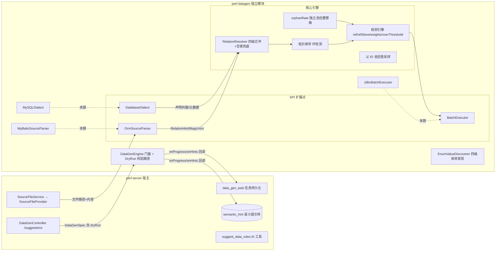

## 产品概述
Java 性能测试智能体平台（PerformanceTestor）压测前置「数据准备」能力升级：将 Mock 数据生成功能从 perf-server 拆为**独立可复用 Maven 模块 perf-datagen**（纯 Java 库，平台引入使用），本期实现 MyBatis + MySQL，保留多库多 ORM SPI 扩展点。灌入数据与数据库表间关系（含无外键约束的语义关联识别）、业务代码语义（枚举/魔法值）一致，并提供 Dry-Run 试运行防呆。

## 核心功能
- **独立 Mock 模块**：`DataGenEngine.execute(DataGenSpec, EngineListener)` 唯一入口，无状态不落库，进度与语义提示经回调交宿主；依赖严格 provided/optional 隔离，轻量 jar 不做 shade
- **联表数据生成**：表组拓扑排序（环检测报错定位到表）、父 ID 池插入后回查采样（>50 万分段）、`ref`/`refSkew` 热点倾斜（累计权重二分 O(log n)）、`orphanRate` **独立采样池后置替换** NULL/无效 ID（与 refSkew 池隔离，避免热行误伤）、自引用深度 5 限制、兼容旧单表请求
- **无外键关联识别（四级优先级）**：①显式规则 ②DB 声明外键 ③ORM 源码语义（resultMap association/collection、注解 SQL JOIN 正则辅助）④命名约定推断（`父表_id`、单复数归一、类型兼容、数据抽样置信度）；**空表兜底**：父表行数为 0 时无条件采纳命名推断（confidence=0.3/LOW，source=NAMING_EMPTY_TABLE_FALLBACK，回调提示"建议验收时确认"）；抽样策略：行数<100 全表、>100 随机 1000 条、500ms 超时降级为纯命名；低置信经建议接口确认采纳，不静默生效
- **枚举语义化（四级发现）**：MySQL ENUM 类型 → CHECK 约束 → 列注释「1=待支付 2=已支付」→ Java 枚举反查；weights 权重分布（如 [10,80,10]），杜绝随机串整批失败
- **魔法值感知**：MyBatis XML、注解 SQL 字面量、静态常量、Java 枚举扫描，产出「表列→候选值（含来源 文件：行号）」；范围谓词生成 `overThreshold` 规则；源码不可读时降级纯 DB 元数据并黄色警告
- **MyBatis 解析容错（防 SQL 碎片化）**：关联识别以 XML `<resultMap>` 的 `<association>`/`<collection>` 为主（AST 成功率 100%）；注解 SQL JOIN 仅简单正则辅助、匹配失败静默跳过；单文件解析超时 5s 强制跳过，不中断灌数
- **Dry-Run 试运行**：完整执行拓扑排序、规则解析、SQL 预检、外键池预检查但不 INSERT，回调报告预计行数/事务时长估算/缺失警告；前端“试运行通过”后启用“正式执行”
- **宿主集成**：任务落库（总行/已插/当前表进度）、semantic_hint 语义提示库、/suggestions 建议采纳、AI 工具 suggest_data_rules（无 API Key 降级规则档）、灌数后端点非空自检
- **前端数据准备台**：表组配置、规则编辑器（refSkew 高倾斜附“建议降 BATCH_SIZE 或分区”小字警告）、建议一键采纳、多表进度、试运行/正式执行双按钮、降级黄色警告


## 技术栈
- **新模块 perf-datagen**：纯 Java 17 库；`com.github.javaparser:javaparser-core`（compile）；jackson-databind/slf4j-api/mysql-connector-j 均为 provided/optional（宿主统一提供）；父 pom dependencyManagement 统一版本（含 jackson-bom）+ modules 注册；不做 maven-shade 重定位、不做 Uber-Jar（目标 <200KB），杜绝 Classpath Hell
- **宿主 perf-server**：Spring Boot 3.2.5 + MyBatis，沿用现有分层（controller/datagen/source/entity/mapper/ai）
- **前端**：Vue 3 + TypeScript（perf-web，沿用 StressCenterView 样式与 dataGenApi）
- **SQL**：sql/init.sql 与 init_empty.sql 幂等迁移（沿用 @col_exists + PREPARE 范本）

## 实施方案
1. **模块边界（核心决策）**：引擎无状态不依赖持久化；SPI 三接口（DatabaseDialect/OrmSourceParser/BatchExecutor）签名不预设 MySQL 特有语义，本期仅 MySQL/MyBatis 实现；模块源码输入双模式（磁盘目录自足 / 宿主 SourceFileProvider 以文件路径+内容供给）
2. **核心引擎（Dry-Run 优先）**：先实现校验路径（表存在性/规则可解析/INSERT SQL 预检/FK 池预检/环检测/预计行数与最大事务时长估算），再实现正式写入；现有 DataGenService 批量逻辑迁 JdbcBatchExecutor（BATCH_SIZE=500、每表独立事务），MySQL 特有逻辑（rewriteBatchedStatements、useInformationSchema、getImportedKeys、ENUM TYPE_NAME 解析）迁 MySQLDialect
3. **关联识别与容错**：RelationResolver 四级来源合并去重（同边取最高优先级）；NamingRelationResolver 编码空表兜底与抽样降级；**refSkew×orphanRate 隔离规则**：先生成 refSkew 加权结果，再按 orphanRate 比例随机替换为 NULL 或无效 ID；JdbcBatchExecutor 注释显式警告极高 refSkew（热行承载>50% 子行）建议降 BATCH_SIZE（500→200）或子表分区
4. **MyBatis 解析容错**：JavaParser 解析 XML resultMap 关联声明 + `@Select` 注解 SQL 简单正则（失败静默跳过）+ SqlLiteralExtractor 魔法值抽取（容错）；超时 5s 强制跳过
5. **宿主集成**：DataGenSpecAdapter（含 connId 凭据解析、旧单表兼容）、SourceFileProvider、SemanticHint 落库、/suggestions、SuggestDataRulesTool（沿用 List<AiTool> 自动注册，规则档直出 ruleJson，LLM 档上下文增强，无 Key 降级）、端点非空自检写任务详情
6. **性能**：refSkew 二分采样 O(log n)/行；命名推断抽样单次执行缓存不阻塞主流程；JDBC URL 白名单保持 jdbc:mysql://；模块内纯逻辑单测覆盖拓扑/规则含 overThreshold/命名推断含空表兜底/注释解析/SQL 抽取/IdPool 采样/orphanRate 独立池替换

## 架构设计



## 目录结构

```
perf-datagen/                                   # [NEW] 独立 Mock 数据模块（纯 Java 库）
├── pom.xml                                     # javaparser compile；jackson/slf4j/mysql provided+optional；不做 shade
└── src/main/java/com/perftestor/datagen/
    ├── DataGenEngine.java                      # 门面：execute(DataGenSpec 含 dryRun, EngineListener)
    ├── spi/                                    # DatabaseDialect/OrmSourceParser/BatchExecutor 三接口（扩展点）
    ├── model/                                  # DataGenSpec/TableSpec/SchemaMetadata/RelationHint/MagicHint/EngineListener
    ├── engine/
    │   ├── RelationResolver.java               # 四级来源合并（explicit>db_fk>orm_join>naming）
    │   ├── NamingRelationResolver.java         # 命名推断+空表兜底+抽样超时降级
    │   ├── RuleEngine.java                     # fixed/range/enum+weights/ref/refSkew/overThreshold
    │   ├── TopoSorter.java / IdPool.java       # 环检测 / 主键池分段采样+二分倾斜采样
    ├── enumv/EnumValueDiscoverer.java          # ENUM→CHECK→列注释→Java 枚举 四级发现
    ├── dialect/mysql/MySQLDialect.java         # 承接 rewriteBatchedStatements/useInformationSchema/元数据
    ├── executor/JdbcBatchExecutor.java         # addBatch 迁入+每表独立事务+refSkew 高倾斜警告注释
    ├── orm/mybatis/MyBatisSourceParser.java    # resultMap association 优先+注解正则辅助+5s 超时
    └── util/SqlLiteralExtractor.java           # SQL 字面量/JOIN ON 容错抽取
perf-datagen/src/test/java/...                  # 纯逻辑单测（含空表兜底/orphanRate 独立池）
perf-server/src/main/java/com/perfserver/
├── datagen/
│   ├── DataGenSpecAdapter.java                 # [NEW] DataGenRequest+connId → DataGenSpec
│   ├── DataGenService.java                     # [MODIFY] 编排引擎+落库（进度/提示回调写库）
│   ├── DataGenRequest.java / ColumnInfo.java   # [MODIFY] tables/orphanRate/repoId；comment/suggestedValues/suspectEnum
├── source/SourceFileProvider.java              # [NEW] 索引 → 模块文件供给适配
├── entity/SemanticHint.java + mapper/SemanticHintMapper.java  # [NEW]
├── controller/DataGenController.java           # [MODIFY] /tasks 表组+dryRun、columns 建议、/suggestions
└── ai/tools/DataGenTool.java [MODIFY] + SuggestDataRulesTool.java [NEW]
sql/init.sql、init_empty.sql                    # [MODIFY] data_gen_task 三列 + semantic_hint 表（幂等）
perf-web/src/api/index.ts + views/StressCenterView.vue  # [MODIFY] 表组/规则编辑/建议采纳/试运行按钮/警告
perf-demo/.../DemoDataInitializer.java          # [MODIFY] 幂等补 perf_order FK 约束与列注释
pom.xml（父）                                    # [MODIFY] modules+dependencyManagement（javaparser/jackson-bom）
docs/plans/datagen-optimization_交接.md          # [MODIFY] 更新任务状态与模块架构说明
```

## 关键代码结构

```java
/** 引擎门面：dryRun=true 时完整执行校验预检但不 INSERT，经回调报告预计行数/时长/缺失警告 */
public interface DataGenEngine {
    EngineResult execute(DataGenSpec spec, EngineListener listener);
}
public interface EngineListener {
    void onProgress(long totalRows, long insertedRows, String currentTable);
    void onHints(List<MagicHint> magicHints, List<RelationHint> relationHints);
}
```

```java
/** 空表兜底：父表 0 行时无条件采纳命名推断（LOW 置信度，交宿主提示确认） */
RelationHint hint = rowCount == 0
    ? RelationHint.namingFallback(child, parent, 0.3, "NAMING_EMPTY_TABLE_FALLBACK")
    : sampleVerified(...); // <100 全表 / >100 抽样 1000 条 / 500ms 超时降级
```


## Agent Extensions
### Skill
- **lsp-code-analysis**
  - Purpose: DataGenService 逻辑迁出至 perf-datagen 前，定位 DataGenService/DataGenRequest/ColumnInfo/RuleSet 全部符号引用与调用链
  - Expected outcome: 输出受影响符号清单，确保 DataGenTool/DataGenController 等调用方迁移后 MySQL 行为零差异
### SubAgent
- **code-explorer**
  - Purpose: 实施语义解析与宿主集成前，深挖 SourceFileService 索引结构与文件读取接口、AiAgentService 规则档流程与 AbstractAiTool 注册链路、StressCenterView gen 状态与 dataGenApi 结构
  - Expected outcome: 输出精确修改点清单（方法签名、状态字段、API 封装位置），避免漏改误改
