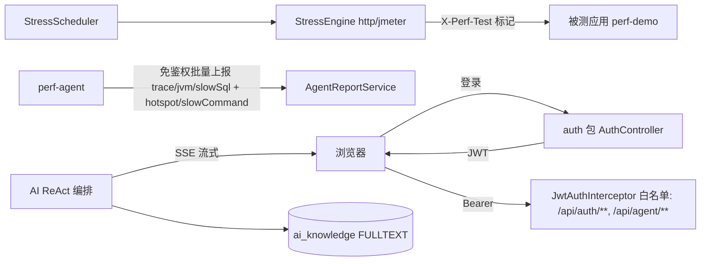

## 产品概述
基于前期对 PerformanceTestor（Java 性能测试智能体平台，四模块）的深度代码评估，实施全面改进：修复 P0/P1/P2 三级缺陷、完成 8 项工程快速优化、并按四阶段落地全部新功能，最终通过端到端全链路验证。

## 执行进度（2026-08-31 更新）

| 里程碑 | 状态 | 说明 |
| --- | --- | --- |
| M0 P0 正确性与安全修复 | ✅ 完成 | JWT 鉴权 / 探针根语义 / 压测引擎加固 / agent JVM 修复，44 个单测 |
| M1 灌数引擎修复 | ✅ 完成 | 引擎无状态化 + 拓扑精确环路，7 个新单测 |
| M2 前端工程优化 | ✅ 完成 | 依赖瘦身 / Pinia stores / 组件拆分 / 404+title |
| M3 二阶段功能 | ✅ 完成 | CPU 热点采样 / JMeter 适配 / 定时压测基线告警 / 流量标记，11 个新单测 |
| M4 三阶段功能 | ✅ 完成（3/3） | ✅ AI ReAct+SSE+知识库 / ✅ 修复效果自动验证 / ✅ 容量科学化（拟合+R²+拐点+置信区间，14 个新单测） |
| M5 四阶段功能 | ✅ 完成（3/3） | ✅ PG 方言+JPA 解析 / ✅ 中间件观测 / ✅ 报告导出（PDF/Word，15 个新单测） |
| M6 端到端验证 | ✅ 完成 | 全量构建（228 测试）+ 真实 MySQL/PG 容器全链路验证；E2E 修复 3 个真实缺陷 |

验证状态：后端全模块 `mvn test` 通过（228 个测试，0 失败）；前端 `vue-tsc` + `vite build` 通过。
**M0–M6 全部 16 项任务已完成**，端到端验证细节见 `docs/handoff/handoff-main.md` 第 2.2 节。

## 核心功能
- **安全鉴权**：管理员登录、平台接口统一鉴权（被测探针上报通道免鉴权）、前端登录页与路由守卫、未授权统一跳转、敏感密码与密钥安全化
- **观测正确性**：调用链以 HTTP 入口为根（消除半截链路与采样稀释）、GC 分类精确、方法级 CPU 热点火焰图、Redis/ES/MQ 慢命令统一治理
- **压测能力**：高并发无锁统计、预热期与阶梯加压、精确限流、JMeter 引擎真实可用、定时压测与版本间基线对比、超阈值告警通知、压测流量标记
- **AI 闭环**：多角色推理编排与流式对话输出、性能知识库沉淀与检索、修复落地后一键重放压测验证效果并自动关闭问题
- **数据与报告**：PostgreSQL 造数方言、容量曲线科学拟合与置信区间、性能报告导出
- **工程质量**：前端依赖瘦身与全局状态共享、巨型页面拆分为复用组件、补齐 404 与标题同步、死配置清理

## 视觉效果
新增登录页（深色毛玻璃卡片 + 荧光青绿呼吸按钮）、404 页（霓虹大数字悬浮动效）、报告打印页（屏幕深色/打印白底 A4 版式）；压测表单从两个巨型页面抽取为风格一致的复用组件；火焰图与慢命令视图沿用现有霓虹色系，全站视觉统一。


## 技术栈
- **后端**（沿用）：Spring Boot 3.2.5 + JDK 17 + MyBatis + MySQL 8；新增最小依赖：`jjwt` 0.12.x（鉴权）、`openhtmltopdf` 1.0.10（报告 PDF，仅 perf-server）
- **前端**（沿用）：Vue3 + TS + Vite + Tailwind + ECharts；卸载 `tdesign-vue-next`/`vue-echarts`（装而未用），启用已安装的 Pinia
- **探针**（沿用）：ByteBuddy Advice 内联增强；JMeter 走 CLI 零依赖（不引入 jmeter Maven 依赖）；知识库用 MySQL FULLTEXT（不引入向量库/ES）
- **项目约定**：新增表必须同步 `sql/init.sql` 与 `sql/init_empty.sql` 两份幂等脚本；Mapper XML 禁止 `${}`

## 实现方案（按里程碑）

### M0 — P0 正确性与安全修复 ✅（已完成 4/4）
1. **轻量 JWT 鉴权**：新增 `perf-server/.../auth/` 包（JwtService HS256 签发校验 / AuthController `POST /api/auth/login` / JwtAuthInterceptor / WebAuthConfig）；拦截器白名单精确放行 `/api/auth/login` 与 `/api/agent/**`（agent 无 JWT 能力，必须免鉴权）；账号密码与 jwt-secret 走 `application.yml` 环境变量占位 `${PERF_ADMIN_PASSWORD:admin123}`；父 POM dependencyManagement 统一管理 jjwt 版本。前端：`stores/auth.ts`（localStorage token）+ LoginView + `router.beforeEach` 守卫 + `http.ts` 请求拦截注入 Bearer / 401 清 token 跳登录（登录页自身 401 不跳转防死循环）；`scripts/*.sh` 密码全部改 `${MYSQL_PASSWORD:-root123}` 参数化
2. **探针根语义修复**：`TraceEnhancer` 增加对 `jakarta.servlet.Filter#doFilter` / `javax.servlet.Filter#doFilter` 的拦截作为唯一 trace 根；`TraceContext` 增加 NOT_SAMPLED 状态——根未命中采样时标记整链短路，下游业务方法 enter 检测标记直接跳过，一次性消除"重复 beginRoot 采样稀释（实际 trace 量 = 1-(1-p)^d）"与"半截链路缺入口元数据"两个问题
3. **压测引擎加固**：`StressStatistician` 去 `synchronized`——`LongAdder` 计数 total/error + 分片直方图（worker 按线程 hash 写独立分片桶数组，`collectWindow()` 汇总时无锁合并；保持 30000 桶 × 1ms 语义不变，报告口径兼容）；`StressTaskRequest` 增加 warmupSec（默认 10s，warmup 期不计入正式统计）/ rampUpSec（阶梯升并发）/ headers（自定义头，供流量标记）；QPS 限流从每 worker sleep 改全局 CAS 令牌桶；主线程 `Thread.sleep(50)` 忙轮询改精确 deadline 等待；sampler `shutdown()` 后补 `awaitTermination(2s)` 消除采样竞态
4. **agent JVM 修复**：`JvmCollector#isYoungGc` 改精确名称映射表（Copy/PS Scavenge/ParNew/G1 Young → Young；PS MarkSweep/MarkSweepCompact/CMS/G1 Mixed → Old；ZGC/Shenandoah 的 Cycles→Young、Pauses→Old；未知收集器归 Old 并一次性 warn）；`collectCpu` 缓存强转 `(com.sun.management.OperatingSystemMXBean)` 替代每次 `newPlatformMXBeanProxy`，用 `getCpuLoad()` 替换废弃 API；`MetricsReporter#stop` 补 final flush（drain 三队列尽力上报，3s 超时兜底，兑现注释承诺）；`AgentPremain#agentmain` 用 AtomicBoolean 幂等防双触发

### M1 — 灌数引擎修复 ✅（已完成 1/1）
5. `DefaultDataGenEngine` 的 ormHints 从 volatile 实例字段改为 `execute()` 方法内局部传递（兑现"引擎无状态"Javadoc，消除并发任务互踩）；`TopoSorter` 环检测后沿邻接表 DFS 提取真实环路（替代"列出全部未入序表"误导性报错）；补并发隔离与精确环路单测

### M2 — 前端工程优化 ✅（已完成 1/1）
6. 卸载 `tdesign-vue-next`/`vue-echarts`，`main.ts` 移除全量注册；建 `stores/repoStore.ts`/`appStore.ts` 消除 `sourceApi.repos()` 等 6 处重复拉取；从 StressCenterView（895 行）/QuickStartView（913 行）抽取 `components/stress/StressForm.vue` + `StressReport.vue` 公共组件；补 404 兜底路由与 `afterEach` 同步 document.title；`PerfServerApplication` 移除无效 `@EnableAsync`/`@EnableScheduling`（M3 落地定时调度时恢复后者并真正使用）

### M3 — 二阶段功能 ✅（已完成 3/3）
7. **CPU 热点采样**：agent 新增 `HotspotSampler`（守护线程 10ms 周期对 RUNNABLE 线程 `getStackTrace()`，栈帧 `ConcurrentHashMap<frame, LongAdder>` 聚合、上限 8192 帧防内存洪水，30s 批量上报 topN；`hotspotEnabled` 默认关）；`AgentReportService.handleReport` 扩展 hotspot 批量类型 + 新表 `hotspot_method`；前端 TraceAnalyzerView 增 CPU 火焰图 Tab
8. **JMeter 真实适配**：`JmeterStressEngine#run` 实现——JMX 模板生成（ThreadGroup/RampUp/ConstantThroughputTimer 映射现有参数）→ `ProcessBuilder` 调 `jmeter -n -t plan.jmx -l result.jtl` → 解析 JTL CSV（timeStamp/elapsed/success）回填 StressStatistician 重建分位统计；`jmeterHome` 可配，启动检测未安装时该引擎标记不可用并明确提示（不影响默认 http 引擎）
9. **定时压测/基线/告警**：新表 `stress_schedule`（调度表达式、任务模板 JSON、启用状态、基线版本、webhook 配置）+ `StressScheduler`（@Scheduled 30s 扫描到期任务，恢复 @EnableScheduling）；同场景（同 URL/并发/时长）按 appVersion 自动 diff QPS/P95/错误率；`NotifyService` 支持自定义 webhook 与钉钉/飞书消息模板（复用 capacity 阈值配置触发）；压测请求注入 `X-Perf-Test: 1` 标记头，perf-demo 演示 header 检测切影子表路由

### M4 — 三阶段功能 ✅（已完成 3/3）
10. **AI 编排升级** ✅：`AiAgentService` 升级 ReAct 显式循环（Thought/Action/Observation，`ReactStep` 结构化留痕，Observation 截断到 2000 字符防上下文膨胀，轮次上限 10 收尾摘要）；`PromptBuilder` 增 `AiRole` 三角色（压测执行/根因分析/修复建议）+ `detectRole(intent)` 路由，角色切换时 system prompt 原地替换保留历史；`LlmClient` 增 stream 模式（`StreamAccumulator` 合并 delta 与分片 tool_calls）；新增 `AiChatStreamController`（`POST /api/ai/chat/stream`，SseEmitter 300s，事件 token/thought/tool/observation/done/error）；新表 `ai_knowledge`（FULLTEXT ngram 中文检索）+ `AiKnowledgeService`（结论自动入库，正文 ≥40 字）+ `SearchKnowledgeTool`；前端 AiAssistantView 改 fetch+ReadableStream 逐 token 渲染（含停止按钮、ReAct 过程留痕）
11. **修复效果自动验证** ✅：`performance_issue` 加列 `stress_task_id`/`verify_json`/`verify_time`（两份脚本 + `add_column_if_missing` 幂等补列）；`createFromStress` 自动快照场景、`bindStressTask` 支持补绑；新增 `IssueVerifyService.verify()`——重放同场景压测（同 URL/方法/并发/时长/限流）→ `BaselineCompareService.diff(重放, 快照)` → P95 降幅 ≥30% 且无回归则自动 `resolved` 并写 `verify_json`；接口 `POST /api/source/issues/{id}/verify` 与 `/bind-stress`；前端 OptimizeView 加"验证修复"按钮与结果卡片（前后指标 + 基线对比表格 + 无快照补绑入口）
12. **容量科学化** ✅：新增 `capacity/CurveFitter`（二项式最小二乘解 3×3 正规方程组、`qps = a·c² + b·c + k`、R²=1-SSE/SST、a<0 时顶点 `c*=-b/2a` 为理论最大并发、非均匀网格二阶差分拐点检测、QPS 泊松 σ=√qps 与 P95 分位数反推 σ 的 95% CI）；`CapacityAnalyzer` 拆为插值（原判定逻辑零改动）+ `fillScience` 补充模型（过载档位截断、<3 档静默跳过）；`CapacityResult` 向后兼容新增 `model/r2/fittedCurve/confidenceInterval/rtKneeConcurrency`（CurvePoint 补 `p50Ms`/`totalRequests`）；前端 StressReport 容量卡片展示拟合公式/R²/理论拐点/RT 拐点/分档置信区间表，并新增拟合曲线图（实测散点+拟合虚线+95% 置信带+拐点 diamond+RT 拐点 markLine）

### M5 — 四阶段功能 ✅（已完成 3/3）
13. **PG 方言** ✅：perf-datagen 新增 `PostgreSQLDialect`（information_schema 元数据、双引号标识符、CHECK 约束枚举发现、SERIAL 识别）+ `JpaSourceParser`（JavaParser 解析 @Entity/@ManyToOne/@OneToMany 构建 relationHints）；H2 `MODE=PostgreSQL` 单测复用现有 SPI 测试模式；DataGenService 按 JDBC URL 自动路由 `supports()`
14. **中间件观测** ✅：TraceEnhancer 沿用 JDBC 拦截模式新增 Redis（Lettuce sync/Jedis 命令接口）、ES client、RabbitMQ Channel 拦截；超阈值入新表 `slow_command`（type/command/costMs/traceId 关联调用链）；`middlewareEnabled` 默认关控制开销；前端慢 SQL Tab 扩展为慢命令合并视图
15. **报告导出** ✅：`ReportHtmlRenderer` 渲染自包含 HTML（内联 CSS：A4/白底黑字/表格边框/分页控制，须输出**良构 XHTML**——openhtmltopdf 用 TRaX XML 解析器，void 元素未自闭合会直接抛 SAXParseException）；`ReportExportService` 支持 html/pdf/doc 三格式（PDF 走 openhtmltopdf 1.0.10 + PDFBox 后端 `PdfRendererBuilder`，探测并注册系统中文字体避免中文变方块；Word 用 MHTML/Office XML 命名空间头 + `.doc` 扩展名的 HTML 兼容方案，**不引入 Apache POI**）；`ReportExportController` 提供 `GET /api/reports/export?stressTaskId=&format=&printMode=`，直接返回 `ResponseEntity<byte[]>` 绕过 `ApiResponse` 包壳，文件名按 RFC 5987 编码；前端 `StressReport` 头部新增「打印预览 / 导出 PDF / 导出 Word」（服务端渲染统一报告，前端不重复实现打印样式）

### M6 — 端到端验证 ✅（已完成）
16. `mvn test` 全模块（为 GC 映射/无锁统计/精确环路/无状态引擎补新单测）+ `npm run build`（vue-tsc）+ `scripts/build.sh`；`scripts/start-all.sh` 拉起 MySQL+server+demo+web 后验证：登录流程（未登录 401 → 登录取 token → 携带访问）✅、agent 免鉴权上报正常 ✅、压测 `GET /api/user/list?limit=200` 20 并发复现基线（QPS≈300/P95≈135ms，实测 QPS 323.9/P95 112ms/错误率 0%）且 warmup 生效（首秒 P99 无冷启动尖刺）✅、CPU 热点/基线 diff/报告导出冒烟 ✅（无 jmeter 环境时该项降级跳过）

**E2E 暴露并修复的 3 个真实缺陷**（纯单测无法发现）：① 全项目缺失 PostgreSQL JDBC 驱动 → 父 pom 托管 `postgresql:42.7.3`（server runtime / datagen test）；② 枚举发现值未参与值生成，枚举列被填随机长串 → `DefaultDataGenEngine` 增加 `dbEnumValues` 缓存（键 `表名.列名`，单例 Bean 每次 execute 清空）；③ PG 严格类型致枚举/JSON 列写入失败 → `PostgreSQLDialect.enrichJdbcUrl` 追加 `stringtype=unspecified`。新增真实 PG 冒烟用例 `PostgreSQLDialectLiveTest`（5 例）+ `PostgresEnumGenerationLiveTest`（2 例），无 PG 实例时自动跳过。

## 架构设计（新增部分）


## 目录结构（关键文件）
```
workspace/
├── pom.xml                                    # [MODIFY] dependencyManagement 增 jjwt/openhtmltopdf 版本
├── sql/{init.sql,init_empty.sql}              # [MODIFY] 新增 hotspot_method/stress_schedule/ai_knowledge/slow_command 表（两份同步）
├── perf-server/src/main/java/com/perfserver/
│   ├── auth/                                  # [NEW] JwtService/AuthController/JwtAuthInterceptor/WebAuthConfig
│   ├── PerfServerApplication.java             # [MODIFY] 移除死注解（M3 恢复 @EnableScheduling）
│   ├── stress/HttpStressEngine.java           # [MODIFY] 令牌桶/精确等待/竞态/warmup/ramp-up/标记头
│   ├── stress/StressStatistician.java         # [MODIFY] LongAdder+分片直方图无锁化（对外 API 不变）
│   ├── stress/JmeterStressEngine.java         # [MODIFY] JMX 生成+CLI+JTL 解析真实实现
│   ├── stress/StressScheduler.java            # [NEW] 定时压测调度
│   ├── stress/BaselineCompareService.java     # [NEW] 版本基线 diff
│   ├── notify/NotifyService.java              # [NEW] webhook/钉钉/飞书告警
│   ├── collector/AgentReportService.java      # [MODIFY] 扩展 hotspot/slowCommand 上报类型
│   ├── capacity/CapacityAnalyzer.java         # [MODIFY] 拟合+置信区间+拐点
│   ├── ai/AiAgentService.java                 # [MODIFY] ReAct 循环+三角色路由
│   ├── ai/LlmClient.java                      # [MODIFY] stream 模式
│   ├── ai/AiChatStreamController.java         # [NEW] SSE 接口
│   ├── ai/tools/SearchKnowledgeTool.java      # [NEW] 知识库检索工具
│   ├── source/SourceIssueService.java         # [MODIFY] 场景快照+verify 验证闭环
│   ├── report/ReportExportService.java        # [NEW] HTML→PDF/.doc 导出
│   └── resources/application.yml              # [MODIFY] auth 配置+环境变量占位+新开关
├── perf-agent/src/main/java/com/perfagent/
│   ├── AgentPremain.java                      # [MODIFY] agentmain 幂等
│   ├── config/AgentConfig.java                # [MODIFY] hotspotEnabled/middlewareEnabled 等新参数
│   ├── instrumentation/TraceEnhancer.java      # [MODIFY] Filter 入口拦截+中间件客户端拦截
│   ├── trace/TraceContext.java                # [MODIFY] NOT_SAMPLED 整链短路
│   ├── jmx/JvmCollector.java                  # [MODIFY] GC 映射表+CPU MXBean 缓存
│   ├── reporter/MetricsReporter.java          # [MODIFY] stop 补 final flush+新数据类型
│   └── hotspot/HotspotSampler.java            # [NEW] CPU 热点弱采样
├── perf-datagen/src/main/java/com/perftestor/datagen/
│   ├── DefaultDataGenEngine.java              # [MODIFY] 无状态化（ormHints 局部传递）
│   ├── TopoSorter.java                        # [MODIFY] DFS 精确环路
│   ├── dialect/PostgreSQLDialect.java         # [NEW] PG 方言
│   └── orm/JpaSourceParser.java               # [NEW] JPA 注解解析
├── perf-web/src/
│   ├── main.ts                                # [MODIFY] 移除 TDesign 注册
│   ├── router/index.ts                        # [MODIFY] /login、/404、守卫、title 同步、/report/print
│   ├── api/http.ts                            # [MODIFY] Bearer 注入+401 跳转
│   ├── api/index.ts                           # [MODIFY] 新增 auth/report/schedule 等 API
│   ├── stores/{auth,repo,app}.ts              # [NEW] Pinia 状态共享
│   ├── views/{LoginView,NotFoundView,ReportPrintView}.vue  # [NEW]
│   ├── components/stress/{StressForm,StressReport}.vue     # [NEW] 压测公共组件
│   └── views/{StressCenterView,QuickStartView,TraceAnalyzerView,AiAssistantView}.vue  # [MODIFY] 复用组件/火焰图 Tab/SSE
└── scripts/{start-all,start-server,start-agent}.sh         # [MODIFY] 密码环境变量化
```

## 关键代码结构
```java
/** StressStatistician 无锁化重构契约：对外 API 签名不变，保证全部调用点零改动兼容 */
public class StressStatistician {
    public void record(long costMs, boolean error);   // 无锁：LongAdder + 线程分片桶
    public WindowStats collectWindow();               // 仅汇总合并时轻量同步
    public StageSnapshot stageSnapshot();             // 语义不变
}
```

## 实现注意（防回归）
- `/api/agent/**` 必须保持免鉴权；白名单用前缀匹配并在拦截器单测覆盖
- agent 改动保持热路径零新增锁：NOT_SAMPLED 判断复用现有单 ThreadLocal 读
- StressStatistician 桶语义与分位口径不变，历史报告对比兼容
- perf-datagen 公共接口变更需同步 perf-server 宿主层 DataGenService 调用点
- H2 单测不依赖外部环境；JMeter/PG 仅在可用环境验证，缺环境时降级跳过并留日志


## 设计方案
沿用现有深色科技风（深蓝黑底 + 荧光青绿霓虹 + 毛玻璃），新增页面与组件保持七屏视觉一致：

- **登录页 /login**：脱离 MainLayout 的全屏独立页；深色底叠加径向渐变光晕；中央 glass-card 毛玻璃卡片（glass 阴影）承载平台标识、账号/密码输入（复用现有 input-* 样式类）、荧光青绿渐变主按钮带 pulseGlow 呼吸动效；登录失败红色提示条 + 输入框抖动动效；输入框 focus 态 neon 描边
- **404 页**：超大 neon 渐变描边数字 404（float 悬浮动画）+ 引导文案 +「返回总览」ghost 按钮
- **报告打印页 /report/print**：屏幕端保持深色主题，`print:` 变体切换白底 A4 版式（黑白友好配色、表格去阴影、分页控制）
- **压测公共组件**：StressForm（项目/接口选择、URL 拼接、并发/时长/QPS/预热参数）与 StressReport（指标卡 + 实时 QPS 曲线）从两个 900 行巨型视图抽取，复用 metric-card/glass-card/btn-primary 现有全局类
- **CPU 火焰图/慢命令视图**：沿用 TraceAnalyzerView 现有 ECharts 霓虹色系火焰图；慢命令以类型徽章（redis/es/mq）区分
- **响应式**：沿用现有断点策略，登录页居中自适应窄屏

## Agent Extensions

### SubAgent
- **code-explorer**
  - Purpose：各任务执行前精确定位目标类当前实现细节（前序任务会使评估阶段记录的行号漂移）；为探针 Filter 入口拦截、Redis/ES/MQ 客户端拦截点做跨文件调用链与匹配器分析
  - Expected outcome：产出准确的修改点清单（类/方法/行为依据），避免基于过期评估结论误改

### Skill
- **lsp-code-analysis**
  - Purpose：StressStatistician 无锁化重构与前端巨型组件拆分时，做符号引用、调用层级与影响面分析，确认无遗漏调用点；验证 StressEngine 对外契约改动不破坏现有调用方
  - Expected outcome：重构前后引用关系完整清单，调用点零遗漏

## TODOS

- [x] 实现轻量 JWT 鉴权：auth 包+拦截器白名单+登录页/守卫/401+密码环境变量化（14 单测）
- [x] 用 [subagent:code-explorer] 修复探针根语义：Filter 入口拦截+未采样整链短路（8 单测，含一请求一链路/嵌套 Filter/上下文存活期回归）
- [x] 用 [skill:lsp-code-analysis] 无锁化压测统计+warmup/ramp-up+令牌桶限流+竞态修复（9 单测）
- [x] 修复 GC 精确映射+CPU MXBean 缓存+final flush+agentmain 幂等（13 单测）
- [x] 灌数引擎无状态化（ormHints 局部传递）+拓扑环 DFS 精确提取+补单测（7 新单测）
- [x] 卸载未用依赖+建 Pinia stores+拆分压测公共组件+404/title 补齐（vue-tsc+build 通过）
- [x] agent CPU 热点弱采样+上报存储+前端火焰图 Tab（新表双脚本同步）
- [x] 实现 JMeter 引擎：JMX 生成+CLI 调用+JTL 解析+未安装降级（5 单测）
- [x] 定时压测调度+版本基线 diff+webhook 告警+压测流量标记（6 单测）
- [x] AI ReAct 多角色编排+SSE 流式输出+知识库 FULLTEXT 检索工具（33 新单测）
- [x] 问题场景快照+一键重放压测+指标 diff+达标自动关闭（9 新单测）
- [x] 容量评估非线性拟合+置信区间+拐点检测（CurveFitter 二项式最小二乘+R²+二阶导拐点+95% CI，结果 JSON 向后兼容加 model/r2/fittedCurve/confidenceInterval/rtKneeConcurrency，14 单测）
- [x] PostgreSQLDialect+JpaSourceParser+H2 PG 模式单测+URL 路由（PostgreSQLDialect：URL 路由 supports(jdbc:postgresql:)、reWriteBatchedInserts 增强、JDBC DatabaseMetaData 元数据、双引号标识符、pg_enum 原生枚举 + CHECK 约束文本解析双通道枚举发现、SERIAL/BIGSERIAL（nextval 默认值）识别；JpaSourceParser：解析 @Entity/@Table/@ManyToOne/@OneToOne/@JoinColumn/@ManyToMany/@JoinTable 产出 relationHints（SRC_ORM_JOIN 0.9），mappedBy 反向声明跳过；公共片段抽取为 orm/support/JavaSourceHints 供 MyBatis/JPA 复用；DefaultDataGenEngine 改造为多方言 List<DatabaseDialect>（按 URL 路由）+ 多解析器 List<OrmSourceParser>（特征检测 + order 排序合并）；DataGenEngineConfig 注册 MySQL+PG / MyBatis+JPA；DataGenService.validateDbUrl 改为按已注册方言 supports 判别、connect 的 URL 增强改为走方言 enrichJdbcUrl（原硬编码 MySQL 参数会污染 PG 连接串）；22 新单测）
- [x] Redis/ES/MQ 拦截+慢命令上报与前端视图（agent：`MiddlewareSupport` 命令渲染（字符串/数字/byte[] 带长度前缀且仅解码前 256B/数组集合限 4 元素/复杂对象仅记类型名避免大序列化/超 6 参记 +n more/命令总长截断 1000；enter 仅记 nanoTime+参数引用，exit 先判阈值未超直接返回）+ `RedisInterceptor`/`EsInterceptor`/`MqInterceptor` 三个 Advice；`TraceEnhancer` 注册三类类型匹配器（Lettuce/Jedis 按 `hasSuperType(named(...))` 类型名匹配故 agent 零 Redis 依赖、ES RestClient 含自身、RabbitMQ Channel 的 basicPublish 等 11 个命令方法）+ 复用 `middlewareMethods()` 统一排除静态/抽象/合成/桥接/close/生命周期；`AgentConfig` 新增 `middlewareEnabled`（默认 false）与 `slowCommandThresholdMs`（默认 100）；`MetricsReporter` 新增 slowCommand 队列 `reportSlowCommand` + `dropped.slowCommand` + 未知项目/停机时清理队列；`TraceContext.currentTraceId()` 补齐链路关联。server：`SlowCommand` 实体 + `slow_command` 表（idx_app_time/idx_type/idx_trace/idx_cost）+ `SlowCommandMapper`（batchInsert/query/findByTraceId）+ `AgentReportService.saveSlowCommands`（类型归一小写、command 截断 1000 防超 VARCHAR(1024)、缺 type 跳过）+ `MetricQueryService.slowCommands` + `GET /api/slow-commands` + DataCleanup 级联清理。前端：慢 SQL 列表升级为「慢命令」合并视图（SQL/Redis/ES/MQ 统一结构按耗时倒序 + 类型徽标配色 + 类型筛选，选定具体中间件类型时交由后端过滤减少传输）；`scripts/start-agent.sh` 新增 `MIDDLEWARE_ENABLED`/`SLOW_COMMAND_THRESHOLD_MS` 开关；21 新单测）
- [x] 报告打印页+PDF/Word 导出（`ReportHtmlRenderer` 自包含 HTML 渲染（内联 CSS：A4/白底黑字/表格边框/卡片不跨页断裂，须为良构 XHTML 否则 openhtmltopdf 的 TRaX 解析器直接报错）+ `ReportExportService`（html/pdf/doc 三格式；PDF 走 openhtmltopdf+PDFBox 并探测注册系统中文字体；Word 用 MHTML/Office XML 头 + .doc 扩展名的 HTML 兼容方案，零 Apache POI 依赖）+ `ReportExportController`（`GET /api/reports/export?stressTaskId=&format=&printMode=`，直接返回 ResponseEntity 绕过 ApiResponse 包壳，RFC 5987 中文文件名）+ 前端 StressReport 头部「打印预览 / 导出 PDF / 导出 Word」三按钮（打印预览与下载均用裸 axios 携带 token，因封装实例响应拦截器会解包丢失 Content-Disposition，且 window.open 直开无 JWT 会被 401）；15 单测）
- [x] 全量构建+单测+start-all.sh 全链路压测验证与新功能冒烟（228 测试全过；真实 MySQL 8.0 + PostgreSQL 16 容器端到端：登录鉴权/agent 免鉴权上报/基线压测复现 QPS 323.9 P95 112ms 错误率 0%/warmup 生效/分档压测拟合 R²=0.9558/报告导出三格式/数据清理级联/11 个接口冒烟全 200/PG 方言与灌数；E2E 暴露并修复 3 个真实缺陷：缺失 PG JDBC 驱动、枚举发现值未参与生成、PG 严格类型致枚举列写入失败）