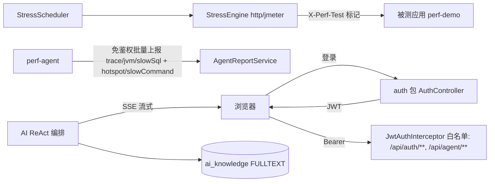

# PerformanceTestor 平台改进计划

> 生成日期：2026-08-30　状态：执行中　来源：全量代码评估结论（docs/plans 之外的评估报告见对话记录）
> 范围决策（用户确认）：全部四阶段功能 + 轻量 JWT 鉴权 + 端到端验证

## 一、背景与目标

基于对四个模块（perf-server 99 文件 / perf-agent 15 文件 / perf-datagen 32 文件 / perf-web 全部视图）的深度代码评估，按六大里程碑逐步修复 P0/P1/P2 三级缺陷、完成 8 项工程快速优化、并落地四阶段新功能，最终通过端到端全链路验证。

## 二、里程碑与任务清单

### M0 — P0 正确性与安全修复

| 任务 | 内容 |
| ---- | ---- |
| 轻量 JWT 鉴权 | 后端新增 `auth/` 包（JwtService HS256 / AuthController `POST /api/auth/login` / JwtAuthInterceptor / WebAuthConfig）；白名单放行 `/api/auth/**` 与 `/api/agent/**`（探针无 JWT 能力必须免鉴权）；账号密码与 jwt-secret 走环境变量占位；前端 stores/auth.ts + LoginView + router.beforeEach 守卫 + http.ts Bearer 注入与 401 统一跳转；scripts 密码参数化 |
| 探针根语义修复 | TraceEnhancer 拦截 `jakarta/javax.servlet.Filter#doFilter` 作为唯一 trace 根；TraceContext 增加 NOT_SAMPLED 状态——根未命中采样时整链短路，消除采样稀释（1-(1-p)^d）与半截链路 |
| 压测引擎加固 | StressStatistician 去 synchronized（LongAdder + 线程分片直方图，30000 桶×1ms 语义不变，对外 API 不变）；warmupSec（默认 10s 不计入正式统计）/ rampUpSec 阶梯升并发 / headers 自定义头；QPS 限流改全局 CAS 令牌桶；主线程忙轮询改精确 deadline 等待；sampler shutdown 补 awaitTermination(2s) |
| agent JVM 修复 | isYoungGc 改精确收集器名称映射表（Copy/PS Scavenge/ParNew/G1 Young→Young；PS MarkSweep/MarkSweepCompact/CMS/G1 Mixed→Old；ZGC/Shenandoah Cycles→Young、Pauses→Old；未知归 Old 并一次性 warn）；collectCpu 缓存强转 OperatingSystemMXBean、getCpuLoad() 替换废弃 API；MetricsReporter#stop 补 final flush（3s 超时兜底）；agentmain AtomicBoolean 幂等 |

### M1 — 灌数引擎修复

- `DefaultDataGenEngine` ormHints 从 volatile 实例字段改 execute() 内局部传递（兑现"引擎无状态"契约，消除并发任务互踩）
- `TopoSorter` 环检测后 DFS 提取真实环路（替代"列出全部未入序表"）
- 补并发隔离与精确环路单测

### M2 — 前端工程优化

- 卸载 tdesign-vue-next / vue-echarts（装而未用），main.ts 移除全量注册
- 建 stores/repoStore.ts / appStore.ts，消除 sourceApi.repos() 等 6 处重复拉取
- StressCenterView（895 行）/ QuickStartView（913 行）抽取 components/stress/StressForm.vue + StressReport.vue
- 补 404 兜底路由、afterEach 同步 document.title
- PerfServerApplication 移除无效 @EnableAsync/@EnableScheduling（M3 恢复后者）

### M3 — 二阶段功能

- **CPU 热点采样**：agent 新增 HotspotSampler（守护线程 10ms 周期采 RUNNABLE 线程栈，ConcurrentHashMap<frame,LongAdder> 聚合、上限 8192 帧，30s 批量上报 topN，hotspotEnabled 默认关）；AgentReportService 扩展 hotspot 类型 + 新表 hotspot_method；前端火焰图 Tab
- **JMeter 真实适配**：JMX 模板生成（ThreadGroup/RampUp/ConstantThroughputTimer）→ ProcessBuilder 调 `jmeter -n -t plan.jmx -l result.jtl` → 解析 JTL CSV 回填分位统计；jmeterHome 可配，未安装降级提示
- **定时压测/基线/告警**：新表 stress_schedule + StressScheduler（@Scheduled 30s 扫描）；同场景按 appVersion 自动 diff QPS/P95/错误率；NotifyService 支持 webhook/钉钉/飞书；压测请求注入 `X-Perf-Test: 1` 标记头，perf-demo 演示 header 检测影子表路由

### M4 — 三阶段功能

- **AI 编排升级**：ReAct 显式循环（Thought/Action/Observation，工具结果截断防上下文膨胀）；压测执行/根因分析/修复建议三角色路由；`POST /api/ai/chat/stream` SseEmitter 流式（LlmClient stream 模式）；新表 ai_knowledge（FULLTEXT）+ 分析结论自动入库 + search_knowledge 工具；前端流式渲染
- **修复效果自动验证**：问题创建时快照压测场景；`POST /api/source/issues/{id}/verify` 重放同场景压测 → 前后指标 diff → 达标自动关闭问题
- **容量科学化**：二项式/指数拟合 + RT-并发二阶导拐点检测 + 分档采样方差置信区间；结果 JSON 增 model/r2/fittedCurve（向后兼容）

### M5 — 四阶段功能

- **PG 方言**：PostgreSQLDialect（information_schema、双引号标识符、CHECK 枚举、SERIAL 识别）+ JpaSourceParser（@Entity/@ManyToOne/@OneToMany）；H2 MODE=PostgreSQL 单测；DataGenService 按 URL 自动路由
- **中间件观测**：TraceEnhancer 沿 JDBC 拦截模式新增 Redis（Lettuce/Jedis）、ES client、RabbitMQ Channel 拦截；超阈值入新表 slow_command；middlewareEnabled 默认关；前端慢命令合并视图
- **报告导出**：ReportPrintView 打印页（print: 变体白底 A4）+ openhtmltopdf PDF（`GET /api/reports/export?stressTaskId=&format=pdf|doc`，Word 用 HTML .doc 零依赖）

### M6 — 端到端验证

- mvn test 全模块（GC 映射/无锁统计/精确环路/无状态引擎补新单测）+ npm run build（vue-tsc）+ scripts/build.sh
- start-all.sh 拉起全链路验证：登录流程（未登录 401→登录→携 token 访问）、agent 免鉴权上报、压测 `GET /api/user/list?limit=200` 20 并发复现基线（QPS≈300/P95≈135ms）且 warmup 生效、CPU 热点/基线 diff/报告导出冒烟（无 jmeter 环境降级跳过）

## 三、技术约束（防回归）

1. `/api/agent/**` 必须保持免鉴权；白名单前缀匹配需单测覆盖
2. agent 热路径零新增锁：NOT_SAMPLED 判断复用现有单 ThreadLocal 读
3. StressStatistician 桶语义与分位口径不变，历史报告对比兼容
4. perf-datagen 公共接口变更需同步 perf-server 宿主层 DataGenService 调用点
5. 新增表必须同步 `sql/init.sql` 与 `sql/init_empty.sql` 两份幂等脚本
6. Mapper XML 禁止 `${}`；新增最小依赖：jjwt 0.12.x、openhtmltopdf 1.0.10（仅 perf-server）
7. JMeter 走 CLI 零 Maven 依赖；知识库用 MySQL FULLTEXT（不引入向量库）
8. H2 单测不依赖外部环境；JMeter/PG 缺环境时降级跳过并留日志

## 四、新增架构



## 五、关键文件变更清单

```
pom.xml                                    # dependencyManagement 增 jjwt/openhtmltopdf
sql/{init.sql,init_empty.sql}              # 新增 hotspot_method/stress_schedule/ai_knowledge/slow_command（双脚本同步）
perf-server .../auth/                      # [NEW] JwtService/AuthController/JwtAuthInterceptor/WebAuthConfig
perf-server .../stress/                    # StressStatistician 无锁化 / HttpStressEngine 加固 / JmeterStressEngine 实现
perf-server .../stress/StressScheduler.java + BaselineCompareService.java   # [NEW]
perf-server .../notify/NotifyService.java  # [NEW]
perf-server .../collector/AgentReportService.java  # 扩展 hotspot/slowCommand
perf-server .../capacity/CapacityAnalyzer.java     # 拟合+置信区间+拐点
perf-server .../ai/                         # ReAct 循环 / LlmClient stream / SSE 控制器 / SearchKnowledgeTool
perf-server .../source/SourceIssueService.java     # 场景快照+verify 闭环
perf-server .../report/ReportExportService.java    # [NEW] HTML→PDF/.doc
perf-agent .../                             # AgentPremain 幂等 / TraceEnhancer Filter+中间件拦截 / TraceContext NOT_SAMPLED
                                            # JvmCollector GC 映射 / MetricsReporter flush / HotspotSampler [NEW]
perf-datagen .../                           # DefaultDataGenEngine 无状态化 / TopoSorter DFS / PostgreSQLDialect+JpaSourceParser [NEW]
perf-web/src/                               # stores/{auth,repo,app}.ts [NEW] / LoginView+NotFoundView+ReportPrintView [NEW]
                                            # components/stress/{StressForm,StressReport}.vue [NEW] / http.ts+router 改造
scripts/*.sh                                # 密码环境变量化
```
