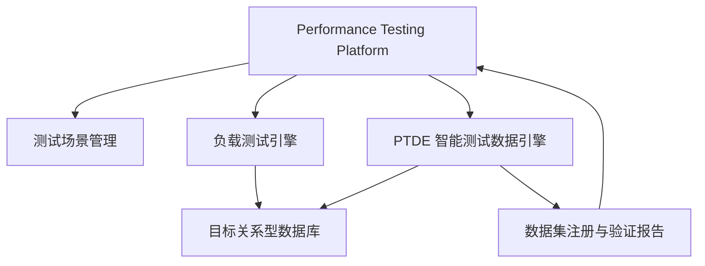
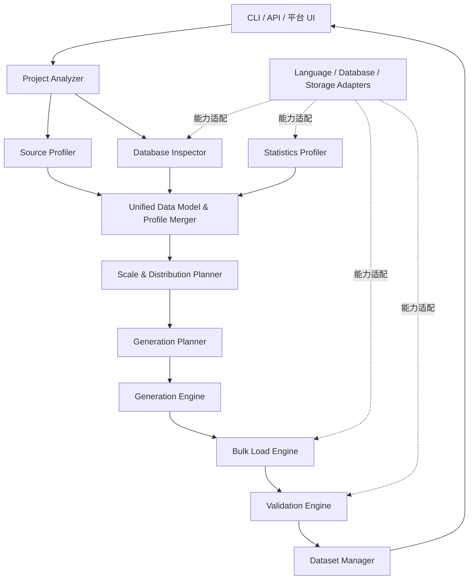
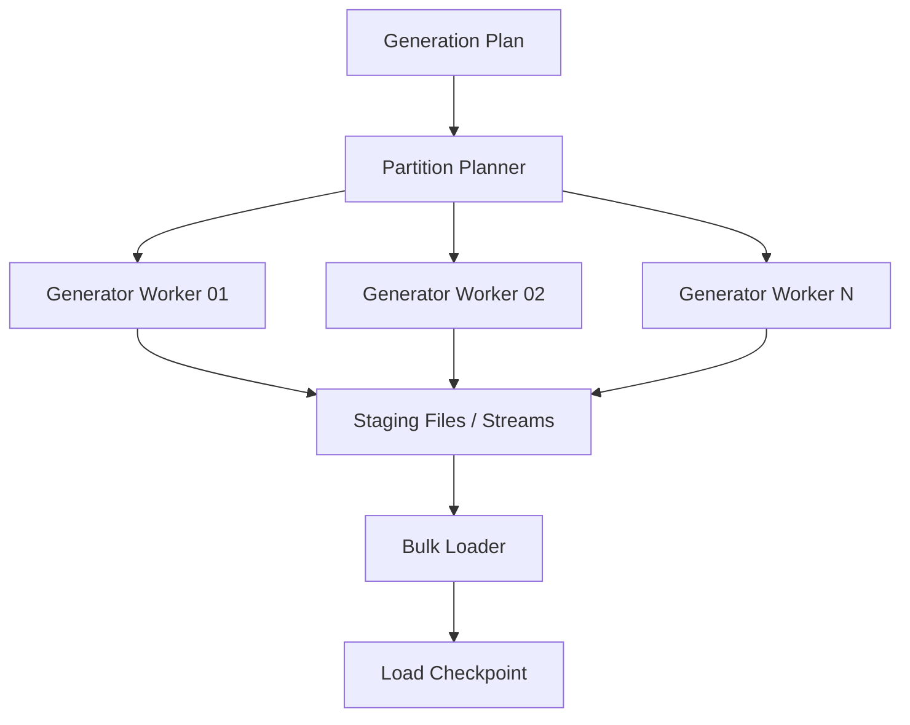
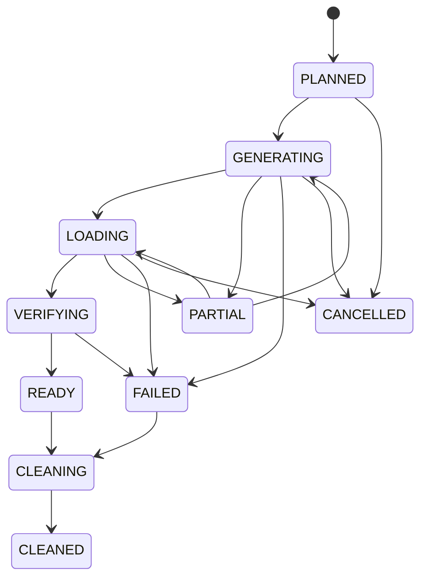
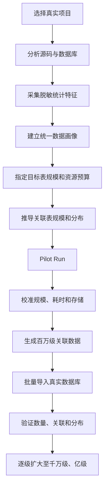

# 性能测试平台：智能测试数据引擎完整技术方案

- **系统名称**：Performance Test Data Engine（PTDE）
- **文档类型**：总体技术方案 / 架构基线
- **版本**：1.0
- **状态**：设计稿
- **适用范围**：单个既有项目的分析、大规模性能测试数据规划、生成、装载、验证及数据集生命周期管理

---

## 1. 背景与目标

性能测试的有效性不仅取决于并发数、TPS、QPS 和响应时间，也取决于被测数据库中的数据规模、数据分布、关联关系、时间跨度、热点特征以及索引和存储状态。

同样是 1 亿条订单，如果用户订单量分布、订单状态比例、时间分布、商品热度和字段选择性不同，数据库的索引命中、缓存行为、JOIN 成本、排序成本和锁竞争都可能不同。因此，单纯向数据库填充大量随机记录，并不能保证性能测试结果具有代表性。

PTDE 的目标是：**分析被测项目的源码和数据库结构，融合可选的脱敏生产统计特征，根据性能测试目标动态推导数据规模与分布，确定性地生成大规模关联数据，并通过适配器高效装载到目标关系型数据库，最终验证数据集是否达到预期。**

### 1.1 已确定的设计约束

| 约束 | 决策 |
|---|---|
| 数据规模 | 不设固定上限，由测试目标、数据关系、存储预算、资源能力和试运行结果动态规划 |
| 数据来源 | 同时支持源码/数据库结构推导，以及脱敏生产统计特征；允许单独使用或融合使用 |
| 数据库范围 | 面向多种关系型数据库，采用统一模型与数据库能力适配机制 |
| 数据写入 | 大规模主体数据以确定性生成和批量装载为主，不逐行调用业务 API |
| AI 职责 | 负责项目语义理解、规则发现和规划建议；不负责逐条生成、直接写库和自我验收 |
| 核心结果 | 可复现、可验证、可追踪、可清理的 Performance Dataset |

### 1.2 产品目标

1. **理解项目**：识别技术栈、实体、字段、约束、SQL 访问模式和业务规则。
2. **理解数据**：识别数据量、字段分布、关联分布、时间分布、热点和相关性。
3. **动态规划**：按记录数、生产比例、存储容量或工作负载目标推导各表规模。
4. **大规模生成**：流式、分片、并行地生成可复现的关联数据。
5. **高效装载**：根据目标数据库能力选择合适的原生批量导入或通用降级方式。
6. **可信验证**：验证数量、关系、分布、业务不变量和数据库统计状态。
7. **生命周期管理**：管理数据集定义、实例、版本、检查点、恢复和清理。

### 1.3 非目标

PTDE 不负责：

- 产生压测请求、模拟用户行为或调度并发负载；这些属于性能测试负载引擎。
- 计算或判定 TPS、QPS、RT、错误率等压测结果。
- 自动修改被测项目的业务代码或数据库表结构。
- 将生产业务明文数据直接复制到测试环境。
- 用 AI 逐行生成数亿条记录。
- 在未授权的生产数据库中执行写入、清理或破坏性操作。

PTDE 可以读取性能测试场景提供的查询模式、访问比例、数据范围和并发目标，但不替代负载测试引擎。

---

## 2. 系统边界与总体架构

### 2.1 在性能测试平台中的位置



PTDE 负责测试开始前的数据准备、数据集就绪状态确认，以及测试结束后的数据集清理或复用。负载测试引擎根据数据集 ID 获取数据集信息，并使用该数据集执行压测。

### 2.2 总体架构



### 2.3 七个核心子系统

| 子系统 | 主要职责 | 主要输入 | 主要输出 |
|---|---|---|---|
| Project Analyzer | 分析项目结构、源码、ORM、SQL、测试代码 | 项目目录、源码版本 | Project Snapshot、源码发现结果 |
| Source Profiler | 提取业务实体、规则、状态、访问模式 | 源码分析结果 | Source Profile、Business Invariants、Access Patterns |
| Statistics Profiler | 采集脱敏统计画像 | 只读统计源、采集策略 | Statistics Profile |
| Unified Data Model | 融合数据库结构、源码语义和统计特征 | 多来源画像 | Unified Data Profile |
| Scale & Distribution Planner | 推导规模、分布、容量和资源预算 | Dataset Spec、统一画像 | Generation Plan |
| Generation & Bulk Load | 确定性生成、分片、批量装载、断点恢复 | Generation Plan | 已装载数据分片 |
| Validation & Dataset Manager | 验证、注册、恢复、复用和清理 | 执行清单、数据库状态 | Dataset Instance、Validation Report |

### 2.4 核心设计原则

- **模型先行**：模块之间传递结构化模型，不传递自然语言对话作为执行依据。
- **AI 与执行隔离**：AI 输出候选发现和建议；程序校验后形成确定性计划。
- **关系优先**：数据按实体关系和业务约束生成，不按表独立随机生成。
- **分布优先于随机**：真实分布、相关性和访问特征是数据质量的重要组成。
- **生成与装载解耦**：生成 Worker 不直接绑定数据库连接，便于独立扩缩容。
- **能力探测**：数据库功能按产品、版本、兼容模式和部署方式进行能力探测。
- **失败可恢复**：生成、装载、验证均需分片检查点和幂等策略。
- **默认安全**：生产统计读取和目标测试库写入采用不同权限身份。

---

## 3. 项目自动分析

### 3.1 分析范围

| 分析对象 | 提取内容 | 用途 |
|---|---|---|
| 项目配置与依赖 | 语言、框架、构建工具、数据库驱动、配置方式 | 选择语言和数据库适配器 |
| ORM / Entity | 字段、类型、关联、生成策略 | 建立实体模型 |
| 数据库 Schema | 表、列、主键、外键、唯一约束、索引、分区、序列、触发器 | 确认硬约束 |
| Repository / Mapper | 查询、更新、JOIN、分页、排序 | 识别数据访问模式 |
| Service / Domain | 状态转换、金额计算、校验、副作用 | 提取业务规则 |
| Controller / API | 外部业务入口、参数和查询路径 | 关联业务操作与数据访问 |
| SQL 文件 | SQL 模板、查询条件、聚合、更新字段 | 分析实际访问字段 |
| 测试代码 | Fixture、Factory、初始化 SQL、测试断言 | 复用已有业务约束 |
| 数据库迁移文件 | DDL、索引和字段变更 | 识别结构演进和快照版本 |

### 3.2 技术栈识别原则

1. 优先依据构建配置、依赖清单、运行配置和源码证据。
2. 区分项目声明的数据库驱动与运行时实际连接的数据库。
3. 对无法确认的技术信息标记为 `UNKNOWN`，不得仅凭目录名或文件名猜测。
4. 将运行环境配置中的敏感值脱敏后保存，不把口令写入分析报告。
5. 保留识别证据和置信度，允许用户修正。

### 3.3 数据库结构分析

至少采集：

- Catalog / Schema / Table / View。
- Column、数据类型、精度、长度、字符集、可空性、默认值。
- Primary Key、Foreign Key、Unique Constraint、Check Constraint。
- 普通索引、唯一索引、复合索引及列顺序。
- 分区键、分区边界及分区数量。
- 自增列、Identity、Sequence。
- Trigger、Generated Column、Computed Column。
- 表存储统计、索引大小和数据库统计信息（按适配器能力提供）。

数据库元数据是硬约束来源。AI 不得覆盖或猜测数据库事实。

### 3.4 源码语义分析

源码分析重点提取：

- 实体语义和字段业务含义。
- ORM 关系与数据库关系之间的差异。
- 非数据库外键的逻辑关联，例如 `tenant_id + customer_id`。
- 状态枚举及合法状态转换。
- 字段之间的条件关系，例如支付状态与支付时间。
- 业务唯一性约束和跨表不变量。
- 查询和更新路径中的关键字段。
- 外部副作用：消息、支付、邮件、短信、缓存和文件存储。

建议分析顺序：Entity / DTO → Repository / Mapper → Service / Domain Service → Controller / API → Event Handler / Job → 测试代码。

### 3.5 查询访问模式分析

对项目 SQL 和可识别的数据访问调用提取：

- 涉及的表及 JOIN 关系。
- WHERE 过滤字段与条件类型。
- ORDER BY、GROUP BY、LIMIT / OFFSET。
- 范围查询字段和时间窗口。
- 聚合字段、更新字段、锁定字段。
- 典型查询参数的选择性线索。

示例：

```sql
SELECT *
FROM orders
WHERE user_id = ?
  AND status = ?
  AND created_at BETWEEN ? AND ?
ORDER BY created_at DESC
LIMIT 20;
```

可提取的访问模式：用户维度过滤、状态过滤、时间范围、时间排序、分页。对应数据画像应关注用户订单量分布、状态比例、时间分布，以及组合字段之间的相关性。

### 3.6 分析可信度和证据

统一采用三种发现状态：

| 状态 | 含义 | 执行策略 |
|---|---|---|
| `CONFIRMED` | 数据库或源码明确证明 | 可作为硬约束或确定规则 |
| `INFERRED` | 根据多个代码线索推断 | 需验证，必要时由用户确认 |
| `UNKNOWN` | 无法确认 | 不得自动假设为事实 |

每条发现至少保存：`id`、`type`、`value`、`source_file` / `database_object`、`evidence`、`confidence`、`analyzer_version`。

---

## 4. 双来源数据画像

PTDE 支持两种主要数据来源：源码与数据库结构推导，以及脱敏生产统计特征。两者应分别采集、分别版本化，再按规则融合。

### 4.1 源码画像负责的内容

- 字段含义及合法值。
- 业务状态和状态转换。
- 实体关系和逻辑关联。
- 业务校验、金额计算和跨表不变量。
- 数据创建和修改操作。
- 查询访问字段和业务流程。

### 4.2 生产统计画像负责的内容

- 表记录数及数据增长趋势。
- 字段基数（Distinct Count）。
- NULL 比例。
- 高频值及类别频率。
- 数值直方图、分位数、最小值和最大值。
- 字段长度分布。
- 时间分桶和时间跨度。
- 关联基数、每个父实体的子实体数量分布。
- 热点实体和倾斜程度。
- 与访问模式相关的字段联合分布。

生产统计画像可以来自数据库统计信息、受控统计 SQL、脱敏聚合结果或用户提供的统计文件。不得默认导出生产原始业务记录。

### 4.3 统计采集安全

- 使用独立只读身份采集生产统计。
- 优先读取数据库已有统计信息或低成本聚合结果。
- 需要扫描时支持采样、超时、资源限制和采集窗口。
- 对高基数敏感字段使用分桶、Top-K、最小样本阈值或哈希类别。
- 不收集不必要的姓名、手机号、身份证号、地址等明文值。
- 记录采集时间、采样率、统计精度、数据源版本和采集策略。
- 对小样本类别设置披露保护，避免从统计结果反推出个体信息。

### 4.4 统一画像融合优先级

| 信息 | 主要依据 | 冲突处理 |
|---|---|---|
| 字段类型、主键、外键 | 数据库 Schema | 以目标 Schema 为准 |
| 字段含义 | 源码和人工确认 | AI 推断需标记 |
| 业务规则 | 源码、测试断言 | 未确认规则不自动执行 |
| 字段值分布 | 脱敏生产统计 | 可以由测试目标覆盖 |
| 数据规模 | 用户目标、生产基线、资源预算 | 目标冲突时返回规划错误 |
| 热点分布 | 统计画像和访问模式 | 记录统计新鲜度和置信度 |
| 缺失特征 | 明确配置或规则生成 | 不得伪装为生产统计 |

### 4.5 Profile 合并示例

```yaml
profile:
  id: production-profile-001
  source:
    type: aggregated_statistics
    database_type: mysql
    collected_at: "2026-11-15T02:00:00Z"
    sampling_rate: 0.1

  table:
    name: orders
    approximate_rows: 125000000
    row_count_accuracy: approximate

  columns:
    - name: status
      distinct_count: 4
      null_ratio: 0
      distribution:
        type: weighted_categorical
        values:
          PAID: 0.64
          COMPLETED: 0.26
          PENDING: 0.06
          CANCELLED: 0.04

    - name: user_id
      distinct_count: 9800000
      null_ratio: 0
      distribution:
        type: skewed
        parameters:
          fitted_model: zipf
          fitted_parameter: 1.1
          fit_quality: 0.92

    - name: created_at
      distribution:
        type: temporal
        buckets:
          - range: last_7_days
            ratio: 0.08
          - range: last_30_days
            ratio: 0.20
          - range: last_90_days
            ratio: 0.30
          - range: older
            ratio: 0.42
```

示例参数仅说明模型结构。实际分布参数应通过采样或统计拟合得到；无法确认时使用 `UNKNOWN`，不可伪造。

---

## 5. 统一数据模型

统一数据模型是项目分析、规模规划、生成和验证之间的契约。

### 5.1 核心模型

| 模型 | 说明 |
|---|---|
| `ProjectSnapshot` | 项目源码版本、技术栈、依赖和配置指纹 |
| `DatabaseSchemaSnapshot` | 目标数据库结构快照 |
| `EntityModel` | 业务实体、字段和约束 |
| `RelationModel` | 外键、ORM 关系和逻辑关联 |
| `BusinessInvariant` | 跨字段、跨实体业务不变量 |
| `AccessPattern` | SQL 访问模式和字段选择性需求 |
| `StatisticsProfile` | 脱敏统计画像 |
| `UnifiedDataProfile` | 融合后的统一数据画像 |
| `DatasetSpec` | 用户指定的测试数据目标 |
| `GenerationPlan` | 规模、分布、分片及执行计划 |
| `ExecutionManifest` | 每次生成和装载过程记录 |
| `DatasetDefinition` | 可复用的数据集定义 |
| `DatasetInstance` | 某个目标环境中实际构建的数据集实例 |
| `ValidationReport` | 数据集验证报告 |

### 5.2 EntityModel 示例

```yaml
entity:
  id: order
  table: orders
  fields:
    - name: id
      type: bigint
      primary_key: true
      generation: planned_range
    - name: user_id
      type: bigint
      nullable: false
      relation: user.id
    - name: amount
      type: decimal
      precision: 18
      scale: 2
      business_rule: order_amount_invariant
    - name: status
      type: varchar
      length: 20
      allowed_values:
        - PENDING
        - PAID
        - COMPLETED
        - CANCELLED
  relations:
    - target: user
      cardinality: many_to_one
      join_fields: [user_id]
  evidence:
    - type: database_foreign_key
      object: fk_orders_user
    - type: source_mapping
      file: src/main/java/.../Order.java
```

### 5.3 BusinessInvariant 示例

```yaml
invariant:
  id: payment-paid-order-consistency
  description: 支付成功订单必须存在成功支付记录
  status: CONFIRMED
  scope:
    entities: [order, payment]
  predicate:
    type: relation_exists
    when:
      entity: order
      field: status
      equals: PAID
    require:
      entity: payment
      match:
        payment.order_id: order.id
      where:
        payment.status: SUCCESS
  evidence:
    - source: OrderService.pay
    - source: PaymentMapper
```

业务规则模型应支持结构化表达；暂时无法表达的规则可登记为需要人工审核的验证器，不得直接执行任意 AI 生成的代码。

---

## 6. 动态规模规划器

规模规划器根据测试目标、关系模型、统计画像和资源预算，推导各表目标记录数、分布参数、存储预算和生成成本。

### 6.1 支持的目标类型

1. **指定记录数（Row Target）**：对核心表指定精确目标行数。
2. **生产规模倍率（Scale Factor）**：按生产基线放大，可对不同表设置独立倍率。
3. **存储容量目标（Storage Target）**：按表数据、索引和开销预算反推规模。
4. **工作负载目标（Workload Driven）**：结合 SQL 访问模式、选择性、数据范围、热点和并发目标规划数据集。
5. **自动规划（Auto Planning）**：基于画像、容量约束和用户限制给出多档方案。

多种目标可以组合。例如指定订单表 1 亿行，同时要求总存储不超过 200GB、时间跨度为两年。规划器必须判断目标是否兼容，并输出约束冲突，不得静默降低行数或改变分布。

### 6.2 DatasetSpec 示例

```yaml
dataset_spec:
  name: ecommerce-large-scale
  profile_mode: hybrid
  production_profile_id: production-profile-001
  target_database: performance_test

  targets:
    rows:
      orders: 100000000
    storage:
      max_total: 200GB
      include_indexes: true
    time_range:
      from: "2025-01-01"
      to: "2026-11-16"

  workload:
    scenarios:
      - id: query-user-orders
        weight: 0.45
      - id: query-recent-orders
        weight: 0.35
      - id: query-hot-products
        weight: 0.20

  constraints:
    max_generation_time: 8h
    max_memory: 8GB
    max_staging_storage: 500GB
    max_database_connections: 16

  reproducibility:
    seed: 20261116
```

### 6.3 关系规模推导

以电商数据模型为例：

```text
User 1:N Order 1:N OrderItem N:1 Product
```

若订单目标行数为 `N_order`，每单明细数为 `items_i`，则：

\[
N_{item}=\sum_{i=1}^{N_{order}} items_i
\]

若平均每单 3 条明细，订单目标 1 亿，则期望订单明细约 3 亿条。实际数量应由配置的离散分布采样产生；若要求精确数量，规划器需在采样后执行受控的配额修正。

用户数不能简单按照订单数除以一个固定平均值推算。应先定义用户订单量分布，再计算其总和，并考虑零订单用户、活跃用户、历史用户和用户群体比例。

示例分布：

| 用户群体 | 用户占比 | 平均订单数 |
|---|---:|---:|
| 低活跃 | 70% | 2 |
| 普通 | 20% | 15 |
| 活跃 | 9% | 60 |
| 高活跃 | 1% | 500 |

加权平均订单数为：

\[
0.7\times2+0.2\times15+0.09\times60+0.01\times500=12.4
\]

理论用户量约为订单数除以 12.4，但最终值还要根据零订单用户占比、分布尾部和目标精确度调整。

### 6.4 规模约束求解

规划器至少要处理：

- 表行数目标。
- 关联基数目标。
- 字段分布约束。
- 时间跨度。
- 最大存储容量。
- 最大数据生成时间。
- 最大中间文件空间。
- 最大数据库连接数和导入并发。
- 目标环境磁盘和数据库资源限制。

建议使用确定性的约束检查和规划算法。复杂目标可采用启发式规划，但必须记录算法版本、约束、推导过程和估算置信度。

### 6.5 存储估算与校准

初始估算：

\[
S_{total}=S_{table}+S_{index}+S_{overhead}
\]

\[
S_{table}\approx\sum_i N_i\times B_i
\]

其中 `B_i` 必须是基于实际数据库试装载测得或校准的平均存储成本，而不是简单把字段定义长度相加。实际空间受行格式、字符集、可变长度列、NULL、页面填充率、压缩、索引、分区、LOB 和存储引擎等影响。

推荐使用 Pilot Run 校准：

1. 生成代表性小样本。
2. 导入目标数据库并创建目标索引。
3. 采集表大小、索引大小、记录数和数据库资源。
4. 计算实际平均存储成本。
5. 扩大样本并再次测量，修正非线性偏差。
6. 输出目标容量估算及误差区间。

### 6.6 规划结果示例

```yaml
generation_plan:
  id: plan-001
  target:
    type: row_count
    entity: Order
    rows: 100000000

  entities:
    User:
      estimated_rows: 8065000
      source: derived
    Product:
      target_rows: 1000000
      source: explicit
    Order:
      target_rows: 100000000
      source: explicit
    OrderItem:
      estimated_rows: 300000000
      source: derived

  storage:
    estimated_table_size: 120GB
    estimated_index_size: 45GB
    estimated_total_size: 165GB
    confidence: estimated

  constraints:
    max_storage: 200GB
    max_generation_time: 8h

  warnings: []
```

`source` 允许值包括 `explicit`、`production`、`derived`、`estimated`。每个规划结果都应能解释来源和推导理由。

---

## 7. 数据分布与生成模型

### 7.1 支持的分布类型

| 分布 | 用途 |
|---|---|
| Uniform | 均匀分布 |
| Normal | 正态或近似正态数值 |
| LogNormal | 长尾数值 |
| Zipf / Skewed | 热点实体和高度倾斜 |
| Weighted Categorical | 状态、类型和类别比例 |
| Temporal | 时间序列、冷热数据和业务高峰 |
| Sequential | 连续编号或有序键 |
| Random | 随机离散值 |
| Conditional | 根据其他字段条件生成 |
| Correlated | 多字段联合分布 |
| Null Ratio | 空值比例 |
| Length Distribution | 字符串和大字段长度分布 |

### 7.2 四层数据分布

1. **字段分布**：字段值域、NULL 比例、基数、频率和直方图。
2. **字段关联分布**：例如订单状态与支付时间、商品类别与价格之间的关联。
3. **实体关联分布**：例如每个用户订单数量、每笔订单明细数量、商品销量。
4. **全局时间和热点分布**：业务高峰、近期数据集中度、热门用户和热门商品。

优先建模与 SQL 过滤、JOIN、排序、聚合、索引和更新操作密切相关的字段，不要求对所有字段组合做高成本相关性建模。

### 7.3 条件分布

不能独立随机生成存在业务关系的字段。例如 `status` 和 `paid_at` 应采用条件分布：

\[
P(paid\_at\mid status)
\]

而不能仅分别拟合两个字段的边缘分布。否则可能产生 `status=PENDING` 但 `paid_at` 已有值等不合理记录。

### 7.4 生成器分层

```text
Generation Engine
  ├── Primitive Generators
  │   ├── Integer / Decimal / String
  │   ├── DateTime / Boolean / Enum
  │   ├── UUID / JSON / LOB
  │   └── Domain-specific Values
  ├── Distribution Samplers
  │   ├── Uniform / Weighted
  │   ├── Normal / LogNormal / Zipf
  │   ├── Temporal / Conditional
  │   └── Correlated Sampler
  └── Relationship Generators
      ├── OneToOne / OneToMany
      ├── ManyToMany
      ├── Composite Key
      └── Foreign Key / Logical Relation
```

### 7.5 数据字段策略

每个字段都应支持以下策略之一或组合：

- 从合法值集合采样。
- 按统计分布采样。
- 根据父实体或其他字段计算。
- 通过关联映射获得 ID。
- 根据业务规则生成。
- 使用固定常量或模板。
- 使用确定性伪随机生成。

### 7.6 主键和外键生成

避免逐行写入父表、查询生成主键、再写入子表的往返模式。优先使用：

- 预分配 ID 范围。
- 可计算的确定性 ID 映射。
- 分片内局部 ID 域。
- 数据库 Sequence 预取（适用时）。
- UUID / 时间有序 ID（适用时）。
- 复合主键生成器。

示例 ID 区间必须经过目标 Schema、既有数据和多 Worker 分片规则检查，避免与既有数据冲突。不能假设所有数据库都适合手工预分配自增值。

### 7.7 多对多与复杂映射

数亿级映射不应全部放在内存中。按规模选择：

- 可计算映射：通过实体 ID 范围和确定性函数推导。
- 分片映射：每个分片只保存自身需要的映射。
- 外部映射存储：对无法重算的映射使用磁盘型 KV 或分片文件。
- 关系配额：通过全局计数器或分片配额保证目标关联数量。

---

## 8. 数据生成与分片执行

### 8.1 生成流程



### 8.2 流式与文件中转两种模式

**文件中转模式**：生成分片文件后，由 Loader 装载。适合超大数据、跨机器生成和导入、数据文件复用及断点恢复。

**流式直传模式**：Generator 通过有界缓冲向 Loader 提供数据。适合中等规模、临时数据集和中间存储空间有限的场景。

两种模式共用 Generation Plan、分片元数据、数据格式定义和检查点协议。

### 8.3 数据文件格式

格式由数据库 Adapter 能力和数据类型决定，候选包括 CSV、TSV、数据库原生文本格式或二进制格式。必须明确：

- 字符集与编码。
- 字段和行分隔符。
- NULL 表达方式。
- 引号与转义。
- 日期时间格式和时区。
- Decimal 精度。
- 二进制及 LOB 编码。
- 特殊字符和换行处理。
- 文件校验和。

不能假设一个 CSV 文件格式能无损表达所有数据库类型。

### 8.4 分片规划

按表、ID 范围、业务分区键或确定性哈希切分。分片大小应由以下指标动态调节：

- 目标数据库导入吞吐。
- 生成 Worker CPU 和内存。
- 网络吞吐。
- 临时存储空间。
- 数据库连接数、事务日志和 IO 压力。
- 分布倾斜程度。

### 8.5 循环依赖处理

对实体关系图执行强连通分量分析，识别循环依赖。再判断：

1. 字段是否允许暂时为空。
2. 数据库是否支持延迟约束。
3. 能否先生成实体再回填关联。
4. 能否在隔离测试环境使用分阶段装载。
5. 目标数据库是否允许安全的约束处理方式。

没有明确安全构建方式时必须阻止执行并输出原因。不得默认关闭全部外键约束来绕过问题。

---

## 9. Bulk Load Engine

### 9.1 设计原则

大规模主体数据不应逐条调用 Controller / Service / Repository。优先通过确定性生成器构建关联数据，再由数据库原生批量导入能力写入。小规模初始化数据和必须通过业务流程产生的特殊状态，可以使用项目业务入口或适配器。

建议三种构建方式：

| 方式 | 适用场景 |
|---|---|
| 业务接口 / Service | 小规模基础数据、必须执行真实业务副作用的状态 |
| Repository / DAO | 初始化或构建特定历史状态，且数据访问层可安全复用 |
| 原生批量装载 | 大规模主体数据、可确定生成规则的记录 |

### 9.2 数据库适配器分层

```text
Database Adapter
  ├── Connection Adapter
  ├── Metadata Adapter
  ├── SQL Dialect Adapter
  ├── Statistics Adapter
  ├── Key Generation Adapter
  ├── Constraint Adapter
  ├── Bulk Load Adapter
  ├── Transaction Adapter
  └── Storage Metrics Adapter
```

### 9.3 能力矩阵

适配器不应仅根据数据库产品名称硬编码能力。必须结合产品版本、兼容模式、存储引擎、权限、驱动版本和部署形态进行能力探测。

| 数据库候选 | 批量机制候选 | 适配重点 |
|---|---|---|
| MySQL | `LOAD DATA INFILE` / `LOAD DATA LOCAL INFILE` | 文件位置、`secure_file_priv`、客户端 LOCAL 权限、错误和警告处理、触发器、分区 |
| PostgreSQL | `COPY` / `COPY FROM STDIN` | 服务端文件权限、客户端流式传输、触发器、约束、RLS、失败后的空间清理 |
| Oracle | SQL*Loader Conventional / Direct Path | 装载模式、约束和索引、并行装载、LOB、装载后验证 |
| SQL Server | `BULK INSERT` / BCP / Bulk Copy API | 文件访问、批次、错误文件、触发器、约束、身份列、日志行为 |
| OceanBase | 按 MySQL / Oracle 兼容模式和版本探测 `LOAD DATA` 等机制 | 版本差异、兼容模式、触发器限制、子任务事务、LOB、旁路导入限制 |

上述仅为候选路径，不代表同一数据库所有版本和部署形态均支持相同能力。实现阶段必须根据官方文档和目标环境实测确认。

### 9.4 装载策略选择

装载前检查目标表：

- 是否存在触发器。
- 是否存在生成列或默认值。
- 是否有外键、唯一约束和 Check Constraint。
- 是否为分区表。
- 是否有 LOB / JSON / 特殊类型。
- 是否有自增或 Sequence 主键。
- 是否启用行级安全或特殊权限策略。
- 是否存在复制、日志或事务限制。

之后选择原生批量、通用批量参数绑定或降级逐批 INSERT。不能为了吞吐默认关闭全部约束、触发器或日志保护。

### 9.5 并发和限流

并发度与批次大小应通过 Pilot Run 校准，不设置通用固定最优值。控制指标包括数据库 CPU、IO、网络、事务日志、锁等待、连接数、生成端 CPU、内存和暂存空间。

配置示例：

```yaml
execution:
  generator:
    workers: auto
    max_memory: 2GB

  loader:
    concurrency: auto
    batch_rows: 50000
    max_connections: 16

  throttling:
    enabled: true
    database_cpu_soft_limit: 75
```

参数只是结构示例。实际值必须由目标数据库、数据类型、部署规模和试导入结果确定。

### 9.6 失败恢复

每个 Shard / Chunk 都需要保存：

- 唯一分片 ID。
- 目标表和数据范围。
- 期望行数、生成行数、装载行数。
- 文件或流的校验摘要。
- 已提交 Chunk 编号。
- 数据库返回的行数、警告和错误信息。
- 当前状态与最后更新时间。

恢复流程：

1. 读取上次执行清单。
2. 查询目标库中实际已写入数据量和分片归属。
3. 识别已完成、未开始和部分提交的分片。
4. 对部分分片执行安全清理或确认偏移恢复。
5. 重新装载并验证。
6. 更新检查点。

不能假设每个数据库的批量导入都是全文件原子事务。特别是一个文件被拆为多个独立子任务时，恢复前必须确认实际提交状态。

---

## 10. 数据库适配能力探测

### 10.1 探测项

- 产品名称、版本、兼容模式、存储引擎。
- 元数据查询能力。
- 索引和约束读取能力。
- 分区信息读取能力。
- 统计信息读取能力。
- 原生批量导入能力。
- 并行导入能力。
- 主键 / Sequence 获取方式。
- 事务边界和批量失败语义。
- 触发器和约束执行语义。
- LOB / JSON / 二进制字段支持。
- 表和索引存储统计读取能力。
- 数据库统计信息刷新方式。

### 10.2 Adapter Capability 示例

```yaml
database_adapter:
  product: mysql
  version: "8.x"
  compatibility_mode: native
  capabilities:
    schema_inspection: true
    index_inspection: true
    foreign_key_inspection: true
    partition_inspection: true
    bulk_load: true
    parallel_load: true
    sequence_support: false
    deferred_constraints: false
    storage_statistics: true
    post_load_analyze: true
  bulk_load:
    selected_strategy: load_data_local
    requires_client_local_infile: true
    supports_error_diagnostics: true
```

具体属性由探测程序填充，不能直接复制示例作为真实能力声明。

### 10.3 降级机制

当原生导入能力不可用时：

1. 尝试该数据库官方支持的替代批量接口。
2. 再降级为参数化批量 INSERT。
3. 降低批次和并发，保持事务边界可控。
4. 输出性能能力降级告警。

若目标数据规模无法在资源预算内可靠完成，则在执行前明确失败，不应伪装为成功。

---

## 11. 数据验证体系

验证分五层。

### 11.1 数量验证

- 每张表目标行数与实际行数。
- 分片行数之和与总行数一致。
- 精确目标与允许误差分别处理。
- 采样生成的概率分布允许配置统计容差。

### 11.2 结构和关系验证

- 主键和唯一约束。
- 外键完整性。
- 孤儿记录。
- 多对多关联重复。
- 业务逻辑关联。
- 父子实体数量和关联基数。

大规模验证可利用数据库约束、分区级校验、分片摘要和精确统计组合。对要求零孤儿记录的关系，最终必须提供足够强的完整性证据，不能只用随机抽样证明。

### 11.3 分布验证

- NULL 比例。
- Distinct Count。
- Top-K 频率。
- 直方图和分位数。
- 时间分桶。
- 热点集中度。
- 用户/商品等关联基数分布。
- 关键字段联合分布。

针对概率生成分布，采用配置的统计容差和适当拟合检验；对精确配额分布，直接检查目标数量。

### 11.4 业务不变量验证

示例：

- 订单金额与明细金额关系。
- 已支付订单与支付记录关系。
- 多租户关联不得跨租户。
- 状态与时间字段一致性。
- 库存、余额和业务流水之间的一致性。

规则必须来源于已确认源码、测试断言或人工确认，不得将 AI 推断直接当作硬规则。

### 11.5 数据库就绪验证

- 表和索引实际大小。
- 索引是否完整。
- 分区数据分布。
- 数据库统计信息是否更新。
- 核心查询的执行计划。
- 典型查询选择性是否接近目标画像。
- 热点数据是否达到预期。

数据集 `READY` 表示数据构建和约定的验证完成，不代表被测数据库一定能达到目标 TPS；性能能力仍由压测执行确认。

---

## 12. Dataset 生命周期管理

### 12.1 Definition 与 Instance 分离

- `DatasetDefinition`：描述如何生成数据，包括模型、规模、分布、Seed、目标约束和版本。
- `DatasetInstance`：某个目标数据库环境中实际创建的数据集，包括实际行数、存储、分片、执行记录和验证结果。

同一个 Definition 可以在不同测试环境中构建多个 Instance。

### 12.2 状态机



状态转换由确定性程序控制，并记录操作者、时间和原因。所有中断和重试都必须更新执行清单。

### 12.3 Dataset Manifest 示例

```yaml
dataset:
  id: ds-20261116-001
  name: ecommerce-large-scale

  project:
    source_revision: abc123
    schema_fingerprint: sha256:...

  profile:
    source_type: hybrid
    source_profile_id: production-profile-001
    profile_fingerprint: sha256:...

  generation:
    seed: 20261116
    generator_version: 1.0.0
    partition_algorithm_version: 1

  target:
    order_rows: 100000000
    storage_limit: 200GB

  actual:
    order_rows: 100000000
    total_storage: 165GB

  target_database:
    product: mysql
    version: "8.x"
    environment_id: performance-test-01

  status: READY
  validation:
    structural: PASS
    relationship: PASS
    distribution: PASS
    business: PASS
```

### 12.4 可复现性

固定随机种子不是完整的可复现性保证。必须记录：

- 源码版本和 Schema 指纹。
- 统计画像快照及采集时间。
- DatasetSpec 和 GenerationPlan。
- Seed 和生成器版本。
- 分片算法版本。
- 数据库 Adapter 版本和能力快照。
- 数据库默认值、Sequence 或 Identity 的实际生成结果（适用时）。
- 实际数据 ID 范围、分片摘要和时间输入。

### 12.5 清理策略

优先顺序：

1. 独立 Schema：销毁专用 Schema 后重建。
2. 独立测试数据库：重建或清空专用数据库。
3. 独立分区：使用目标数据库支持的分区清理机制。
4. 共享表：依据明确的数据集所有权标记分批清理。

共享表中没有批次标记或可靠归属信息时，不得猜测数据归属。若数据已被其他批次或非测试业务引用，应阻止清理并报告冲突。大规模逐行 DELETE 不应作为默认清理方式。

---

## 13. 安全与环境隔离

### 13.1 环境策略

| 环境 | 策略 |
|---|---|
| 独立性能测试数据库 | 允许在授权后构建 |
| 独立测试 Schema | 允许在授权后构建 |
| 共享测试库 | 必须确认数据空间、命名空间和所有权策略 |
| 生产数据库 | 禁止执行数据构建、更新和清理 |
| 无法识别的环境 | 禁止写入 |

不得仅根据连接名称、主机名或环境变量名称判断数据库是测试环境。

### 13.2 权限分离

```text
Production Statistics Collector
  └── Read Only / Statistics Only

Performance Dataset Builder
  └── Test Database Write

Dataset Cleanup Operator
  └── Test Dataset Scoped Delete / Reset
```

生产统计采集和目标测试库写入使用不同凭据、不同权限和不同审计记录。

### 13.3 执行前安全门禁

- 识别数据库产品、实例、Schema 和环境用途。
- 校验用户授权和写入权限。
- 确认目标 Schema 是否独占或有数据隔离策略。
- 检查磁盘、日志和数据库资源预算。
- 检查外部副作用和触发器风险。
- 检查清理策略和恢复策略。
- 明确禁止的 DDL、TRUNCATE 和 DROP 操作。
- 所有破坏性动作必须有明确授权和审计。

---

## 14. 部署与技术选型

### 14.1 部署模式

**单机模式**：一个 Coordinator，多个本地 Generator Worker，一个或多个 Loader Worker，使用本地或共享暂存存储。适合早期阶段和中大型测试数据集。

**分布式模式**：Coordinator 负责规划和调度，多个生成 Worker 独立生成分片，暂存层存储数据文件，Loader Worker 根据目标数据库能力执行导入。适合生成端 CPU、内存、网络或单机磁盘成为瓶颈的场景。

生成 Worker 和 Loader Worker 必须解耦，以便分别扩容和限流。

### 14.2 渐进式部署原则

第一阶段不引入不必要的复杂分布式基础设施。先使用本地多进程 Worker、持久化任务状态、分片文件和检查点。只有单机资源或吞吐确实不足时，再引入多机 Worker、共享对象存储、任务租约、心跳和分布式调度。

### 14.3 技术语言建议

| 模块 | 可选技术 | 选择原则 |
|---|---|---|
| AI / 源码语义分析 | Python 等 | AST、分析生态和模型调用便利性 |
| 任务管理与 API | 使用平台既有技术栈 | 避免重复建设运行环境 |
| 高吞吐生成 Worker | Go / Rust / Java | 依据团队经验、驱动生态和基准测试选型 |
| 数据库访问 | 原生驱动、JDBC、ODBC 或厂商工具 | 优先可靠的数据库能力适配 |
| 中间数据 | 分片文件、流式缓冲 | 兼顾吞吐、恢复和空间 |
| 元数据存储 | 平台已有关系型数据库 | 保存定义、任务和检查点 |
| 日志与监控 | 平台已有观测体系 | 统一追踪和告警 |

不建议让 Python 逐行生成数亿条数据成为核心性能路径。Python 可以承担 AI 和分析任务；高吞吐生成核心应经基准测试决定语言。若平台已有成熟 Java 技术栈，也不必为 PTDE 强行引入另一套语言。

---

## 15. CLI 与平台 API

### 15.1 CLI 建议

```bash
# 初始化项目
ptde init

# 分析项目源码
ptde analyze

# 检查目标数据库结构
ptde database inspect

# 采集脱敏统计画像
ptde profile collect

# 查看融合画像
ptde profile inspect

# 创建数据集规划
ptde plan create

# 预览规模、分布和资源预算
ptde plan preview

# 构建数据集
ptde dataset build

# 查询构建状态
ptde dataset status

# 验证数据集
ptde dataset verify

# 查询数据集列表
ptde dataset list

# 清理数据集
ptde dataset cleanup
```

命令应支持 `--dry-run`、`--seed`、`--config`、`--dataset`、`--batch`、`--resume` 和明确授权的清理参数。生产环境不提供数据构建和清理入口。

### 15.2 API 能力

```text
POST   /projects/analyze
GET    /projects/{projectId}/snapshot
POST   /profiles/collect
GET    /profiles/{profileId}
POST   /datasets/plan
GET    /plans/{planId}
POST   /datasets
GET    /datasets/{datasetId}
POST   /datasets/{datasetId}/build
POST   /datasets/{datasetId}/resume
POST   /datasets/{datasetId}/verify
POST   /datasets/{datasetId}/cleanup
GET    /datasets/{datasetId}/progress
```

API 需要实现权限校验、幂等请求、任务 ID、异步执行状态、审计日志和请求超时控制。构建任务应通过后台任务机制执行，不应让长时间数据库装载占用普通 HTTP 请求线程。

### 15.3 与性能测试任务关联

性能测试任务引用 `DatasetInstance ID`，并记录数据集 Definition 版本、实际数据量、Schema 指纹、统计画像版本和验证结果。压测报告应能反查使用的数据集，保证测试结果可解释、可复现。

---

## 16. 监控和可观测性

### 16.1 关键指标

| 指标 | 说明 |
|---|---|
| Generation Throughput | 每秒生成记录数 |
| Load Throughput | 每秒数据库装载记录数 |
| End-to-End Duration | 生成到验证完成总耗时 |
| Generator CPU | 生成 Worker CPU |
| Peak Memory | 峰值内存 |
| Staging Size | 中间文件空间 |
| Database CPU / IO | 目标数据库资源消耗 |
| Network Throughput | 生成端、暂存层和数据库间网络吞吐 |
| Transaction Log Growth | 日志增长情况 |
| Load Error / Warning | 装载错误和警告 |
| Resume Recovery Time | 故障恢复时间 |
| Validation Duration | 验证耗时 |
| Estimated vs Actual Storage | 预估与实际存储偏差 |

### 16.2 运行日志

每条执行日志应携带：`dataset_id`、`plan_id`、`task_id`、`table_id`、`shard_id`、`chunk_id`、`worker_id`、`database_id`、`operation`、`status`、`duration` 和错误分类。

禁止把数据库口令、生产明文数据和敏感字段值写入日志。

### 16.3 试运行校准

通过 Pilot Run 测量真实生成吞吐、装载吞吐、数据库 CPU/IO、存储增长和验证时间，再推导目标并发、分片大小和预计耗时。不能直接按小规模吞吐线性外推到十亿级数据，必须在扩大样本后再次校准。

---

## 17. 实施路线图

建议分为 P0～P7 八个阶段。架构从第一阶段就保留多数据库和大规模能力，但不要求第一阶段实现全部数据库和分布式部署。

### P0：基础模型与执行框架

**交付内容**：
- Project Snapshot、Schema Snapshot。
- Entity / Relation / Invariant 模型。
- Statistics Profile、Unified Data Profile。
- DatasetSpec、GenerationPlan、Manifest。
- 状态机、配置校验、审计和日志基础设施。

**验收标准**：模型不依赖某一种数据库或编程语言；输入输出有 Schema；模型有版本和指纹；状态转换由程序控制。

### P1：项目分析引擎

**交付内容**：
- 技术栈识别。
- ORM / Entity 分析。
- 数据库 Schema 读取。
- Repository / Mapper / SQL 访问模式提取。
- 业务规则与证据提取。

**验收标准**：使用真实项目验证实体、约束、查询访问模式和分析证据；未知项明确标记；不能把 AI 推断伪装成数据库事实。

### P2：统计画像与融合

**交付内容**：
- 只读统计 Collector。
- 行数、基数、NULL、频次、直方图、分位数和时间分布。
- 脱敏、采样、资源限制。
- Profile Merger 和冲突报告。

**验收标准**：不导出生产明文业务记录；统计画像有采集时间、采样率和精度标记；源码硬约束不会被生产统计覆盖。

### P3：规模与分布规划

**交付内容**：
- 指定行数、生产倍率、容量目标和工作负载目标。
- 关联规模推导。
- 字段分布和条件分布规划。
- 存储和生成成本估算。
- 规划冲突和资源预算检查。

**验收标准**：每张表的规模有来源和推导说明；关联数量可验证；冲突时明确失败；容量估算通过试装载校准。

### P4：确定性数据生成

**交付内容**：
- 字段生成器和分布采样器。
- 关系生成器。
- ID 映射和多对多生成。
- 流式生成、分片和 Seed。
- 文件格式和摘要。

**验收标准**：相同输入可复现逻辑数据；生成数据满足字段和关系约束；百万级及以上数据不要求全量常驻内存。

### P5：多数据库批量装载

**交付内容**：
- Database Capability Probe。
- 至少一个数据库的完整 Bulk Load Adapter。
- 批量导入、并发限流和检查点。
- 中断恢复和错误诊断。
- 约束、触发器、分区及 LOB 兼容策略。

**验收标准**：导入结果可核对；失败后可安全恢复；不会静默丢弃错误记录；原生能力受限时能说明降级原因。

### P6：完整验证与数据集管理

**交付内容**：
- 数量、关系、分布、业务规则和数据库就绪验证。
- Dataset Definition / Instance。
- READY / PARTIAL / FAILED 等状态。
- 复用、清理和审计。

**验收标准**：只有约定的验证项全部满足后才进入 READY；清理只作用于本系统拥有且可确认归属的数据；所有结果可追溯。

### P7：平台集成和规模扩展

**交付内容**：
- CLI、API 和平台 UI。
- 数据集绑定性能测试任务。
- 分布式 Worker（按需要启用）。
- 全链路监控和容量预测。
- 多数据库扩展及故障演练。

**验收标准**：性能测试任务能够绑定和复用数据集；压测结果能反查数据集版本；任务取消、重试和清理完整可控。

---

## 18. 测试与验收基准

### 18.1 功能验收

| 维度 | 验收要求 |
|---|---|
| 项目识别 | 技术栈、运行时数据库和项目版本识别准确且有证据 |
| Schema 分析 | 目标 Schema 的字段、约束、索引和分区信息完整 |
| 业务模型 | 实体、关系、状态和规则有来源与可信度 |
| 统计画像 | 支持脱敏聚合、分布和采集元数据 |
| 规模规划 | 支持动态目标、关系推导、容量约束和冲突诊断 |
| 数据生成 | 支持确定性 Seed、关联、条件分布和分片 |
| 批量装载 | 支持能力探测、限流、进度、错误和恢复 |
| 数据验证 | 支持数量、关系、分布、业务和数据库状态验证 |
| 生命周期 | 支持复用、追踪、清理和审计 |
| 安全 | 不允许未授权生产写入和不明归属清理 |

### 18.2 规模测试矩阵

| 测试规模 | 主要验证 |
|---|---|
| 百万级 | 功能正确性、模型完整性、基本生成和装载 |
| 千万级 | 并行生成、批量装载、内存控制和统计验证 |
| 亿级 | 长时间运行、检查点、限流、恢复和大规模关系 |
| 十亿级及以上 | 分布式生成、分布式装载、存储和任务恢复能力 |

规模是测试目标，不是预设产品硬上限。能否执行取决于资源、数据库能力、数据类型和约束条件。

### 18.3 故障与边界场景

- 生成 Worker 中途退出。
- Loader 连接断开。
- 数据库部分提交后失败。
- 临时文件损坏或磁盘空间不足。
- 分片重复执行。
- 同一 Dataset 并发构建。
- 主键范围与既有数据冲突。
- 外键循环依赖。
- 热点严重倾斜。
- 超长字段、LOB、特殊字符和多字节字符。
- 数据库 Schema 在分析后发生变化。
- 统计画像过期。
- 数据库切换版本或兼容模式。
- 清理时数据已被其他任务引用。
- 生产统计采集超过资源预算。

### 18.4 完成定义

一个数据集只有同时满足以下条件才可以标记为 `READY`：

1. 目标表数据数量达到指定规则。
2. 所有必要分片完成，且没有未处理装载错误。
3. 关键实体关系通过验证。
4. 配置要求的数据分布验证通过。
5. 必要业务不变量验证通过。
6. 数据库索引和统计信息达到约定就绪状态。
7. 数据集 Manifest、执行清单和验证报告完整。
8. 清理策略、所有权和目标环境信息明确。

---

## 19. 风险与应对

| 风险 | 影响 | 应对 |
|---|---|---|
| 源码分析遗漏业务规则 | 数据不真实 | 证据、置信度、未知项和人工确认 |
| 生产统计过期 | 分布与当前业务偏离 | 记录采集时间、有效期和漂移检测 |
| 统计信息不精确 | 规模和分布估算偏差 | 标记近似精度、抽样和 Pilot Run |
| 复杂字段相关性 | 生成不合理数据 | 条件分布和重点字段联合建模 |
| ID 映射占用大量内存 | 生成端内存不足 | 确定性映射、分片映射和外部存储 |
| 数据库导入部分提交 | 重试重复或遗漏 | 分片检查点、实际行数核对和清理恢复 |
| 关闭约束导致脏数据 | 数据集不可用 | 默认保留约束，特殊策略需显式批准并完整验证 |
| 外部副作用 | 触发真实消息或业务行为 | 默认隔离，使用测试专用配置和适配器 |
| 生产统计采集扰动生产库 | 影响线上业务 | 只读身份、采样、限时、资源阈值和采集窗口 |
| 直接清理共享表 | 误删其他数据 | 所有权标记、独占 Schema 或安全阻断 |
| 小规模吞吐无法外推 | 预计耗时不准确 | 多轮 Pilot Run 和逐级扩容校准 |
| 数据库能力差异 | 装载行为不一致 | Adapter Capability 探测与版本级测试 |

---

## 20. 架构决策记录（ADR）

| 编号 | 决策 | 结论 |
|---|---|---|
| D01 | 产品定位 | 性能测试数据引擎 PTDE |
| D02 | 数据来源 | 源码/Schema + 脱敏生产统计双来源 |
| D03 | 数据规模 | 由测试目标动态规划，无固定产品上限 |
| D04 | 数据分布 | 支持字段、字段关联、实体关联、时间和热点分布 |
| D05 | 统一模型 | 数据库无关的 Entity / Relation / Profile 模型 |
| D06 | AI 职责 | 语义理解、规则发现和规划建议，不逐行生成、不直接写库 |
| D07 | 生成方式 | 确定性算法、流式处理、并行分片 |
| D08 | 装载方式 | 优先目标数据库原生批量导入，通用方式作为降级 |
| D09 | 数据库扩展 | Adapter + Capability 探测 |
| D10 | 数据一致性 | 数量、关系、分布、业务不变量和数据库就绪验证 |
| D11 | 可复现性 | Seed + 源码/Schema/Profile/算法版本快照 |
| D12 | 故障恢复 | 分片和 Chunk 检查点，按实际提交状态恢复 |
| D13 | 数据安全 | 生产统计只读；测试库写入；生产禁止构建和清理 |
| D14 | 数据清理 | 数据集所有权和隔离优先，不按猜测删除 |
| D15 | 部署架构 | 先单机多 Worker，按瓶颈演进至分布式 |
| D16 | 数据集管理 | Definition 与 Instance 分离，状态机可审计 |

---

## 21. 推荐的首个纵向验证场景

不建议第一阶段同时支持所有数据库和十亿级数据。应先选择一个真实业务项目和一个实际数据库，完成端到端纵向验证，但从第一天保留多数据库抽象。

推荐流程：



首个纵向验证必须证明：

1. PTDE 理解的是项目数据关系，而不只是读取数据库表结构。
2. PTDE 能够利用脱敏生产统计生成相似的数据分布，而不只是随机填充字段。
3. PTDE 能在真实数据库中高效、可恢复地装载数据，并提供独立验证证据。

---

## 22. 最终结论

PTDE 的核心竞争力不是随机数据生成算法，而是把项目语义、生产统计、测试目标、数据规模、关联关系和数据库执行能力连接成一条可靠的自动化链路：

```text
项目源码与数据库结构
          +
脱敏生产统计特征
          +
性能测试目标与资源预算
          ↓
统一数据画像
          ↓
规模与分布规划
          ↓
确定性关联数据生成
          ↓
数据库原生批量装载
          ↓
数量 / 关系 / 分布 / 业务验证
          ↓
可复现、可追踪、可复用的性能测试数据集
```

最终应坚持三个重点：

- **数据规模可规划**：不由固定模板决定，而由测试目标和资源约束动态推导。
- **数据特征可信**：不仅有足够的行数，还要有真实的字段分布、关联分布、时间分布和热点特征。
- **数据构建可靠**：真实数据库批量装载、断点恢复、独立验证和安全清理缺一不可。

PTDE 应作为性能测试平台的独立数据准备子系统，通过 CLI、API 和数据集注册接口与平台集成，不与负载测试引擎混为一体。

---

## 附录 A：数据库官方批量装载文档

以下链接用于实现阶段核对具体产品和版本的装载语义。适配器实现必须再次确认目标数据库版本、兼容模式、部署方式、权限和限制，不应仅凭产品名称假定能力。

- [MySQL 8.4 Reference Manual：LOAD DATA Statement](https://dev.mysql.com/doc/refman/8.4/en/load-data.html)
- [PostgreSQL Documentation：COPY](https://www.postgresql.org/docs/current/sql-copy.html)
- [Oracle Database 26：SQL*Loader Conventional and Direct Path Loads](https://docs.oracle.com/en/database/oracle/oracle-database/26/sutil/oracle-sql-loader-conventional-and-direct-loads.html)
- [Microsoft Learn：BULK INSERT (Transact-SQL)](https://learn.microsoft.com/en-us/sql/t-sql/statements/bulk-insert-transact-sql?view=sql-server-ver17)
- [OceanBase Database：LOAD DATA（V5.0.1）](https://www.oceanbase.com/en/docs/common-oceanbase-database-cn-1000000006619362)
- [OceanBase Database：LOAD DATA（V4.6.0）](https://en.oceanbase.com/docs/common-oceanbase-database-10000000003679041)

## 附录 B：术语

| 术语 | 含义 |
|---|---|
| PTDE | Performance Test Data Engine，智能性能测试数据引擎 |
| Dataset Definition | 可复用的数据集定义 |
| Dataset Instance | 某个目标数据库中的实际数据集实例 |
| Data Profile | 表、字段、关系和分布的数据画像 |
| Business Invariant | 跨字段或跨实体业务不变量 |
| Access Pattern | SQL / 业务访问模式 |
| Generation Plan | 经校验的数据生成和装载计划 |
| Bulk Load | 数据库批量装载 |
| Shard | 数据生成和装载的逻辑分片 |
| Chunk | 分片内部可独立检查点和恢复的批次 |
| Pilot Run | 用代表性小样本进行的试生成和试装载，用于校准资源、吞吐和存储估算 |
| Capability Probe | 对目标数据库实际能力进行探测 |
| Profile Merger | 融合源码画像、数据库结构和脱敏统计画像的组件 |

---

**文档结束**
